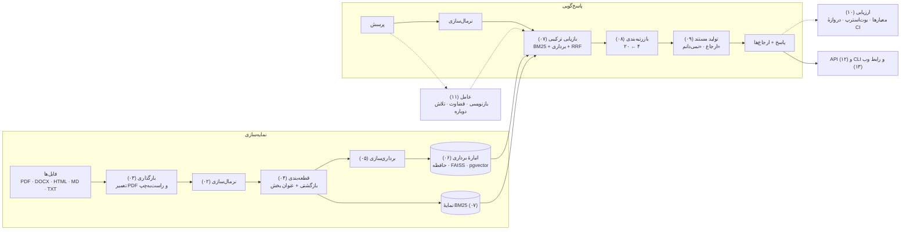
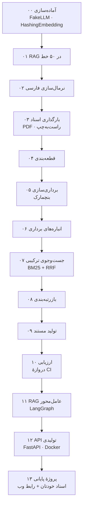
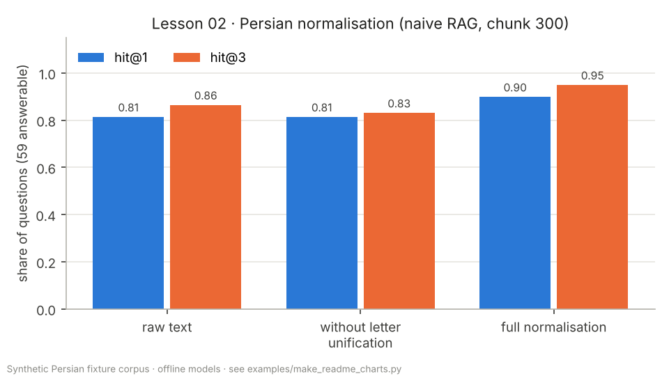
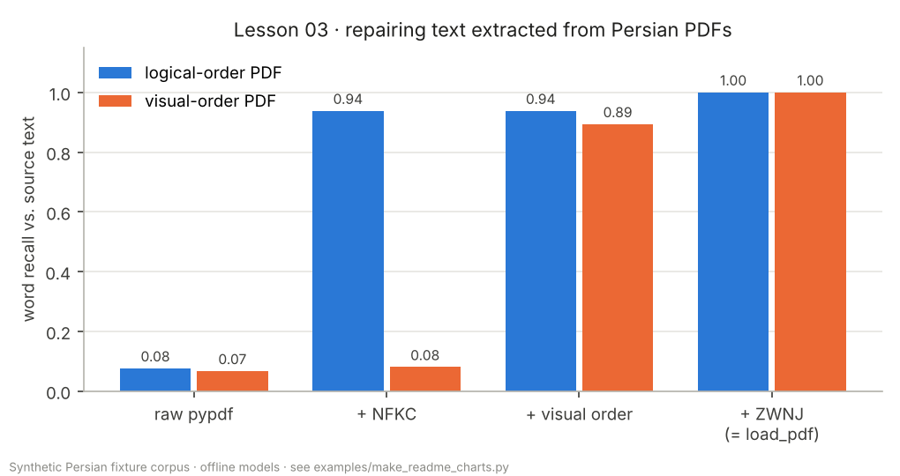
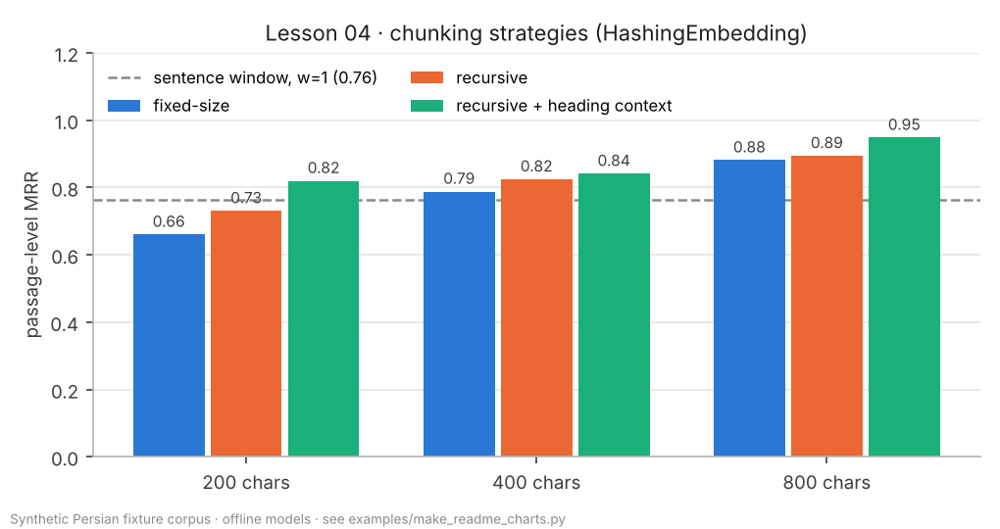
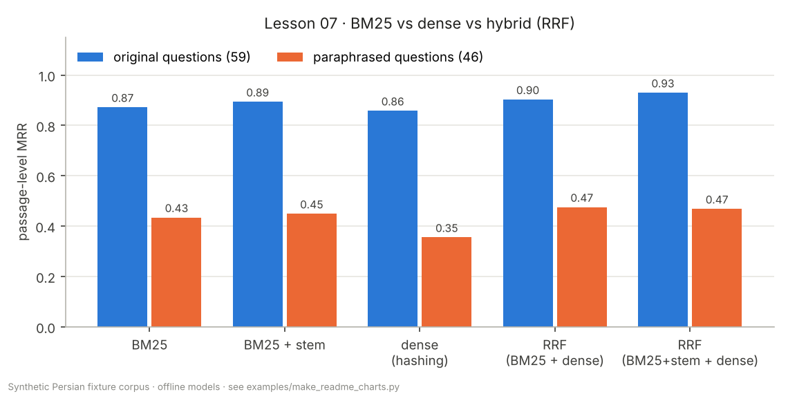
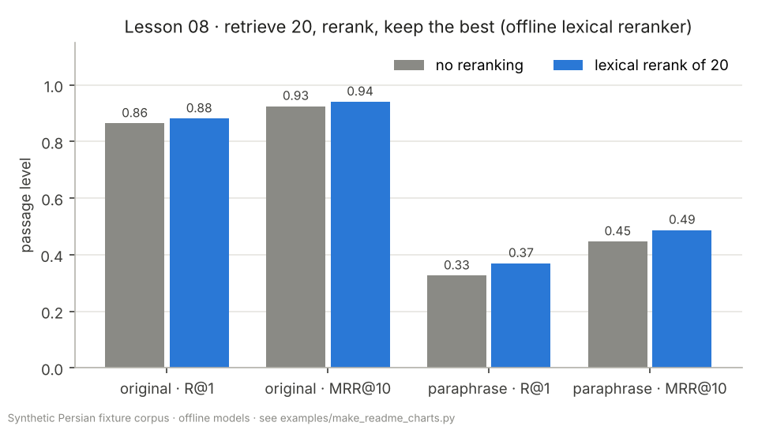
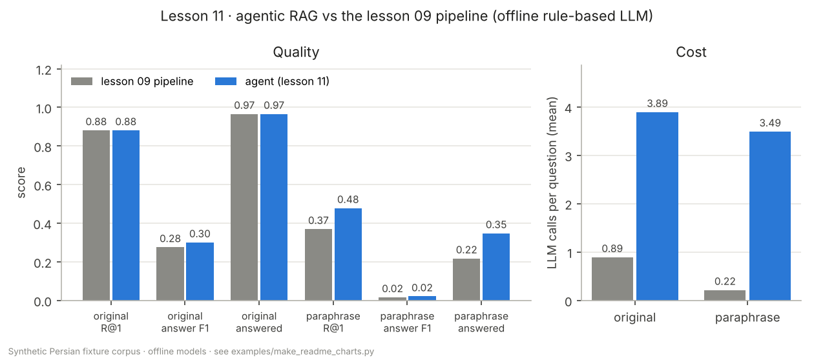
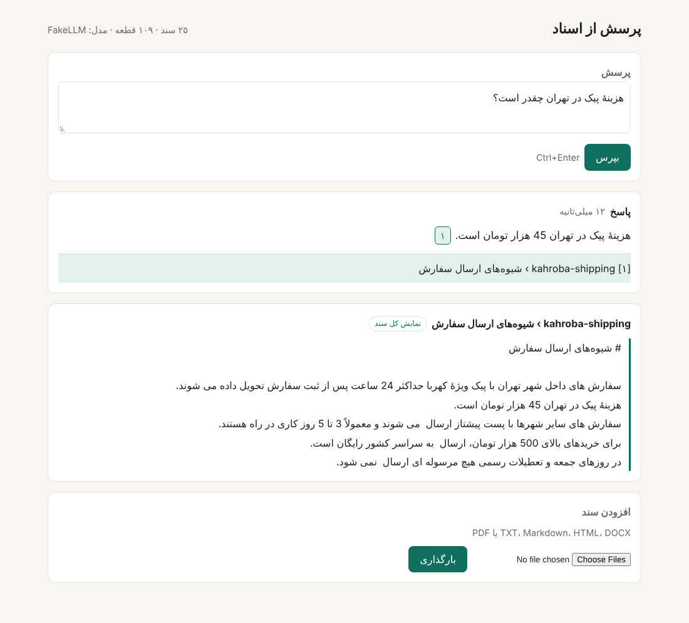

<div dir="rtl">

# آکادمی RAG فارسی

**[English](README.md)** · **[سایت مستندات](https://snikookar.github.io/Persian-RAG-Academy/)** · **[تغییرات نسخه‌ها](CHANGELOG.md)**

[](https://github.com/snikookar/Persian-RAG-Academy/actions/workflows/ci.yml)
[](https://snikookar.github.io/Persian-RAG-Academy/)
[](https://pypi.org/project/parsrag/)
[](pyproject.toml)
[](LICENSE)

**یک دورهٔ رایگان و پروژه‌محور در ۱۴ درس برای ساختن، سنجیدن و راه‌اندازی سیستم‌های تولید تقویت‌شده با بازیابی (Retrieval-Augmented Generation یا RAG) روی متن فارسی — به‌همراه `parsrag`، کتابخانه‌ای که در طول دوره خودتان از نو می‌سازید.**

هر درس یک توضیح فارسی با نمودار و عددهای اندازه‌گیری‌شده دارد، یک کد شروع (Starter) با جاهای خالی، و یک تصحیح‌کنندهٔ خودکار (Grader) که برای هر بررسیِ ناموفق راهنمایی فارسی و انگلیسی نشان می‌دهد. کتابخانهٔ کامل، همان پاسخ مرجع است. همه‌چیز — تست‌ها، تصحیح‌کننده، CI و مثال‌ها — **بدون اینترنت، بدون کلید API و بدون دانلود مدل** اجرا می‌شود. مدل‌های واقعی (هر API سازگار با OpenAI، Ollama، sentence-transformers) اختیاری‌اند.

## چرا این پروژه؟

بیشتر آموزش‌های RAG برای انگلیسی نوشته شده‌اند. متن فارسی یک پایپ‌لاین ساده را بی‌سروصدا خراب می‌کند: هیچ خطایی نمی‌دهد، فقط سند درست پیدا نمی‌شود. سه نمونه از درس‌ها:

| مشکل | پیش از | پس از | درس |
|---|---|---|---|
| **حروف عربی به‌جای فارسی.** «كتاب» با کاف و یای عربی و «کتاب» یکسان دیده می‌شوند ولی برای کامپیوتر دو رشتهٔ متفاوت‌اند؛ سندی که با صفحه‌کلید عربی تایپ شده، هیچ‌وقت با پرسش جور نمی‌شود. | `كتاب هاي  من ۱۲٣` | `کتاب‌های من 123` — یک املا، نیم‌فاصلهٔ درست، یک دستگاه رقم | [۰۲](lessons/02-normalization/README.fa.md) |
| **متن خراب PDF.** خیلی از PDFها به‌جای حرف، «شکل نمایشی» آن را ذخیره می‌کنند و بعضی هر خط را به ترتیب دیداری (برعکس) می‌نویسند. روی صفحه درست است، ولی جست‌وجو چیزی پیدا نمی‌کند. | `.ﺪﻨﮐﯽﻣ ﺐﺼﻧ ﻪﻧﺎﺒﺷ ﺖﻧﺎﻣﺍ ﯼﺍﺮﺑ ﺪﻨﻤﺷﻮﻫ ٔﻪﺴﻔﻗ ﮏﯾ` (بازیابی واژه‌ها ۰٫۰۷) | `یک قفسهٔ هوشمند برای امانت شبانه نصب می‌کند.` (بازیابی واژه‌ها ۱٫۰۰) | [۰۳](lessons/03-loading-documents/README.fa.md) |
| **پرسش محاوره‌ای.** کاربر می‌نویسد «چقدره»، «میشه»، «تو تهران»؛ سند نوشته «چقدر است»، «می‌شود»، «در تهران». | `هزینهٔ پیک تو تهران چقدره و مرجوعی تا کی میشه؟` | `هزینهٔ پیک در تهران چقدر است؟` و `مرجوعی تا کی می‌شود؟` — بازنویسی به فارسی معیار و شکستن به دو زیرپرسش | [۱۱](lessons/11-agentic-rag/README.fa.md) |

روی پرسش‌های دوره، نرمال‌سازی نرخ اصابت در رتبهٔ اول (hit@1) پایپ‌لاین ساده را از ۰٫۸۱ به ۰٫۹۰ می‌رساند، و اگر فقط گام یکسان‌سازی حروف را خاموش کنید، دوباره به ۰٫۸۱ برمی‌گردد. در درس‌ها هر تصمیم دیگری هم همین‌طور با عدد سنجیده می‌شود.

## معماری

پایپ‌لاین کامل `parsrag` همان‌طور که `PersianRAG` (درس ۱۳) آن را سرهم می‌کند. هر جعبه یک جزء جایگزین‌پذیر با پیش‌فرض آفلاین است.



### نقشهٔ دوره



## نتیجه‌ها

> **این عددها را درست بخوانید.** همه روی پیکرهٔ کوچک و ساختگی خود مخزن به دست آمده‌اند (۲۵ سند فارسی که برای همین دوره نوشته شده، ۵۹ پرسش پاسخ‌دار و ۴۶ بازنویسیِ پاسخ‌دار) و با مدل‌های آفلاین و قطعی (`HashingEmbedding`، یک `FakeLLM` استخراجی و یک LLM قاعده‌محور برای عامل). نشان می‌دهند *چطور* باید اندازه گرفت و هر انتخاب عدد را *به کدام سمت* می‌برد — نه این‌که یک مدل عصبی واقعی چه نمره‌ای می‌گیرد. برای سنجیدن مدل‌های برداری واقعی روی همین پرسش‌ها، [`examples/benchmark_embeddings.py`](examples/benchmark_embeddings.py) را روی کامپیوتر خودتان اجرا کنید. همهٔ نمودارها با [`examples/make_readme_charts.py`](examples/make_readme_charts.py) دوباره ساخته می‌شوند و عددهایشان در [`docs/eval/readme_numbers.json`](docs/eval/readme_numbers.json) است.

| | |
|---|---|
|  |  |
| **نرمال‌سازی (۰۲).** گام اصلی، یکسان‌سازی حروف عربی و فارسی است؛ بدون آن hit@1 در حد متن خام می‌ماند (۰٫۸۱ در برابر ۰٫۹۰). | **تعمیر PDF (۰۳).** NFKC متن PDF با ترتیب منطقی را درست می‌کند (۰٫۰۷ ← ۰٫۹۴) ولی PDF دیداری را نه (۰٫۰۸)؛ اصلاح ترتیب و بازیابی نیم‌فاصله هر دو را به ۱٫۰۰ می‌رساند. |
|  |  |
| **قطعه‌بندی (۰۴).** قطعه‌های آگاه از ساختار با عنوان بخش، در هر اندازه‌ای از پنجرهٔ ثابت بهترند (MRR از ۰٫۶۷ به ۰٫۸۳ در ۲۰۰ نویسه). | **جست‌وجوی ترکیبی (۰۷).** RRF روی BM25 و برداری روی پرسش‌های اصلی بهترین است (MRR ۰٫۹۳). بازنویسی‌ها همهٔ روش‌های واژگانی را نصف می‌کنند — شکافی که فقط مدل واقعی پر می‌کند. |
|  |  |
| **بازرتبه‌بندی (۰۸).** بازرتبه‌بندی ۲۰ نامزد، R@1 را از ۰٫۸۸ به ۰٫۹۰ (اصلی) و از ۰٫۳۵ به ۰٫۳۷ (بازنویسی) می‌برد؛ بوت‌استرپ جفتی درس ۱۰ نشان می‌دهد بازهٔ اطمینان صفر را در بر دارد. | **عامل در برابر پایپ‌لاین (۱۱).** عامل به بازنویسی‌های بیشتری جواب می‌دهد (۰٫۲۲ ← ۰٫۳۵) با حدود ۴ برابر فراخوانی LLM؛ بهبود F1 پاسخ روی مجموعهٔ اصلی (۰٫۰۲۵+) معنادار نیست. |

پایپ‌لاین کامل در CI با [`docs/eval/baseline.json`](docs/eval/baseline.json) مقایسه می‌شود (`python -m parsrag.eval gate`)؛ گزارش کامل در [`docs/eval/report.md`](docs/eval/report.md) است.

## شروع سریع

### الف) یادگیرنده: شروع دوره

```bash
git clone https://github.com/snikookar/Persian-RAG-Academy.git
cd Persian-RAG-Academy
python -m venv .venv && source .venv/bin/activate
pip install -e ".[loaders]" pytest ruff
python -m grader run 00
```

بعد [درس ۰۰](lessons/00-setup/README.fa.md) را باز کنید. در پوشهٔ `starter/` هر درس جاهای خالی (TODO) هست؛ `python -m grader run NN` نسخهٔ شما را می‌سنجد و `python -m grader list` همهٔ درس‌ها را نشان می‌دهد.

### ب) استفاده از کتابخانه

```bash
pip install parsrag                       # فقط pydantic و numpy
pip install "parsrag[loaders,openai]"     # PDF/DOCX/HTML و هر مدل سازگار با OpenAI
```

> `parsrag` هنوز روی PyPI منتشر نشده است؛ تا نسخهٔ اول، از داخل مخزن با `pip install -e .` نصب کنید.

```python
from parsrag import PersianRAG

rag = PersianRAG()                                   # پیش‌فرض‌های دوره، کاملاً آفلاین
rag.add_documents(["data/fixtures/corpus"])          # پوشه، فایل یا Document
answer = rag.ask("هزینهٔ پیک در تهران چقدر است؟")
print(answer.text)                                   # هزینهٔ پیک در تهران 45 هزار تومان است.
for c in answer.citations:
    print(c.doc_id, c.section)                       # kahroba-shipping شیوه‌های ارسال سفارش
print(rag.ask("پایتخت فرانسه کجاست؟").text)          # نمی‌دانم
```

LLM پیش‌فرض، `FakeLLM` استخراجی و آفلاین است؛ برای مدل واقعی `llm=OpenAICompatibleLLM(...)` بدهید یا `parsrag.toml` را تنظیم کنید ([درس ۱۳](lessons/13-capstone/README.fa.md)). همین کار از خط فرمان:

```bash
parsrag init                                        # یک parsrag.toml با توضیح همهٔ گزینه‌ها
parsrag ingest docs/ --calibrate dev.jsonl          # نمایه‌سازی و کالیبره کردن «نمی‌دانم»
parsrag ask "شرایط مرجوعی کالا چیست؟"
parsrag eval test.jsonl --baseline baseline.json    # گزارش درس ۱۰ و دروازهٔ افت کیفیت
```

### ج) سرویس: API و رابط وب

```bash
docker compose up --build        # API + PostgreSQL/pgvector ← http://localhost:8000
```

یا بدون Docker: `pip install -e ".[api,loaders]"` و بعد `parsrag serve --docs data/fixtures/corpus`. نقطه‌های پایانی: `GET /health`، `POST /ingest`، `POST /ingest/files`، `GET /documents`، `POST /ask`، `POST /ask/stream` (رویدادهای سرور یا SSE) و مستندات OpenAPI در `/docs` ([درس ۱۲](lessons/12-production-api/README.fa.md)). رابط وب راست‌به‌چپ است، پاسخ را استریم می‌کند و هر ارجاع را دقیقاً در همان بخش سند اصلی نشان می‌دهد:



## درس‌ها

| # | درس | در گیت‌هاب | در سایت |
|---|---|---|---|
| ۰۰ | آماده‌سازی محیط، ابزارهای آفلاین و تصحیح‌کننده | [README](lessons/00-setup/README.fa.md) | [سایت](https://snikookar.github.io/Persian-RAG-Academy/lessons/00-setup/) |
| ۰۱ | RAG در ۵۰ خط | [README](lessons/01-rag-in-50-lines/README.fa.md) | [سایت](https://snikookar.github.io/Persian-RAG-Academy/lessons/01-rag-in-50-lines/) |
| ۰۲ | نرمال‌سازی متن فارسی | [README](lessons/02-normalization/README.fa.md) | [سایت](https://snikookar.github.io/Persian-RAG-Academy/lessons/02-normalization/) |
| ۰۳ | بارگذاری اسناد فارسی (PDF، DOCX، HTML و راست‌به‌چپ) | [README](lessons/03-loading-documents/README.fa.md) | [سایت](https://snikookar.github.io/Persian-RAG-Academy/lessons/03-loading-documents/) |
| ۰۴ | قطعه‌بندی متن فارسی | [README](lessons/04-chunking/README.fa.md) | [سایت](https://snikookar.github.io/Persian-RAG-Academy/lessons/04-chunking/) |
| ۰۵ | برداری‌سازی و بنچمارک بازیابی | [README](lessons/05-embeddings/README.fa.md) | [سایت](https://snikookar.github.io/Persian-RAG-Academy/lessons/05-embeddings/) |
| ۰۶ | انباره‌های برداری (حافظه، FAISS، pgvector) | [README](lessons/06-vector-stores/README.fa.md) | [سایت](https://snikookar.github.io/Persian-RAG-Academy/lessons/06-vector-stores/) |
| ۰۷ | جست‌وجوی ترکیبی (BM25 فارسی + برداری + RRF) | [README](lessons/07-hybrid-search/README.fa.md) | [سایت](https://snikookar.github.io/Persian-RAG-Academy/lessons/07-hybrid-search/) |
| ۰۸ | بازرتبه‌بندی | [README](lessons/08-reranking/README.fa.md) | [سایت](https://snikookar.github.io/Persian-RAG-Academy/lessons/08-reranking/) |
| ۰۹ | تولید مستند با ارجاع و «نمی‌دانم»ِ صادقانه | [README](lessons/09-grounded-generation/README.fa.md) | [سایت](https://snikookar.github.io/Persian-RAG-Academy/lessons/09-grounded-generation/) |
| ۱۰ | ارزیابی و دروازهٔ کیفیت در CI | [README](lessons/10-evaluation/README.fa.md) | [سایت](https://snikookar.github.io/Persian-RAG-Academy/lessons/10-evaluation/) |
| ۱۱ | RAG عامل‌محور با LangGraph | [README](lessons/11-agentic-rag/README.fa.md) | [سایت](https://snikookar.github.io/Persian-RAG-Academy/lessons/11-agentic-rag/) |
| ۱۲ | API تولیدی (FastAPI، استریم، کش، Docker) | [README](lessons/12-production-api/README.fa.md) | [سایت](https://snikookar.github.io/Persian-RAG-Academy/lessons/12-production-api/) |
| ۱۳ | پروژهٔ پایانی: RAG روی اسناد خودتان با رابط وب | [README](lessons/13-capstone/README.fa.md) | [سایت](https://snikookar.github.io/Persian-RAG-Academy/lessons/13-capstone/) |

واژه‌نامهٔ اصطلاحات فارسی و انگلیسی دوره: [docs/glossary.fa.md](docs/glossary.fa.md).

## پرسش‌های پرتکرار

**کلید API یا کارت گرافیک لازم دارم؟** نه. همهٔ درس‌ها، تست‌ها و مثال‌ها روی یک لپ‌تاپ معمولی و بدون اینترنت اجرا می‌شوند. مدل واقعی فقط وقتی به کار می‌آید که خودتان گزینه‌ای مثل `--model st:NAME` یا `--llm NAME` بدهید.

**چرا عددها روی پرسش‌های اصلی این‌قدر بالا و روی بازنویسی‌ها این‌قدر پایین‌اند؟** پرسش‌های اصلی همان واژه‌های اسناد را به کار می‌برند و این به نفع روش‌های واژگانی است؛ مجموعهٔ بازنویسی دقیقاً برای نشان دادن همین نوشته شده. انتظار می‌رود برداری‌سازهای عصبی این فاصله را کم کنند — با `examples/benchmark_embeddings.py` خودتان بسنجید.

**`HashingEmbedding` مدل برداری واقعی است؟** نه؛ واژه‌ها و n-gramهای نویسه‌ای را در یک بردار درهم‌سازی (Hash) می‌کند. قطعی است و هیچ وابستگی ندارد، و این همان چیزی است که تست و CI لازم دارند. درس ۰۵ توضیح می‌دهد کی باید عوضش کنید.

**می‌توانم `parsrag` را برای زبان دیگری به کار ببرم؟** ساختار پایپ‌لاین عمومی است، ولی نرمال‌سازی، توکن‌سازی، فهرست واژه‌های ایست و پرامپت‌ها مخصوص فارسی‌اند.

**داده‌های نمونه از کجا آمده‌اند؟** همهٔ اسناد و پرسش‌های `data/fixtures/` برای همین مخزن نوشته شده‌اند (فروشگاه خیالی «کهربا» و کتابخانهٔ خیالی «سپیدار») و هیچ متن دارای حق نشری در آن‌ها نیست.

## مشارکت

از گزارش اشکال، نظر دربارهٔ درس‌ها، اصلاح و درس تازه استقبال می‌کنیم. پیش از شروع [CONTRIBUTING.md](CONTRIBUTING.md) (ساختار درس‌ها، قواعد نوشتن داده‌های نمونه، اجرای تصحیح‌کننده و دروازهٔ ارزیابی) و [آیین‌نامهٔ رفتاری](CODE_OF_CONDUCT.md) را بخوانید. برای مشکلات امنیتی [SECURITY.md](SECURITY.md) را ببینید.

## مجوز

[MIT](LICENSE). همهٔ داده‌های نمونهٔ فارسی در `data/fixtures/` برای همین مخزن نوشته شده‌اند و زیر همین مجوزند.

## ارجاع به این پروژه

اگر از دوره یا `parsrag` در آموزش یا پژوهش استفاده می‌کنید، لطفاً به آن ارجاع دهید ([CITATION.cff](CITATION.cff)):

</div>

```bibtex
@software{nikookar_persian_rag_academy_2026,
  author  = {Nikookar, Samane},
  title   = {Persian RAG Academy: a course and library for Retrieval-Augmented Generation on Persian text},
  year    = {2026},
  version = {0.1.0},
  url     = {https://github.com/snikookar/Persian-RAG-Academy},
  license = {MIT}
}
```
