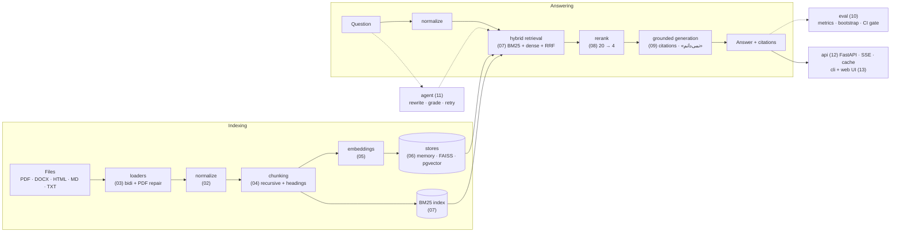
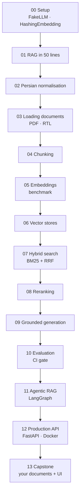

# Persian RAG Academy

**[فارسی](README.fa.md)** · **[Documentation (Persian)](https://snikookar.github.io/Persian-RAG-Academy/)** · **[Changelog](CHANGELOG.md)**

[](https://github.com/snikookar/Persian-RAG-Academy/actions/workflows/ci.yml)
[](https://snikookar.github.io/Persian-RAG-Academy/)
[](https://pypi.org/project/parsrag/)
[](pyproject.toml)
[](LICENSE)

**Build, evaluate and ship Retrieval-Augmented Generation (RAG) for Persian text — a free
14-lesson course in Persian, and `parsrag`, the library you rebuild along the way.**

Every lesson has a Persian explanation with diagrams and measured results, starter code with
TODOs, and an automatic grader with bilingual hints. The finished library is the reference
solution. Everything — tests, grader, CI, examples — runs **offline, with zero API keys and no
model downloads**; real models (any OpenAI-compatible API, Ollama, sentence-transformers) are
optional extras.

## Why this exists

Most RAG tutorials assume English. Persian text breaks a naive pipeline in quiet ways: nothing
crashes, the right document simply is not found. Three examples from the lessons:

| Problem | Before | After | Lesson |
|---|---|---|---|
| **Arabic vs Persian letters.** «كتاب» (Arabic KAF, YEH) and «کتاب» look identical but are different strings, so a rules document written on an Arabic keyboard never matches the question. | `كتاب هاي  من ۱۲٣` | `کتاب‌های من 123` — one spelling, ZWNJ restored, one digit system (`parsrag.normalize`) | [02](lessons/02-normalization/README.fa.md) |
| **Broken PDF text.** Many PDF producers store glyph shapes (presentation forms) and some store each line in *visual* order. Copy-paste looks fine; search finds nothing. | `.ﺪﻨﮐﯽﻣ ﺐﺼﻧ ﻪﻧﺎﺒﺷ ﺖﻧﺎﻣﺍ ﯼﺍﺮﺑ ﺪﻨﻤﺷﻮﻫ ٔﻪﺴﻔﻗ ﮏﯾ` (word recall 0.07) | `یک قفسهٔ هوشمند برای امانت شبانه نصب می‌کند.` (word recall 1.00) | [03](lessons/03-loading-documents/README.fa.md) |
| **Colloquial questions.** Users write «چقدره»، «میشه»، «تو تهران»; documents say «چقدر است»، «می‌شود»، «در تهران». | `هزینهٔ پیک تو تهران چقدره و مرجوعی تا کی میشه؟` | `هزینهٔ پیک در تهران چقدر است و مرجوعی تا کی می‌شود؟` + split into two sub-questions | [11](lessons/11-agentic-rag/README.fa.md) |

On the course questions, normalisation moves hit@1 of the naive pipeline from 0.81 to 0.90, and
switching off only the letter unification step drops it straight back to 0.81. The lessons
measure every other decision the same way.

## Architecture

The full `parsrag` pipeline as assembled by `PersianRAG` (lesson 13). Every box is a
replaceable component with an offline default.



### Course map



## Results

> **Read these numbers for what they are.** They come from the repository's small synthetic
> Persian corpus (25 original documents, 59 answerable questions plus 46 answerable
> paraphrases) with offline, deterministic models (`HashingEmbedding`, an extractive `FakeLLM`,
> a rule-based agent LLM). They show *how* to measure and *which way* each choice moves the
> numbers — not how a neural model would score. To benchmark real embedding models on the same
> questions, run [`examples/benchmark_embeddings.py`](examples/benchmark_embeddings.py) on your
> own machine. All charts are regenerated by
> [`examples/make_readme_charts.py`](examples/make_readme_charts.py); the numbers behind them
> are in [`docs/eval/readme_numbers.json`](docs/eval/readme_numbers.json).

| | |
|---|---|
|  |  |
| **Normalisation (02).** Unifying Arabic/Persian letters is the step that matters: without it hit@1 stays at the raw-text level (0.81 → 0.90 with it). | **PDF repair (03).** NFKC fixes logical-order PDFs (0.07 → 0.94 word recall) but not visual-order ones (0.08); order repair and ZWNJ recovery bring both to 1.00. |
|  |  |
| **Chunking (04).** Structure-aware chunks with the heading prepended beat fixed windows at every size (MRR 0.66 → 0.82 at 200 characters). | **Hybrid search (07).** RRF over BM25 and dense is the best untuned method on the original questions (MRR 0.93). Paraphrases halve every lexical method — the gap only a real model closes. |
|  |  |
| **Reranking (08).** Reranking 20 candidates lifts R@1 0.86 → 0.88 (original) and 0.33 → 0.37 (paraphrase); lesson 10's paired bootstrap shows the interval contains 0. | **Agent vs pipeline (11).** The agent answers more paraphrases (0.22 → 0.35) at ~4× the LLM calls; on the original set its answer-F1 gain (+0.025) is not significant. |

The end-to-end pipeline is gated in CI against [`docs/eval/baseline.json`](docs/eval/baseline.json)
(`python -m parsrag.eval gate`); the full report is in [`docs/eval/report.md`](docs/eval/report.md).

## Quick start

### a) Learner: take the course

```bash
git clone https://github.com/snikookar/Persian-RAG-Academy.git
cd Persian-RAG-Academy
python -m venv .venv && source .venv/bin/activate
pip install -e ".[loaders]" pytest ruff
python -m grader run 00          # then open lessons/00-setup/README.fa.md
```

Each lesson's `starter/` has TODOs; `python -m grader run NN` tests your version and prints a
Persian/English hint for every failing check. `python -m grader list` shows all lessons.

### b) Library user

```bash
pip install parsrag                       # core: pydantic + numpy only
pip install "parsrag[loaders,openai]"     # PDF/DOCX/HTML + any OpenAI-compatible model
```

> `parsrag` is not on PyPI yet; until the first release, install from a clone with
> `pip install -e .`.

```python
from parsrag import PersianRAG

rag = PersianRAG()                                   # the course defaults, fully offline
rag.add_documents(["data/fixtures/corpus"])          # folders, files or Document objects
answer = rag.ask("هزینهٔ پیک در تهران چقدر است؟")
print(answer.text)                                   # هزینهٔ پیک در تهران 200 هزار تومان است.
for c in answer.citations:
    print(c.doc_id, c.section)                       # kahroba-shipping شیوه‌های ارسال سفارش
print(rag.ask("پایتخت فرانسه کجاست؟").text)          # نمی‌دانم
```

The default LLM is the offline extractive `FakeLLM`; pass `llm=OpenAICompatibleLLM(...)` or
configure `parsrag.toml` for a real model ([lesson 13](lessons/13-capstone/README.fa.md)).
The same pipeline from the command line:

```bash
parsrag init                                        # commented parsrag.toml
parsrag ingest docs/ --calibrate dev.jsonl          # index + calibrate «نمی‌دانم»
parsrag ask "شرایط مرجوعی کالا چیست؟"
parsrag eval test.jsonl --baseline baseline.json    # lesson 10 report + regression gate
```

### c) Service: API + web UI

```bash
docker compose up --build        # API + PostgreSQL/pgvector → http://localhost:8000
```

Or without Docker: `pip install -e ".[api,loaders]"` and `parsrag serve --docs data/fixtures/corpus`.
Endpoints: `GET /health`, `POST /ingest`, `POST /ingest/files`, `GET /documents`, `POST /ask`,
`POST /ask/stream` (Server-Sent Events) and OpenAPI docs at `/docs`
([lesson 12](lessons/12-production-api/README.fa.md)). The right-to-left web UI streams answers
and opens every citation at its exact span in the source document:


## Lessons

| # | Lesson | درس | GitHub | Docs |
|---|---|---|---|---|
| 00 | Setup, offline tools, grader | آماده‌سازی محیط | [README](lessons/00-setup/README.fa.md) | [site](https://snikookar.github.io/Persian-RAG-Academy/lessons/00-setup/) |
| 01 | RAG in 50 lines | RAG در ۵۰ خط | [README](lessons/01-rag-in-50-lines/README.fa.md) | [site](https://snikookar.github.io/Persian-RAG-Academy/lessons/01-rag-in-50-lines/) |
| 02 | Persian normalisation | نرمال‌سازی متن فارسی | [README](lessons/02-normalization/README.fa.md) | [site](https://snikookar.github.io/Persian-RAG-Academy/lessons/02-normalization/) |
| 03 | Loading Persian documents (PDF, DOCX, HTML, RTL) | بارگذاری اسناد فارسی | [README](lessons/03-loading-documents/README.fa.md) | [site](https://snikookar.github.io/Persian-RAG-Academy/lessons/03-loading-documents/) |
| 04 | Chunking Persian text | قطعه‌بندی متن فارسی | [README](lessons/04-chunking/README.fa.md) | [site](https://snikookar.github.io/Persian-RAG-Academy/lessons/04-chunking/) |
| 05 | Embeddings and a retrieval benchmark | برداری‌سازی و بنچمارک بازیابی | [README](lessons/05-embeddings/README.fa.md) | [site](https://snikookar.github.io/Persian-RAG-Academy/lessons/05-embeddings/) |
| 06 | Vector stores (in-memory, FAISS, pgvector) | انباره‌های برداری | [README](lessons/06-vector-stores/README.fa.md) | [site](https://snikookar.github.io/Persian-RAG-Academy/lessons/06-vector-stores/) |
| 07 | Hybrid search (Persian BM25 + dense + RRF) | جست‌وجوی ترکیبی | [README](lessons/07-hybrid-search/README.fa.md) | [site](https://snikookar.github.io/Persian-RAG-Academy/lessons/07-hybrid-search/) |
| 08 | Reranking | بازرتبه‌بندی | [README](lessons/08-reranking/README.fa.md) | [site](https://snikookar.github.io/Persian-RAG-Academy/lessons/08-reranking/) |
| 09 | Grounded generation, citations, honest «I don't know» | تولید مستند با ارجاع و «نمی‌دانم» | [README](lessons/09-grounded-generation/README.fa.md) | [site](https://snikookar.github.io/Persian-RAG-Academy/lessons/09-grounded-generation/) |
| 10 | Evaluation and a CI quality gate | ارزیابی و دروازهٔ CI | [README](lessons/10-evaluation/README.fa.md) | [site](https://snikookar.github.io/Persian-RAG-Academy/lessons/10-evaluation/) |
| 11 | Agentic RAG with LangGraph | RAG عامل‌محور با LangGraph | [README](lessons/11-agentic-rag/README.fa.md) | [site](https://snikookar.github.io/Persian-RAG-Academy/lessons/11-agentic-rag/) |
| 12 | Production API (FastAPI, streaming, cache, Docker) | API تولیدی | [README](lessons/12-production-api/README.fa.md) | [site](https://snikookar.github.io/Persian-RAG-Academy/lessons/12-production-api/) |
| 13 | Capstone: RAG over your own documents + UI | پروژهٔ پایانی | [README](lessons/13-capstone/README.fa.md) | [site](https://snikookar.github.io/Persian-RAG-Academy/lessons/13-capstone/) |

## FAQ

**Do I need an API key or a GPU?** No. Every lesson, test and example runs offline on a laptop.
Real models are optional and only used when you pass a flag such as `--model st:NAME` or `--llm NAME`.

**Do I need to read Persian?** The lessons are in Persian; the code, docstrings and this README
are in English, so the library itself is usable without it.

**Why are the benchmark numbers so high on the original questions and so low on paraphrases?**
The original questions reuse the documents' wording, which favours lexical methods; the
paraphrase set was written to expose that. Neural embeddings are expected to narrow the gap —
measure it with `examples/benchmark_embeddings.py`.

**Can I use `parsrag` for non-Persian text?** The pipeline is generic, but normalisation,
tokenisation, the stop-word list and the prompts are Persian-specific.

**Is `HashingEmbedding` a real embedding model?** No — it hashes words and character n-grams into
a vector. It is deterministic and dependency-free, which is what tests and CI need. Lesson 05
explains when to replace it.

**Where does the sample data come from?** Every document and question in `data/fixtures/` was
written for this repository (a fictional shop «کهربا» and library «مهرگان»); no copyrighted text.

## Contributing

Contributions are welcome — bug reports, lesson feedback, fixes, new lessons. Read
[CONTRIBUTING.md](CONTRIBUTING.md) (how lessons are structured, fixture-writing rules, running the
grader and the eval gate) and the [Code of Conduct](CODE_OF_CONDUCT.md). Security issues:
see [SECURITY.md](SECURITY.md).

## License

[MIT](LICENSE). All Persian sample data in `data/fixtures/` was written originally for this
repository and is covered by the same license.

## Cite this project

If you use the course or `parsrag` in teaching or research, please cite it
([CITATION.cff](CITATION.cff)):

```bibtex
@software{nikookar_persian_rag_academy_2026,
  author  = {Nikookar, Samane},
  title   = {Persian RAG Academy: a course and library for Retrieval-Augmented Generation on Persian text},
  year    = {2026},
  version = {0.1.0},
  url     = {https://github.com/snikookar/Persian-RAG-Academy},
  license = {MIT}
}
```
