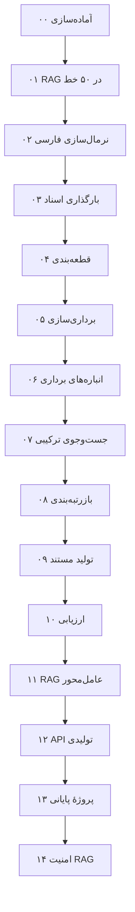

# آکادمی RAG فارسی

**یک دورهٔ رایگان و پروژه‌محور در ۱۵ درس برای ساختن، سنجیدن و راه‌اندازی سیستم‌های تولید تقویت‌شده با بازیابی (Retrieval-Augmented Generation یا RAG) روی متن فارسی.**

در هر درس یک بخش از کتابخانهٔ پایتونی `parsrag` را خودتان می‌سازید. هر درس یک توضیح فارسی با نمودار و عددهای اندازه‌گیری‌شده دارد، یک کد شروع (Starter) با جاهای خالی، و یک تصحیح‌کنندهٔ خودکار (Grader) که برای هر بررسیِ ناموفق راهنمایی می‌دهد. کتابخانهٔ کامل در [گیت‌هاب](https://github.com/snikookar/Persian-RAG-Academy) همان پاسخ مرجع است.

!!! tip "بدون کلید API، بدون اینترنت"
    همهٔ درس‌ها، تست‌ها و مثال‌ها با `FakeLLM` و `HashingEmbedding` روی یک لپ‌تاپ معمولی اجرا می‌شوند. مدل واقعی (هر API سازگار با OpenAI، Ollama یا sentence-transformers) همیشه اختیاری است.

## شروع در سه فرمان

```bash
git clone https://github.com/snikookar/Persian-RAG-Academy.git && cd Persian-RAG-Academy
pip install -e ".[loaders]" pytest ruff
python -m grader run 00
```

بعد سراغ [درس ۰۰](lessons/00-setup.md) بروید. هر درس با `python -m grader run NN` تصحیح می‌شود.

## نقشهٔ دوره



| درس | موضوع | ماژول `parsrag` |
|---|---|---|
| [۰۰](lessons/00-setup.md) | آماده‌سازی محیط، ابزارهای آفلاین و تصحیح‌کننده | `parsrag.doctor` |
| [۰۱](lessons/01-rag-in-50-lines.md) | RAG در ۵۰ خط | `parsrag.naive_rag` |
| [۰۲](lessons/02-normalization.md) | نرمال‌سازی متن فارسی | `parsrag.normalize` |
| [۰۳](lessons/03-loading-documents.md) | بارگذاری اسناد فارسی (PDF، DOCX، HTML و راست‌به‌چپ) | `parsrag.loaders` |
| [۰۴](lessons/04-chunking.md) | قطعه‌بندی متن فارسی | `parsrag.chunking` |
| [۰۵](lessons/05-embeddings.md) | برداری‌سازی و بنچمارک بازیابی | `parsrag.embeddings`، `parsrag.eval` |
| [۰۶](lessons/06-vector-stores.md) | انباره‌های برداری (حافظه، FAISS، pgvector) | `parsrag.stores` |
| [۰۷](lessons/07-hybrid-search.md) | جست‌وجوی ترکیبی (BM25 فارسی + برداری + RRF) | `parsrag.retrieval` |
| [۰۸](lessons/08-reranking.md) | بازرتبه‌بندی | `parsrag.rerank` |
| [۰۹](lessons/09-grounded-generation.md) | تولید مستند با ارجاع و «نمی‌دانم»ِ صادقانه | `parsrag.generate` |
| [۱۰](lessons/10-evaluation.md) | ارزیابی و دروازهٔ کیفیت در CI | `parsrag.eval` |
| [۱۱](lessons/11-agentic-rag.md) | RAG عامل‌محور با LangGraph | `parsrag.agent` |
| [۱۲](lessons/12-production-api.md) | API تولیدی (FastAPI، استریم، کش، Docker) | `parsrag.api` |
| [۱۳](lessons/13-capstone.md) | پروژهٔ پایانی: RAG روی اسناد خودتان | `parsrag.rag`، `parsrag.cli` |
| [۱۴](lessons/14-rag-security.md) | امنیت RAG: تزریق پرامپت پنهان در اسناد | `parsrag.security` |

## چه چیزی کجاست؟

- **درس‌ها:** در منوی کنار صفحه. هر درس همان فایل `lessons/NN-…/README.fa.md` مخزن است.
- **مرجع:** [کتابخانهٔ parsrag](reference/library.md)، [خط فرمان](reference/cli.md) و [API وب](reference/http-api.md).
- **نتیجه‌ها:** [نمودارهای همهٔ اندازه‌گیری‌ها](results.md) و [گزارش ارزیابی پایپ‌لاین](eval/report.md).
- **بنچمارک مدل‌های واقعی:** [دفترچهٔ Colab](https://colab.research.google.com/github/snikookar/Persian-RAG-Academy/blob/main/notebooks/benchmark_real_embeddings.ipynb) برای سنجیدن مدل‌های برداری‌سازی Hugging Face روی پرسش‌های دوره (درس ۰۵).
- **واژه‌نامه:** [اصطلاحات فارسی و انگلیسی دوره](glossary.fa.md) — هر اصطلاح یک معادل ثابت در همهٔ درس‌ها.

## مشارکت

گزارش اشکال، نظر دربارهٔ یک درس یا پیشنهاد درس تازه را در [Issues گیت‌هاب](https://github.com/snikookar/Persian-RAG-Academy/issues/new/choose) ثبت کنید. راهنمای مشارکت در [CONTRIBUTING.md](https://github.com/snikookar/Persian-RAG-Academy/blob/main/CONTRIBUTING.md) است.
