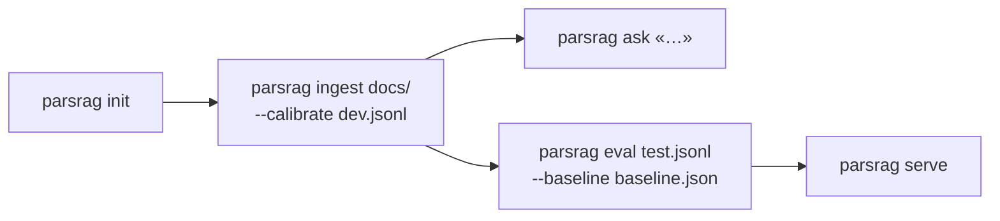

# خط فرمان (CLI)

نصب `parsrag` فرمان `parsrag` را هم نصب می‌کند ([درس ۱۳](../lessons/13-capstone.md)). همهٔ فرمان‌ها بدون مدل واقعی و بدون اینترنت کار می‌کنند؛ مدل را در `parsrag.toml` انتخاب می‌کنید.

```text
parsrag init | ingest | ask | eval | serve
```

## گردش کار پیشنهادی



## `parsrag init [path] [--force]`

یک `parsrag.toml` با توضیح همهٔ گزینه‌ها می‌نویسد:

```toml
[documents]
paths = ["docs"]               # پوشه‌ها یا فایل‌ها، نسبت به همین فایل
pattern = "*"
recursive = true

[index]
path = ".parsrag/index"        # خروجی parsrag ingest

[chunking]
size = 400                     # درس ۰۴
overlap = 50
heading_context = true

[retrieval]
k = 4                          # تعداد متن‌هایی که به مدل داده می‌شود (درس ۰۹)
fetch_k = 20                   # نامزدهای بازرتبه‌ساز (درس ۰۸)
rerank = "lexical"             # "lexical" | "cross-encoder" | "none"
stem = true                    # ریشه‌یابی سبک در BM25 (درس ۰۷)
# min_score = 4.0              # با parsrag eval --calibrate تنظیم می‌شود (درس ۰۹)

[embedding]
provider = "hashing"           # "hashing" (آفلاین) | "st" | "openai" | "tfidf"

[llm]
provider = "fake"              # "fake" (آفلاین، استخراجی) | "ollama" | "openai"
# model = "qwen2.5:7b"
# base_url = "http://localhost:11434/v1"
# api_key_env = "OPENAI_API_KEY"
timeout = 60

[security]
enabled = false                # محافظ تزریق پرامپت (درس ۱۴)
# action = "drop"              # "drop" | "flag" برای قطعه‌های مشکوک
```

کلید API هیچ‌وقت در فایل نوشته نمی‌شود؛ فقط *نام* متغیر محیطی‌اش (`api_key_env`).

## `parsrag ingest [paths ...]`

| گزینه | کار |
|---|---|
| `paths` | پوشه‌ها یا فایل‌ها (پیش‌فرض: `[documents] paths` در پیکربندی) |
| `--config` | فایل TOML یا JSON (پیش‌فرض: `./parsrag.toml` اگر باشد) |
| `--index` | پوشهٔ نمایه (پیش‌فرض: `[index] path`) |
| `--calibrate QA.jsonl` | آستانهٔ «نمی‌دانم» را روی این مجموعه کالیبره و ذخیره کن |

## `parsrag ask "پرسش"`

| گزینه | کار |
|---|---|
| `--k` | تعداد متن‌هایی که به مدل داده می‌شود |
| `--json` | کل پاسخ (متن، ارجاع‌ها، بازه‌ها) به‌صورت JSON |
| `--config`، `--index` | مثل بالا |

## `parsrag eval QA.jsonl`

گزارش درس ۱۰ (بازیابی، F1 پاسخ، دقت ارجاع، وفاداری، «نمی‌دانم») با بازهٔ اطمینان بوت‌استرپ، و در صورت نیاز دروازهٔ افت کیفیت. پیش از ارزیابی، `validate_qa` پرسش‌هایی را که شاهدشان در سند پیدا نمی‌شود گزارش می‌کند.

| گزینه | کار |
|---|---|
| `--calibrate` | کالیبره روی همین فایل (فقط برای آزمایش؛ نتیجه خوش‌بینانه است) |
| `--calibrate-on DEV.jsonl` | کالیبره روی یک فایل دیگر (توصیه‌شده) |
| `--save` | آستانهٔ کالیبره‌شده را در نمایه ذخیره کن |
| `--json`، `--markdown` | نوشتن گزارش کامل یا خلاصه |
| `--baseline FILE` | مقایسه با خط پایه؛ اگر معیاری بیش از حد مجاز افت کرده باشد، با کد خطا خارج می‌شود |
| `--update-baseline` | به‌جای مقایسه، خط پایه را بنویس |
| `--tolerance` | افت مجاز (پیش‌فرض: مقدار ذخیره‌شده در خط پایه) |
| `--name` | نام گزارش یا خط پایه |

## `parsrag serve`

API و رابط وب ([API وب](http-api.md))؛ به افزونهٔ `api` نیاز دارد (`pip install "parsrag[api]"`).

| گزینه | کار |
|---|---|
| `--index` | نمایه‌ای که `parsrag ingest` ساخته |
| `--docs DIR` | به‌جای بارگذاری نمایه، این پوشه را هنگام شروع نمایه کن |
| `--host`، `--port` | پیش‌فرض `127.0.0.1:8000` |
| `--config` | مثل بالا |

## ابزارهای مخزن (فقط در کلون)

```bash
python -m grader list                    # فهرست درس‌ها
python -m grader run 07 --path my/dir    # تصحیح کد شما برای درس ۰۷
python -m grader check-solutions         # پاسخ مرجع همهٔ درس‌ها را بسنج
python -m parsrag.eval run --markdown docs/eval/report.md
python -m parsrag.eval gate --baseline docs/eval/baseline.json
python -m parsrag.doctor                 # بررسی محیط (درس ۰۰)
```
