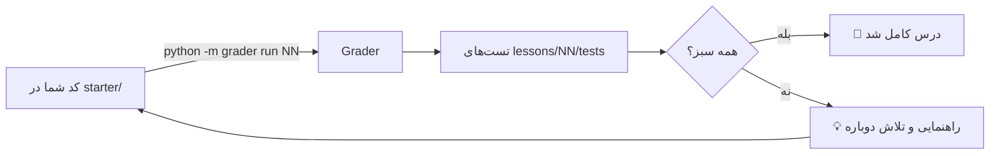

# درس ۰۰ — آماده‌سازی محیط

به «آکادمی RAG فارسی» خوش آمدید! 👋
در این دوره قدم‌به‌قدم یک سیستم **تولید تقویت‌شده با بازیابی (Retrieval-Augmented Generation یا RAG)** برای متن فارسی می‌سازیم. هر درس یک ماژول از کتابخانهٔ `parsrag` را می‌سازد و یک **تصحیح‌کنندهٔ خودکار (Grader)** کار شما را بررسی می‌کند.

در این درس:

1. محیط پایتون را آماده می‌کنیم.
2. یاد می‌گیریم تست‌ها و Grader را اجرا کنیم.
3. با دو ابزار «جعلی» ولی مهم آشنا می‌شویم: `FakeLLM` و `HashingEmbedding`.
4. می‌بینیم چطور (اختیاری) یک مدل واقعی یا Ollama را وصل کنیم.
5. اولین تمرین: یک «پزشک محیط» (`doctor.py`) می‌نویسیم.

---

## ۱. نصب

به **پایتون ۳.۱۰ یا جدیدتر** نیاز دارید.

```bash
git clone https://github.com/snikookar/Persian-RAG-Academy.git
cd Persian-RAG-Academy
python -m venv .venv
source .venv/bin/activate        # ویندوز: .venv\Scripts\activate
pip install -e . pytest ruff
```

نصب پایه فقط دو وابستگی دارد: `pydantic` و `numpy`. همه‌چیزِ دیگر «اختیاری» است و با **extras** نصب می‌شود:

| extra | برای چه؟ | درس |
|---|---|---|
| `openai` | اتصال به هر API سازگار با OpenAI (از جمله Ollama) | ۰۰ به بعد (اختیاری) |
| `st` | مدل‌های برداری واقعی (sentence-transformers) | ۰۵ |
| `loaders` | خواندن PDF/DOCX/HTML | ۰۳ |
| `faiss`, `pgvector` | پایگاه‌دادهٔ برداری | ۰۶ |
| `agent` | LangGraph | ۱۱ |
| `api` | FastAPI | ۱۲ |

```bash
pip install -e ".[openai]"   # فقط وقتی لازم شد
```

> **قانون طلایی این دوره:** همهٔ تست‌ها، تمرین‌ها و مثال‌ها **بدون کلید API و بدون اینترنت** اجرا می‌شوند. هیچ هزینه‌ای لازم نیست. 💸🚫

## ۲. اجرای تست‌ها و Grader

```bash
pytest                          # همهٔ تست‌های کتابخانه و درس‌ها
python -m grader list           # فهرست درس‌ها
python -m grader run 00         # بررسی کد شما در lessons/00-setup/starter
python -m grader run 02 --path my_folder   # بررسی کد شما در پوشه‌ای دلخواه
python -m grader check-solutions           # اجرای تست‌ها روی پاسخ مرجع (parsrag)
```

هر درس یک پوشهٔ `starter/` دارد که در آن توابع با `TODO` علامت خورده‌اند. تا وقتی آن‌ها را کامل نکنید، Grader قرمز است — این طبیعی است! خروجی Grader چیزی شبیه این است:

```text
Lesson 00: درس ۰۰ — آماده‌سازی محیط
 ✘ python_version_ok compares against the minimum version (0/5)
     case:  version=(3, 10, 0), expected=True
     error: not implemented yet / هنوز پیاده‌سازی نشده (TODO: python_version_ok)
     💡 فقط دو عدد اول نسخه (major, minor) را به صورت tuple مقایسه کنید.
 ✔ FakeLLM gives the same answer every time (no network, no key)

Result: 2/10 checks passed
```



پاسخ مرجع هر درس، ماژول متناظر در `src/parsrag/` است. اول خودتان تلاش کنید، بعد نگاه کنید. 😉

## ۳. `FakeLLM` و `HashingEmbedding`: ابزارهای آفلاین

یک سیستم RAG دو مدل لازم دارد:

- **مدل زبانی (LLM)** که پاسخ را می‌نویسد.
- **مدل برداری‌سازی (Embedding)** که متن را به بردار عددی تبدیل می‌کند تا بتوانیم «شباهت معنایی» را حساب کنیم.

مدل‌های واقعی یا پولی‌اند یا باید چند صد مگابایت دانلود شوند. برای یادگیری و تست، دو جایگزین **قطعی (Deterministic)** و آفلاین داریم:

### `FakeLLM`

```python
from parsrag import FakeLLM

llm = FakeLLM(responses=["سلام!"])           # پاسخ‌های از پیش تعیین‌شده
llm.generate([{"role": "user", "content": "خوبی؟"}])   # → "سلام!"

llm = FakeLLM()                               # حالت echo: پیام کاربر را برمی‌گرداند
llm = FakeLLM(mode="extractive")              # جمله‌ای از متن را برمی‌گرداند که بیشترین
                                              # هم‌پوشانی کلمه با «پرسش:» را دارد
llm.calls                                     # همهٔ پیام‌هایی که دریافت کرده (برای تست)
```

حالت `extractive` برای دموی RAG عالی است: «پاسخ» مستقیماً از متن بازیابی‌شده کپی می‌شود، پس اگر بازیابی خوب باشد پاسخ هم خوب است.

### `HashingEmbedding`

به‌جای شبکهٔ عصبی، از **درهم‌سازی ویژگی‌ها (Feature Hashing)** استفاده می‌کند: کلمه‌ها و **n-gramهای حرفی (Character n-grams)** هر متن — مثلاً `<کت`، `کتا`، `تاب`، `اب>` — با تابع CRC32 به یکی از ۱۰۲۴ خانهٔ یک بردار نگاشت می‌شوند. چون «کتاب» و «کتاب‌ها» n-gramهای مشترک زیادی دارند، بردارهایشان شبیه می‌شود:

```python
from parsrag import HashingEmbedding

emb = HashingEmbedding()
a, b, c = emb.embed(["کتاب", "کتاب‌ها", "باران"])
print(a @ b, a @ c)    # ≈ 0.65 و ≈ 0.10  (بردارها نرمال‌اند؛ ضرب داخلی = شباهت کسینوسی)
```

البته این یک مدل معنایی واقعی نیست («خودرو» و «ماشین» را شبیه نمی‌داند). در درس ۰۵ آن را با مدل‌های واقعی مقایسه می‌کنیم و **با عدد** نشان می‌دهیم چقدر فرق دارند.

## ۴. (اختیاری) اتصال به مدل واقعی یا Ollama

کلاس `OpenAICompatibleLLM` با هر سرویسی که API سازگار با OpenAI دارد کار می‌کند:

```python
from parsrag.llm import OpenAICompatibleLLM

# Ollama روی سیستم خودتان (رایگان، بدون کلید):  ollama pull qwen2.5:7b
llm = OpenAICompatibleLLM(model="qwen2.5:7b", base_url="http://localhost:11434/v1")

# یک سرویس ابری (کلید را در متغیر محیطی OPENAI_API_KEY بگذارید، نه در کد!)
llm = OpenAICompatibleLLM(model="gpt-4o-mini")

print(llm.generate([{"role": "user", "content": "سلام! خودت را معرفی کن."}]))
```

یادتان باشد: تست‌ها **هرگز** به این کلاس وصل نمی‌شوند؛ لایهٔ HTTP در تست‌ها شبیه‌سازی (Mock) شده است.

## ۵. تمرین: `doctor.py`

فایل `lessons/00-setup/starter/doctor.py` را باز کنید و سه تابع را کامل کنید:

| تابع | کار |
|---|---|
| `python_version_ok` | آیا نسخهٔ پایتون حداقل ۳.۱۰ است؟ |
| `extras_status` | کدام extraها نصب شده‌اند؟ (`{"openai": True, "st": False, ...}`) |
| `smoke_test` | یک RAG کوچک: سه جمله را در `InMemoryVectorStore` بگذارید، نزدیک‌ترین را به پرسش پیدا کنید و از `FakeLLM(mode="extractive")` پاسخ بگیرید. |

```bash
python -m grader run 00
python lessons/00-setup/starter/doctor.py    # بعد از کامل کردن
python -m parsrag.doctor                     # نسخهٔ مرجع
```

وقتی Grader گفت 🎉، آماده‌اید برای [درس ۰۱ — RAG در ۵۰ خط](../01-rag-in-50-lines/README.fa.md)!
