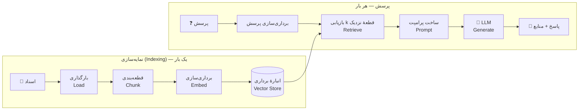

# درس ۰۱ — RAG در ۵۰ خط

در این درس کل چرخهٔ RAG را — ساده و بی‌تعارف — در حدود ۵۰ خط منطق می‌سازیم. هدف این نیست که بهترین سیستم را بسازیم؛ هدف این است که **شکل کلی** را ببینیم. درس‌های بعدی هر قطعه را جداگانه بهتر می‌کنند و هر بهبود را **با عدد** اندازه می‌گیرند.

## RAG چیست؟

مدل‌های زبانی بزرگ (LLM) فقط چیزهایی را می‌دانند که در زمان آموزش دیده‌اند. اگر بپرسید «هزینهٔ پیک فروشگاه کهربا چقدر است؟» یا نمی‌دانند یا — بدتر — یک عدد **از خودشان می‌سازند (Hallucination)**.

**تولید تقویت‌شده با بازیابی (Retrieval-Augmented Generation)** راه‌حل ساده‌ای است: قبل از پرسیدن از مدل، متن‌های مرتبط را از اسناد خودمان **بازیابی (Retrieval)** می‌کنیم و همراه پرسش به مدل می‌دهیم تا پاسخ را **بر اساس همان متن‌ها** بنویسد.



## پنج گام

| گام | در این درس | بعداً بهترش می‌کنیم در |
|---|---|---|
| بارگذاری (Load) | خواندن فایل‌های `.md` | درس ۰۳: PDF، DOCX، HTML و مشکلات راست‌به‌چپ |
| قطعه‌بندی (Chunking) | پنجره‌های ثابتِ ۴۰۰ نویسه‌ای با ۵۰ نویسه هم‌پوشانی | درس ۰۴: قطعه‌بندی آگاه از جمله و پاراگراف فارسی |
| برداری‌سازی (Embedding) | `HashingEmbedding` | درس ۰۵: مقایسهٔ مدل‌های واقعی |
| بازیابی (Retrieval) | شباهت کسینوسی در حافظه | درس ۰۶–۰۸: FAISS، جست‌وجوی ترکیبی، بازرتبه‌بندی |
| تولید (Generation) | `FakeLLM(mode="extractive")` | درس ۰۹: پاسخ مستند با ارجاع و «نمی‌دانم» صادقانه |

## کد

تمام منطق در `src/parsrag/naive_rag.py` است. مهم‌ترین قطعه‌ها:

```python
def chunk_text(text: str, size: int = 400, overlap: int = 50) -> list[str]:
    step = size - overlap
    return [text[i : i + size] for i in range(0, max(len(text) - overlap, 1), step) if text]
```

هم‌پوشانی (Overlap) باعث می‌شود جمله‌ای که روی مرز دو قطعه افتاده، کامل در دست‌کم یکی از آن‌ها باشد.

```python
def build_prompt(question, results):
    context = "\n\n".join(f"[{i}] ({r.chunk.doc_id}) {r.chunk.text}" for i, r in enumerate(results, 1))
    user = f"متن‌های بازیابی‌شده:\n{context}\n\nپرسش: {question}"
    return [Message(role="system", content=SYSTEM_PROMPT), Message(role="user", content=user)]
```

و خود پایپ‌لاین:

```python
rag = NaiveRAG(HashingEmbedding(), FakeLLM(mode="extractive"), chunk_size=400, k=3)
rag.index(load_documents("data/fixtures/corpus"))
answer = rag.answer("هزینهٔ پیک در تهران چقدر است؟")
print(answer.text)                                  # هزینهٔ پیک در تهران 45 هزار تومان است.
print([s.chunk.id for s in answer.sources])         # ['kahroba-shipping#0', ...]
```

اجرا کنید:

```bash
python examples/rag_in_50_lines.py
python examples/rag_in_50_lines.py "تا چند روز بعد از تحویل می‌توانم کالا را برگردانم؟"
```

## داده‌ها

در `data/fixtures/` ۲۵ سند داریم که مخصوص همین دوره نوشته شده‌اند: قوانین یک فروشگاه اینترنتی خیالی به نام «کهربا» و یک کتابخانهٔ عمومی خیالی به نام «سپیدار» (بیشترشان کوتاه‌اند و چهار سند بلند و چندبخشی هم داریم که در درس ۰۴ به کارمان می‌آیند)، به‌همراه ۶۶ پرسش ارزیابی در `qa.jsonl` (هفت پرسش عمداً پاسخی در اسناد ندارند).

متن اسناد **عمداً شلخته** است — دقیقاً مثل متن فارسیِ دنیای واقعی. 😅

## چه چیزی هنوز خراب است؟ (و این خوب است!)

خروجی `examples/rag_in_50_lines.py` را با دقت نگاه کنید:

```text
❓ مرکز خدمات پس از فروش کهربا در کدام شهر است؟
💬 مرکز خدمات پس از فروش کهربا در شهر اصفهان است و دَست
```

پاسخ وسط کلمه قطع شده — چون قطعه‌بندی ما به مرز کلمه و جمله اهمیتی نمی‌دهد (درس ۰۴).

```text
❓ جریمهٔ دیرکرد کتاب در کتابخانهٔ سپیدار چقدر است؟
💬 فرم درخواست همکاری در میز اطلاعات و وب‌سایت کتابخانه در دسترس است.
   📄 sepidar-volunteers#1  ·  sepidar-children#8  ·  sepidar-interlibrary#0
```

سند درست (`sepidar-rules`) حتی در سه نتیجهٔ اول هم نیست. چرا؟ چون آن سند با حروف عربی (`ي` و `ك`) نوشته شده و برای کامپیوتر «كتاب» و «کتاب» دو کلمهٔ کاملاً متفاوت‌اند. این دقیقاً مسئلهٔ [درس ۰۲ — نرمال‌سازی فارسی](../02-normalization/README.fa.md) است.

روی ۵۹ پرسشِ پاسخ‌دار، این پایپ‌لاین ساده در ۷۶٪ موارد سند درست را در رتبهٔ اول و در ۸۵٪ موارد در سه رتبهٔ اول پیدا می‌کند (`hit@1 = 0.763`، `hit@3 = 0.847`). این عدد مبنای ماست؛ هر درس باید آن را بهتر کند.

## تمرین

فایل `lessons/01-rag-in-50-lines/starter/naive_rag.py` را کامل کنید:

1. `chunk_text` — پنجره‌های ثابت با هم‌پوشانی (و `ValueError` برای ورودی نامعتبر).
2. `build_prompt` — پیام system و پیام user با متن‌های شماره‌دار و «پرسش:» در انتها.
3. `NaiveRAG.index` — هر سند را قطعه کنید و `Chunk(id=f"{doc.id}#{i}", doc_id=doc.id, text=...)` بسازید.
4. `NaiveRAG.retrieve` و `NaiveRAG.answer`.

```bash
python -m grader run 01
```

### سؤال‌هایی برای فکر کردن

- اگر `chunk_size` را ۱۰۰ یا ۱۰۰۰ کنید، `hit@1` چه تغییری می‌کند؟ (راهنمایی: `parsrag.eval.hit_rate`)
- چرا `k=3` و نه `k=10`؟ هزینهٔ متن بیشتر در پرامپت چیست؟
- اگر پرسش جوابی در اسناد نداشته باشد (مثل `q25` در `qa.jsonl`) چه اتفاقی می‌افتد؟ (درس ۰۹)
