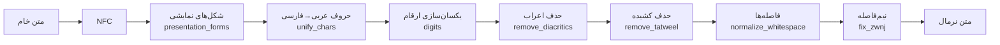

# درس ۰۲ — نرمال‌سازی متن فارسی (Normalization)

> **ماژول:** `parsrag.normalize` · **کد شروع:** `starter/normalize.py` · **تصحیح:** `python -m grader run 02` (۸۹ بررسی) · **پیش‌نیاز:** [درس ۰۱ — RAG در ۵۰ خط](../01-rag-in-50-lines/README.fa.md)

در درس قبل دیدیم که پایپ‌لاین ما برای پرسش «جریمهٔ دیرکرد **کتاب**…» سند قوانین کتابخانه را در رتبهٔ اول پیدا نکرد، چون در آن سند «**كتاب**» نوشته شده بود. این دو کلمه برای ما یکی‌اند، اما برای کامپیوتر نه:

```python
>>> "کتاب" == "كتاب"
False
>>> [hex(ord(c)) for c in "کك"]
['0x6a9', '0x643']     # ک فارسی (KEHEH)  و  ك عربی (KAF)
```

**نرمال‌سازی (Normalization)** یعنی یکدست و استاندارد کردن متن، تا نوشتارهای مختلفِ یک چیز به یک رشتهٔ واحد برسند. برای فارسی این مرحله اختیاری نیست، بلکه یکی از پربازده‌ترین کارهایی است که می‌توانید برای کیفیت جست‌وجو انجام دهید. در این درس آن را می‌سازیم و **با عدد** نشان می‌دهیم چقدر مهم است.

## مشکلات رایج متن فارسی

| مشکل | مثال | چرا پیش می‌آید؟ |
|---|---|---|
| حروف عربی به‌جای فارسی | `علي`، `كتاب` | صفحه‌کلید عربی، متن‌های قدیمی، برخی سیستم‌عامل‌ها |
| سه دستگاه رقم | `۱۲`، `١٢`، `12` | ارقام فارسی (U+06F0)، عربی-هندی (U+0660) و لاتین — شبیه‌اند ولی کدشان فرق دارد |
| نیم‌فاصله (ZWNJ) | `می شود` / `میشود` / `می‌شود` | نیم‌فاصله (U+200C) را خیلی‌ها تایپ نمی‌کنند یا با فاصله عوضش می‌کنند |
| اعراب (Diacritics) | `مُحَمَّد` | متن‌های آموزشی و دینی، تأکید |
| کشیده (Tatweel) | `گارانـــتی` | تزیین در عنوان‌ها و تبلیغات |
| شکل‌های نمایشی (Presentation forms) | `ﺭﺍﻳﮕﺎﻥ` | کپی متن از PDF |
| فاصله‌های اضافه | `سلام    دنیا .` | تایپ دستی، تبدیل فرمت |

همهٔ این‌ها عمداً در اسناد `data/fixtures/corpus/` گنجانده شده‌اند (جدول کامل در `data/fixtures/README.md`).

## طراحی ماژول

هر گام یک تابع کوچک و خالص (Pure function) است و با `NormalizerConfig` می‌توانید هر کدام را خاموش یا روشن کنید:



```python
from parsrag.normalize import normalize, Normalizer, NormalizerConfig

normalize("كتاب هاي  من ۱۲٣")             # 'کتاب‌های من 123'
normalize("۱۲٣", digits="fa")             # '۱۲۳'
normalize("كتاب ها", fix_zwnj=False)       # 'کتاب ها'

clean = Normalizer(NormalizerConfig(digits="fa"))
clean("قيمت: ٣٥ هزار تومان .")             # 'قیمت: ۳۵ هزار تومان.'
```

### چند تصمیم طراحی (و دلیلشان)

- **چرا ارقام پیش‌فرض لاتین‌اند (`digits="en"`)؟** برای *جست‌وجو* فقط یکسان بودن مهم است، نه شکل. توکن‌سازها و مدل‌های برداری ارقام لاتین را خیلی بیشتر دیده‌اند. برای *نمایش* به کاربر می‌توانید `digits="fa"` بگذارید.
- **همزه و مد را نگه می‌داریم.** `آ` و `هٔ` جزء املای فارسی‌اند، نه اعراب. اول متن را با NFC یکپارچه می‌کنیم تا «ا + ◌ٓ» به `آ` تبدیل شود.
- **`fix_zwnj` محافظه‌کار است.** «می رود» را به «می‌رود» تبدیل می‌کند، ولی به «میرود» (چسبیده) دست نمی‌زند، چون بدون فرهنگ لغت نمی‌توان آن را از «میز» یا «میوه» تشخیص داد. همین‌طور «خشک و تر» دست نمی‌خورد، چون «تر» این‌جا پسوند نیست. **تغییر اشتباه بدتر از تغییر ندادن است.**
- **ترتیب مهم است.** شکل‌های نمایشی PDF با NFKC به `ك` عربی تبدیل می‌شوند؛ پس باید *قبل از* یکسان‌سازی حروف اجرا شوند. فاصله‌ها را هم قبل از نیم‌فاصله مرتب می‌کنیم تا «کتاب    ها» هم درست شود.

## اندازه‌گیری: نرمال‌سازی چقدر کمک می‌کند؟

ادعا بدون عدد ارزشی ندارد. همان پایپ‌لاین درس ۰۱ را دو بار روی ۵۹ پرسشِ پاسخ‌دار اجرا می‌کنیم: یک بار روی متن خام، یک بار با نرمال‌سازی اسناد **و** پرسش‌ها. معیار، **نرخ اصابت (Hit rate@k)** است: در چند درصد از پرسش‌ها سند درست در k نتیجهٔ اول بوده است؟

```bash
python examples/normalization_impact.py
```

```text
Hit-rate on 59 answerable fixture questions (HashingEmbedding)

chunk size |  raw @1  norm @1 |  raw @3  norm @3
----------------------------------------------------
       200 |   0.763    0.831 |   0.847    0.949
       300 |   0.814    0.898 |   0.864    0.949
       400 |   0.763    0.864 |   0.864    0.966
```

با قطعه‌های ۳۰۰ نویسه‌ای، **hit@1 از ۸۱٪ به ۹۰٪** رسید (۴۸ → ۵۳ پرسش از ۵۹) و hit@3 از ۸۶٪ به ۹۵٪. پنج پرسشی که درست شدند (`q03`، `q15`، `q18`، `q19`، `q23`) همه به اسنادی تعلق دارند که با حروف عربی نوشته شده‌اند، و هیچ پرسشی بدتر نشد. در هر سه اندازهٔ قطعه، نرمال‌سازی بهتر بود. این عددها در تست `tests/test_pipeline.py` تثبیت شده‌اند تا اگر چیزی خراب شد، متوجه شویم.

### کدام گام بیشترین اثر را دارد؟ آزمایش جداسازی (Ablation)

هر بار یک گام را خاموش می‌کنیم (قطعه‌های ۳۰۰ نویسه‌ای):

```text
config                           @1     @3
all steps                     0.898  0.949
without presentation_forms    0.898  0.949
without unify_chars           0.814  0.831
without digits                0.898  0.949
without remove_diacritics     0.915  0.949
without remove_tatweel        0.898  0.949
without fix_zwnj              0.898  0.949
without normalize_whitespace  0.898  0.949
```

نتیجهٔ صادقانه:

- **یکسان‌سازی حروف** (`unify_chars`) بیشترین اثر را دارد؛ بدون آن hit@1 حدود ۸ واحد درصد (۵ پرسش) و hit@3 حدود ۱۲ واحد درصد افت می‌کند.
- روی نسخهٔ قبلیِ داده‌ها (۲۴ پرسش) خاموش کردن **یکسان‌سازی ارقام** یک پرسش را جابه‌جا کرده بود؛ با دادهٔ بزرگ‌تر فعلی این اثر دیگر دیده نمی‌شود. این یعنی آن اختلاف بیشتر «نویز» بود تا اثر واقعی. روی ۵۹ پرسش هم، هر پرسش حدود ۱٫۷ واحد درصد ارزش دارد — **اختلاف‌های کوچک را با احتیاط تفسیر کنید.**
- خاموش کردن **حذف اعراب** (`remove_diacritics`) این‌جا hit@1 را یک پرسش (۱٫۷ واحد درصد) *بالا* برده است — دقیقاً همان اندازه‌ای که گفتیم در حد نویز است؛ hit@3 تغییری نمی‌کند.
- بقیهٔ گام‌ها (و حالا ارقام) روی این دادهٔ کوچک و با `HashingEmbedding` **اثر قابل‌اندازه‌گیری ندارند**. دلیلش این است که n-gramهای نویسه‌ای تا حدی در برابر یک اعراب یا یک کشیده مقاوم‌اند و توکن‌ساز ما متن را در نیم‌فاصله هم مثل فاصله می‌شکند. این گام‌ها را نگه می‌داریم چون (۱) هزینه‌ای ندارند، (۲) برای نمایش، جست‌وجوی واژگانی (BM25 در درس ۰۷) و مدل‌های عصبی مهم‌اند، و (۳) در درس‌های بعد دوباره اثرشان را اندازه می‌گیریم.

> درس مهم: **همیشه اندازه بگیرید.** گاهی ساده‌ترین گام بیشترین اثر را دارد و گاهی گامی که «باید مهم باشد» در دادهٔ شما مهم نیست.

## تمرین

فایل `lessons/02-normalization/starter/normalize.py` را باز کنید. ثابت‌ها و تابع `normalize()` (که گام‌ها را کنار هم می‌گذارد) آماده‌اند؛ پیاده‌سازی گام‌ها با شماست:

| تابع | راهنمایی |
|---|---|
| `unify_characters` | `str.maketrans` + `str.translate` |
| `unify_digits` | برای هر هدف یک جدول ترجمه؛ هدف ناشناخته → `ValueError` |
| `remove_diacritics` | `re.sub` روی بازهٔ `[ً-ْٰ]` |
| `remove_tatweel` | `str.replace` |
| `fix_presentation_forms` | `unicodedata.normalize("NFKC", ...)` فقط روی بازه‌های نمایشی |
| `normalize_whitespace` | چند `re.sub` |
| `fix_zwnj` | سخت‌ترین! `re.sub` با lookbehind/lookahead و کلاس حرف فارسی `_L` |

```bash
python -m grader run 02          # ۸۹ بررسی
python -m grader run 02 -v       # نمایش همهٔ موارد ناموفق
```

آخرین بررسی (`normalization improves retrieval`) کد شما را روی پایپ‌لاین واقعی اجرا می‌کند و بررسی می‌کند که hit@1 واقعاً بهتر شده باشد. وقتی سبز شد، شما هم یک بهبود قابل‌اندازه‌گیری ساخته‌اید! 🎉

### برای کنجکاوها

- نرمال‌سازی را فقط روی اسناد (نه پرسش‌ها) اعمال کنید. چه می‌شود؟ چرا باید **هر دو** طرف را یکسان نرمال کرد؟
- کتابخانه‌هایی مثل [hazm](https://github.com/roshan-research/hazm) و [parsivar](https://github.com/ICTRC/Parsivar) نرمال‌ساز کامل‌تری دارند (مثلاً با فرهنگ لغت برای «میرود»). چه زمانی افزودن چنین وابستگی‌ای ارزشش را دارد؟

## مطالعهٔ بیشتر

- Unicode Standard Annex #15، *Unicode Normalization Forms* — NFC و NFKC دقیقاً چه می‌کنند: [unicode.org](https://unicode.org/reports/tr15/).
- W3C، *Requirements for Arabic and Persian Text Layout* — نیم‌فاصله، شکل حروف و ارقام از نگاه استاندارد وب: [w3.org](https://www.w3.org/TR/alreq/).

## چالش‌ها (اختیاری)

تمرین‌هایی باز، بدون پاسخ مرجع و بدون بررسی تصحیح‌کننده، برای وقتی که می‌خواهید جلوتر بروید:

1. **متن واقعی.** چند پاراگراف از منبع‌های مختلف (پیام‌رسان، وب‌سایت خبری، PDF اداری) جمع کنید و بشمارید کدام مشکل‌های این درس در آن‌ها پیدا می‌شود. به مشکلی برخوردید که `normalize` پوشش نمی‌دهد؟
2. **نیم‌فاصله برای پسوندهای بیشتر.** قاعده‌های `fix_zwnj` را برای پسوندهایی مثل «ترین»، «هایی» و «ای» گسترش دهید و با چند مثال نشان دهید کجا قاعده اشتباه می‌کند (مثلاً واژه‌هایی که «ها» بخشی از خودِ آن‌هاست).
3. **آزمایش جداسازی روی BM25.** آزمایش جداسازی این درس را با `BM25Retriever` (درس ۰۷) به‌جای `HashingEmbedding` تکرار کنید. آیا گام‌هایی که این‌جا بی‌اثر بودند، آن‌جا اثر دارند؟

## درس بعد

[درس ۰۳ — بارگذاری اسناد فارسی](../03-loading-documents/README.fa.md): جایی که دردسر واقعی شکل‌های نمایشی و مشکلات راست‌به‌چپ آشکار می‌شود.
