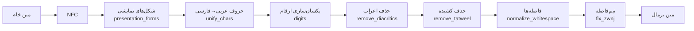

# درس ۰۲ — نرمال‌سازی متن فارسی

در درس قبل دیدیم که پایپ‌لاین ما برای پرسش «جریمهٔ دیرکرد **کتاب**…» سند قوانین کتابخانه را در رتبهٔ اول پیدا نکرد، چون آن سند نوشته بود «**كتاب**». این دو کلمه برای ما یکی‌اند، اما برای کامپیوتر نه:

```python
>>> "کتاب" == "كتاب"
False
>>> [hex(ord(c)) for c in "کك"]
['0x6a9', '0x643']     # ک فارسی (KEHEH)  و  ك عربی (KAF)
```

**نرمال‌سازی (Normalization)** یعنی تبدیل متن به یک شکل یکسان و استاندارد، تا نوشتارهای مختلفِ یک چیز به یک رشته تبدیل شوند. برای فارسی این مرحله اختیاری نیست؛ یکی از پربازده‌ترین کارهایی است که می‌توانید برای کیفیت جست‌وجو انجام دهید. در این درس آن را می‌سازیم و **با عدد** نشان می‌دهیم چقدر مهم است.

## مشکلات رایج متن فارسی

| مشکل | مثال | چرا پیش می‌آید؟ |
|---|---|---|
| حروف عربی به‌جای فارسی | `علي`، `كتاب` | صفحه‌کلید عربی، متن‌های قدیمی، برخی سیستم‌عامل‌ها |
| سه دستگاه رقم | `۱۲`، `١٢`، `12` | ارقام فارسی (U+06F0)، عربی-هندی (U+0660) و لاتین — شبیه‌اند ولی کدشان فرق دارد |
| نیم‌فاصله (ZWNJ) | `می شود` / `میشود` / `می‌شود` | نیم‌فاصله (U+200C) را خیلی‌ها تایپ نمی‌کنند یا با فاصله عوضش می‌کنند |
| اعراب (Diacritics) | `مُحَمَّد` | متون آموزشی و دینی، تأکید |
| کشیده (Tatweel) | `گارانـــتی` | تزئین در عنوان‌ها و تبلیغات |
| شکل‌های نمایشی (Presentation forms) | `ﺭﺍﻳﮕﺎﻥ` | کپی متن از PDF |
| فاصله‌های اضافه | `سلام    دنیا .` | تایپ دستی، تبدیل فرمت |

همهٔ این‌ها عمداً در اسناد `data/fixtures/corpus/` گنجانده شده‌اند (جدول کامل در `data/fixtures/README.md`).

## طراحی ماژول

هر گام یک تابع کوچک و خالص (Pure function) است و `NormalizerConfig` اجازه می‌دهد هر کدام را خاموش یا روشن کنید:



```python
from parsrag.normalize import normalize, Normalizer, NormalizerConfig

normalize("كتاب هاي  من ۱۲٣")             # 'کتاب‌های من 123'
normalize("۱۲٣", digits="fa")             # '۱۲۳'
normalize("كتاب ها", fix_zwnj=False)       # 'کتاب ها'

clean = Normalizer(NormalizerConfig(digits="fa"))
clean("قيمت: ٣٥ هزار تومان .")             # 'قیمت: ۳۵ هزار تومان.'
```

### چند تصمیم طراحی (و دلیلشان)

- **ارقام پیش‌فرض لاتین (`digits="en"`)؟** برای *جست‌وجو* مهم فقط یکسان بودن است، نه شکل. توکنایزرها و مدل‌های برداری ارقام لاتین را خیلی بیشتر دیده‌اند. برای *نمایش* به کاربر می‌توانید `digits="fa"` بگذارید.
- **همزه و مد را نگه می‌داریم.** `آ` و `هٔ` جزء املای فارسی‌اند، نه اعراب. اول متن را با NFC یکپارچه می‌کنیم تا «ا + ◌ٓ» به `آ` تبدیل شود.
- **`fix_zwnj` محافظه‌کار است.** «می رود» را به «می‌رود» تبدیل می‌کند، ولی به «میرود» (چسبیده) دست نمی‌زند، چون بدون فرهنگ لغت نمی‌توان آن را از «میز» یا «میوه» تشخیص داد. همین‌طور «خشک و تر» دست نمی‌خورد چون «تر» این‌جا پسوند نیست. **تغییر اشتباه بدتر از تغییر ندادن است.**
- **ترتیب مهم است.** شکل‌های نمایشی PDF با NFKC به `ك` عربی تبدیل می‌شوند؛ پس باید *قبل از* یکسان‌سازی حروف اجرا شوند. فاصله‌ها را هم قبل از نیم‌فاصله مرتب می‌کنیم تا «کتاب    ها» هم درست شود.

## اندازه‌گیری: نرمال‌سازی چقدر کمک می‌کند؟

ادعا بدون عدد ارزشی ندارد. همان پایپ‌لاین درس ۰۱ را دو بار روی ۲۴ پرسشِ پاسخ‌دار اجرا می‌کنیم: یک بار روی متن خام، یک بار با نرمال‌سازی اسناد **و** پرسش‌ها. معیار، **نرخ اصابت (Hit rate@k)** است: در چند درصد پرسش‌ها، سند درست در k نتیجهٔ اول بود؟

```bash
python examples/normalization_impact.py
```

```text
Hit-rate on 24 answerable fixture questions (HashingEmbedding)

chunk size |  raw @1  norm @1 |  raw @3  norm @3
----------------------------------------------------
       200 |   0.750    0.833 |   0.917    1.000
       300 |   0.792    0.958 |   0.917    1.000
       400 |   0.750    0.875 |   0.958    1.000
```

با قطعه‌های ۳۰۰ نویسه‌ای، **hit@1 از ۷۹٪ به ۹۶٪** رسید (۱۹ → ۲۳ پرسش از ۲۴) و hit@3 به ۱۰۰٪. چهار پرسشی که درست شدند (`q01`، `q15`، `q18`، `q24`) همه به اسنادی تعلق دارند که با حروف عربی نوشته شده‌اند. در هر سه اندازهٔ قطعه، نرمال‌سازی بهتر بود. این عددها در تست `tests/test_pipeline.py` قفل شده‌اند تا اگر چیزی خراب شد بفهمیم.

### کدام گام بیشترین اثر را دارد؟ (Ablation)

هر بار یک گام را خاموش می‌کنیم (قطعه‌های ۳۰۰ نویسه‌ای):

```text
config                           @1     @3
all steps                     0.958  1.000
without presentation_forms    0.958  1.000
without unify_chars           0.833  0.875
without digits                0.917  1.000
without remove_diacritics     0.958  1.000
without remove_tatweel        0.958  1.000
without fix_zwnj              0.958  1.000
without normalize_whitespace  0.958  1.000
```

نتیجهٔ صادقانه:

- **یکسان‌سازی حروف** (`unify_chars`) بیشترین اثر را دارد؛ بدون آن hit@1 حدود ۱۲٫۵ واحد درصد (۳ پرسش) افت می‌کند.
- خاموش کردن **یکسان‌سازی ارقام** فقط یک پرسش (`q24`) را جابه‌جا کرد. پرسش‌های ما عدد ندارند، پس این اثر غیرمستقیم است: ارقام اسناد، ویژگی‌های درهم‌سازی‌شده را کمی عوض می‌کنند. روی ۲۴ پرسش، هر پرسش یعنی ۴ واحد درصد — **اختلاف‌های کوچک را با احتیاط تفسیر کنید.**
- بقیهٔ گام‌ها روی این دادهٔ کوچک و با `HashingEmbedding` **اثر قابل‌اندازه‌گیری ندارند**. دلیلش این است که n-gramهای حرفی تا حدی در برابر یک اعراب یا یک کشیده مقاوم‌اند و توکنایزر ما نیم‌فاصله را هم مثل فاصله می‌شکند. این گام‌ها را نگه می‌داریم چون (۱) هزینه‌ای ندارند، (۲) برای نمایش، جست‌وجوی کلمه‌ای (BM25 در درس ۰۷) و مدل‌های عصبی مهم‌اند، و (۳) در درس‌های بعد دوباره اندازه‌شان می‌گیریم.

> درس مهم: **همیشه اندازه بگیرید.** گاهی ساده‌ترین گام بیشترین اثر را دارد و گاهی گامی که «باید مهم باشد» در دادهٔ شما مهم نیست.

## تمرین

فایل `lessons/02-normalization/starter/normalize.py` را باز کنید. ثابت‌ها و تابع `normalize()` (که گام‌ها را کنار هم می‌گذارد) آماده‌اند؛ شما گام‌ها را پیاده می‌کنید:

| تابع | راهنمایی |
|---|---|
| `unify_characters` | `str.maketrans` + `str.translate` |
| `unify_digits` | برای هر هدف یک جدول ترجمه؛ هدف ناشناخته → `ValueError` |
| `remove_diacritics` | `re.sub` روی بازهٔ `[ً-ْٰ]` |
| `remove_tatweel` | `str.replace` |
| `fix_presentation_forms` | `unicodedata.normalize("NFKC", ...)` فقط روی بازه‌های نمایشی |
| `normalize_whitespace` | چند `re.sub` |
| `fix_zwnj` | سخت‌ترین! `re.sub` با lookbehind/lookahead و کلاس حرف فارسی `_L` |

```bash
python -m grader run 02          # ۷۴ بررسی
python -m grader run 02 -v       # نمایش همهٔ موارد ناموفق
```

آخرین بررسی (`normalization improves retrieval`) کد شما را روی پایپ‌لاین واقعی اجرا می‌کند و چک می‌کند که hit@1 واقعاً بهتر شود. وقتی سبز شد، شما هم یک بهبود قابل‌اندازه‌گیری ساخته‌اید! 🎉

### برای کنجکاوها

- نرمال‌سازی را فقط روی اسناد (نه پرسش‌ها) اعمال کنید. چه می‌شود؟ چرا باید **هر دو** طرف را یکسان نرمال کرد؟
- کتابخانه‌هایی مثل [hazm](https://github.com/roshan-research/hazm) و [parsivar](https://github.com/ICTRC/Parsivar) نرمال‌ساز کامل‌تری دارند (مثلاً با فرهنگ لغت برای «میرود»). چه زمانی ارزش افزودن چنین وابستگی‌ای را دارد؟

درس بعد: **بارگذاری اسناد فارسی** (PDF، DOCX، HTML) — جایی که شکل‌های نمایشی و مشکلات راست‌به‌چپ واقعاً خودشان را نشان می‌دهند.
