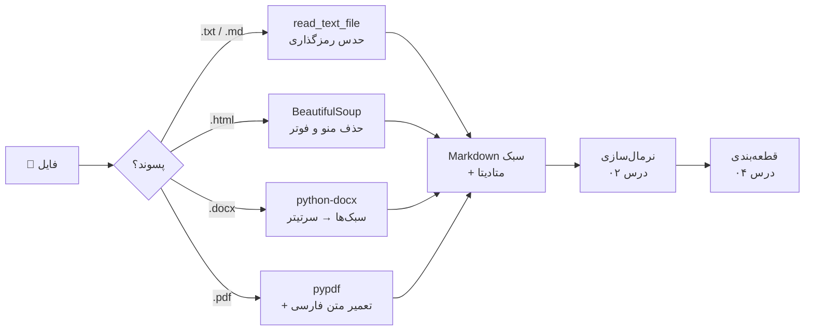
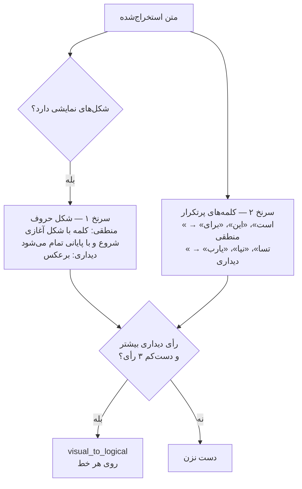
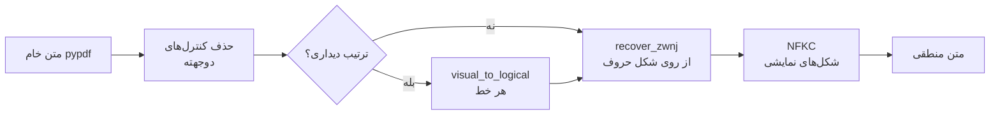

# درس ۰۳ — بارگذاری اسناد فارسی (Loading documents)

> **ماژول:** `parsrag.loaders` · **کد شروع:** `starter/loaders.py` · **تصحیح:** `python -m grader run 03` (۳۶ بررسی) · **پیش‌نیاز:** [درس ۰۲ — نرمال‌سازی متن فارسی](../02-normalization/README.fa.md)

تا این‌جا اسناد ما فایل‌های تمیز `.md` بودند. در دنیای واقعی، دانش یک سازمان در **PDF**، **Word (DOCX)**، **صفحه‌های وب (HTML)** و فایل‌های متنی قدیمی پخش است. گام **بارگذاری (Loading)** باید از همهٔ این‌ها متنی تمیز و قابل‌جست‌وجو بیرون بکشد — و برای فارسی، این گام پر از دام است.

یک جمله را به خاطر بسپارید: **اگر متن در گام بارگذاری خراب شود، هیچ مدل برداری و هیچ LLMای نمی‌تواند نجاتش بدهد.** (Garbage in, garbage out.)

در این درس `parsrag.loaders` را می‌سازیم و چهار مشکل واقعی فارسی را — با عدد — حل می‌کنیم.

## خروجی یک بارگذار

هر بارگذار (Loader) یک `Document` برمی‌گرداند. متن آن یک **Markdown سبک** است (سرتیترها به خط‌های `#` تبدیل می‌شوند) و در `metadata` ثبت می‌شود که هر تکه از کجا آمده:

```python
from parsrag.loaders import load_document, locate

doc = load_document("data/fixtures/documents/kahroba-installation-guide.docx")
doc.metadata["sections"][:2]
# [{'title': 'راهنمای نصب کولر گازی کهربا', 'level': 1, 'start': 0,   'end': 703},
#  {'title': 'پیش از نصب',                  'level': 2, 'start': 109, 'end': 268}]

locate(doc, doc.text.index("فیوز"))
# {'page': None, 'section': 'پیش از نصب', 'section_path': ['راهنمای نصب کولر گازی کهربا', 'پیش از نصب']}
```

`start` و `end` **آفست نویسه‌ای (Character offset)** در `doc.text` هستند. برای PDF فهرست `pages` هم داریم. در درس ۰۴ هر قطعه با کمک `locate` می‌فهمد از کدام صفحه و کدام بخش آمده، تا پاسخ نهایی بتواند بگوید «صفحهٔ ۲، بخش گارانتی».



TXT و Markdown به هیچ بستهٔ اضافه‌ای نیاز ندارند؛ برای بقیه:

```bash
pip install -e ".[loaders]"     # pypdf, python-docx, beautifulsoup4
```

این بسته‌ها **تنبل (Lazy)** import می‌شوند: `import parsrag.loaders` همیشه کار می‌کند و فقط وقتی PDF باز می‌کنید `pypdf` لازم است.

## فایل‌های نمونه

همهٔ فایل‌های `data/fixtures/documents/` متن اصیل همین مخزن‌اند. فایل‌های دودویی (PDF و DOCX) با اسکریپت `data/fixtures/build_fixtures.py` از متن‌های `sources/` ساخته شده‌اند تا هر کسی بتواند ببیند دقیقاً چه چیزی داخلشان است:

| فایل | چه مشکلی را شبیه‌سازی می‌کند |
|---|---|
| `kahroba-notice.txt` | رمزگذاری قدیمی ویندوز (Windows-1256) با `ي`/`ك` عربی |
| `mehregan-events.html` | منو، مسیر راهنما (Breadcrumb)، بنر کوکی، نوار کناری و فوتر؛ موجودیت `&zwnj;` و نشانهٔ LRM |
| `kahroba-installation-guide.docx` | سرتیتر، فهرست، جدول، و نشانه‌های نامرئی RLM دور شماره‌مدل‌های لاتین |
| `kahroba-catalog.pdf` | حروف ذخیره‌شده به شکل **Presentation Forms** و نیم‌فاصله‌های گم‌شده |
| `mehregan-newsletter.pdf` | همان مشکل‌ها، به‌علاوهٔ **ترتیب دیداری (Visual order)** — متن برعکس استخراج می‌شود |

هر دو PDF روی صفحه **کاملاً درست** دیده می‌شوند. مشکل فقط وقتی پیدا می‌شود که متنشان را بیرون بکشید — دقیقاً مثل PDFهای واقعی.

## مشکل ۱ — رمزگذاری قدیمی (TXT)

فایل‌های متنی قدیمی فارسی اغلب با **Windows-1256** ذخیره شده‌اند، نه UTF-8. اگر فرض کنید همه‌چیز UTF-8 است، یا خطا می‌گیرید یا متن به‌هم‌ریخته. `read_text_file` به این ترتیب امتحان می‌کند:

1. اگر BOM داشت (UTF-8 یا UTF-16)، به آن اعتماد کن؛
2. UTF-8 سخت‌گیرانه؛
3. در آخر cp1256.

چرا cp1256 **آخر**؟ چون هر دنباله‌ای از بایت‌ها را بدون خطا رمزگشایی می‌کند — حتی اگر حدسمان غلط باشد. پس فقط وقتی سراغش می‌رویم که UTF-8 شکست خورده باشد.

```python
read_text_file("data/fixtures/documents/kahroba-notice.txt")
# ('اطلاعيه فروشگاه كهربا\nبه اطلاع مشتريان گرامي ...', 'cp1256')
```

دقت کنید: متن هنوز `ي` و `ك` عربی دارد (آن نرم‌افزارهای قدیمی همین را ذخیره می‌کردند) و «اطلاعیهٔ» بدون همزه شده، چون cp1256 همزهٔ روی «ه» را ندارد. بخش اول را نرمال‌سازی درس ۰۲ درست می‌کند؛ بخش دوم برای همیشه از دست رفته است.

## مشکل ۲ — اسکلت صفحهٔ وب (HTML)

در یک صفحهٔ وب، متن اصلی معمولاً کمتر از نیمی از کل متن است. منو، فوتر و بنر کوکی در **همهٔ** صفحه‌های یک سایت تکرار می‌شوند و اگر نمایه شوند، جست‌وجو را آلوده می‌کنند (پرسش «عضویت» به‌جای صفحهٔ عضویت، به منوی همهٔ صفحه‌ها می‌خورد!).

`remove_boilerplate` سه نشانه را بررسی می‌کند: نام برچسب (`nav`، `header`، `footer`، `aside`، `script`...)، ویژگی `role` (مثل `navigation`)، و نام‌های `class`/`id` شبیه `cookie`، `breadcrumb` و `sidebar`. بعد سرتیترها به `#` و ردیف‌های جدول به `a | b` تبدیل می‌شوند:

```text
# رویدادهای پاییز کتابخانهٔ مهرگان

در فصل پاییز، کتابخانه برنامه‌های تازه‌ای ... برگزار می‌کند. ...

## هفتهٔ کتاب
...
کارگاه داستان‌نویسی | ۲۰۰ هزار تومان | ۴۰۰ هزار تومان
```

این قاعده‌های ساده برای بیشتر سایت‌ها کافی‌اند؛ برای سایت‌های پیچیده ابزارهای تخصصی‌تری مثل [trafilatura](https://github.com/adbar/trafilatura) هم هست.

## مشکل ۳ — شکل‌های نمایشی (Presentation Forms) در PDF

حروف عربی‌نویس بسته به جایشان در کلمه شکل عوض می‌کنند: «ب» در `بابا` آغازی (Initial) است، در `صبر` میانی (Medial)، در `کتاب` پایانی (Final) و تنها (Isolated). PDF **شکلِ کشیده‌شده** (Glyph) را ذخیره می‌کند، نه حرف را. خیلی از تولیدکننده‌های PDF به‌جای حرف `ب` (U+0628)، کد شکلِ آن را می‌نویسند — مثلاً `ﺑ` (U+FE91، BEH INITIAL FORM). نتیجه:

```python
>>> raw = load_pdf("data/fixtures/documents/kahroba-catalog.pdf", repair=False).text
>>> raw.splitlines()[0]
'ﮐﺎﺗﺎﻟﻮﮒ ﻟﻮﺍﺯﻡ ﺑﺮﻗﯽ ﮐﻬﺮﺑﺎ - ﭘﺎﯾﯿﺰ 1404'          # روی صفحه درست است...
>>> [hex(ord(c)) for c in raw[:4]]
['0xfb90', '0xfe8e', '0xfe97', '0xfe8e']           # ...ولی هیچ‌کدام حرف معمولی نیست
```

برای کامپیوتر `ﮐﺎﺗﺎﻟﻮﮒ` و `کاتالوگ` هیچ نویسهٔ مشترکی ندارند. راه‌حل، **NFKC** یونیکد است که هر شکل نمایشی را به حرف پایه برمی‌گرداند — همان `fix_presentation_forms` درس ۰۲. (یادتان هست که گفتیم باید *قبل از* یکسان‌سازی حروف اجرا شود؟ چون `ﻙ` با NFKC به `ك` عربی تبدیل می‌شود.)

## مشکل ۴ — ترتیب دیداری (Visual Order)

متن فارسی در حافظه به **ترتیب منطقی (Logical order)** ذخیره می‌شود: اول حرفی که اول خوانده می‌شود. نمایش راست‌به‌چپ کار نرم‌افزار نمایش است. ولی ابزارهای قدیمی‌تر PDF، هر خط را به **ترتیب دیداری** — از چپ به راست، همان‌طور که روی کاغذ کشیده می‌شود — نوشته‌اند. نتیجه، متن وارونه است:

```text
خروجی خام:        .ﺪﻨﮐﯽﻣ ﺐﺼﻧ ﻪﻧﺎﺒﺷ ﺖﻧﺎﻣﺍ ﯼﺍﺮﺑ ﺪﻨﻤﺷﻮﻫ ٔﻪﺴﻔﻗ ﮏﯾ ﻩﺎﻣ ﻦﯾﺍ ﺯﺍ ﺭﺍﺪﯿﭙﺳ ٔﻪﻧﺎﺨﺑﺎﺘﮐ
فقط با NFKC:      .دنکیم بصن هنابش تناما یارب دنمشوه ٔهسفق کی هام نیا زا رادیپس ٔهناخباتک
```

### تشخیص: از کجا بفهمیم متن برعکس است؟

`visual_order_votes` دو سرنخ مستقل را می‌شمارد:



روی خبرنامهٔ نمونه، شمارش آرا `(منطقی ۰، دیداری ۱۰۲)` است. کلمه‌هایی مثل «در/رد» یا «هم/مه» را عمداً کنار گذاشته‌ایم چون وارونه‌شان هم کلمهٔ واقعی است. آستانهٔ «دست‌کم ۳ رأی» هم جلوی تصمیم‌گیری روی تکه‌متن‌های خیلی کوتاه را می‌گیرد: **تغییر اشتباه بدتر از تغییر ندادن است.**

### اصلاح: وارونه کردن، ولی نه همه‌چیز

اعداد و کلمه‌های لاتین در یک خط راست‌به‌چپ همچنان چپ‌به‌راست نمایش داده می‌شوند، پس در متن دیداری *برعکس نشده‌اند*. `visual_to_logical` خط را به **توکن** می‌شکند — هر عدد یا عبارت لاتین یک توکن، هر نویسهٔ دیگر یک توکن — و ترتیب توکن‌ها را برعکس می‌کند:

```python
visual_to_logical("تسا 45 تمیق")           # 'قیمت 45 است'
visual_to_logical("تسا PDF file هخسن")     # 'نسخه PDF file است'
visual_to_logical("(مالس)")                # '(سلام)'   ← پرانتزها آینه‌ای می‌شوند
```

**محدودیت‌ها را صادقانه بگویید:** این یک روش ابتکاری (Heuristic) است، نه الگوریتم کامل دوجهتهٔ یونیکد (Unicode Bidirectional Algorithm). صفحه‌های چندستونی، خط‌هایی که *قبل از* وارونه‌شدن شکسته شده‌اند، و ترکیب‌های پیچیدهٔ عدد و علامت ممکن است هنوز اشتباه دربیایند. همیشه چند صفحه را با چشم بررسی کنید.

## مشکل ۵ — نیم‌فاصلهٔ گم‌شده

نیم‌فاصله (ZWNJ) شکل ندارد؛ فقط جلوی چسبیدن دو حرف را می‌گیرد. پس در PDF **ذخیره نمی‌شود** و `می‌شود` به `میشود` تبدیل می‌شود. نرمال‌ساز درس ۰۲ عمداً به `میشود` دست نمی‌زند (بدون فرهنگ لغت نمی‌شود آن را از «میز» تشخیص داد).

ولی تا وقتی شکل‌های نمایشی را داریم، یک سرنخ طلایی باقی است: در `ﻣﯽﺷﻮﺩ`، حرف «ی» در **شکل پایانی** است و «ش» بعد از آن در **شکل آغازی**. «ی» حرفی دوطرفه‌چسبان (Dual-joining) است و می‌توانست به «ش» بچسبد؛ نچسبیده، پس آن‌جا نیم‌فاصله بوده! `recover_zwnj` دقیقاً همین را بررسی می‌کند. برای حرف‌هایی مثل «ا»، «د» و «و» که هیچ‌وقت به حرف بعد نمی‌چسبند (`کتابخانه`، `دارد`) نیم‌فاصله اضافه نمی‌شود.

> ترتیب حیاتی است: اول ترتیب دیداری را درست کنید، بعد نیم‌فاصله را از روی شکل‌ها بازیابی کنید، و **فقط بعد از آن** NFKC بزنید — NFKC اطلاعات شکل را برای همیشه پاک می‌کند.

## مشکل ۶ — خط‌های ترکیبی و نشانه‌های نامرئی

وقتی در یک پاراگراف فارسی کلمهٔ لاتین می‌آید («مدل KX-2400»)، Word و مرورگرها برای درست نمایش‌دادن، نویسه‌های نامرئی **کنترل جهت** (Bidi controls) مثل RLM (U+200F) و LRM (U+200E) اضافه می‌کنند. چشم آن‌ها را نمی‌بیند، ولی `"KX-2400" in text` شکست می‌خورد و توکن‌ها به‌هم می‌ریزند. `strip_bidi_controls` همه را حذف می‌کند — **به‌جز نیم‌فاصله**، که بخشی از املای فارسی است.

## کنار هم: `repair_pdf_text`



```python
from parsrag.loaders import load_pdf

doc = load_pdf("data/fixtures/documents/mehregan-newsletter.pdf")
doc.metadata["pages"]   # [{'page': 1, 'start': 0, 'end': 451, 'visual_order': True}]
doc.text.splitlines()[1]
# 'کتابخانهٔ مهرگان از این ماه یک قفسهٔ هوشمند برای امانت شبانه نصب می‌کند.'
```

## اندازه‌گیری: هر گام چقدر متن را برمی‌گرداند؟

```bash
python examples/pdf_repair_impact.py
```

متن استخراج‌شده را با متن اصلی (`sources/`) مقایسه می‌کنیم. **بازیابی کلمه (Word recall)** یعنی چند درصد کلمه‌های متن اصلی، دقیقاً همان‌طور در خروجی پیدا می‌شوند (کلمه‌ها با فاصله جدا می‌شوند، پس نیم‌فاصلهٔ گم‌شده هم خطا حساب می‌شود). **عبارت‌ها** یعنی چند عبارت کلیدی با جست‌وجوی سادهٔ زیررشته پیدا می‌شوند:

```text
kahroba-catalog.pdf
step                           word recall  phrases  exact
raw pypdf text                       0.076      0/3  False
+ NFKC presentation forms            0.938      2/3  False
+ visual-order fix                   0.938      2/3  False
+ ZWNJ recovery (= load_pdf)         1.000      3/3   True

mehregan-newsletter.pdf
step                           word recall  phrases  exact
raw pypdf text                       0.067      0/3  False
+ NFKC presentation forms            0.080      0/3  False
+ visual-order fix                   0.893      2/3  False
+ ZWNJ recovery (= load_pdf)         1.000      3/3   True
```

- متن خام PDF عملاً **غیرقابل‌جست‌وجو** است: فقط ۷٪ کلمه‌ها (همان عددها!) پیدا می‌شوند.
- برای کاتالوگ، NFKC به‌تنهایی ۹۴٪ را برمی‌گرداند؛ ۶٪ باقی‌مانده کلمه‌های نیم‌فاصله‌دارند.
- برای خبرنامهٔ وارونه، NFKC تقریباً هیچ کمکی نمی‌کند (۸٪)؛ اصلاح ترتیب، عدد را به ۸۹٪ می‌رساند.
- بازیابی نیم‌فاصله، هر دو را به **۱۰۰٪ و متنِ دقیقاً یکسان** می‌رساند.

**هشدار صادقانه:** این دو PDF را خودمان با شبیه‌ساز `parsrag` ساخته‌ایم، پس دقیقاً از همان مدلی پیروی می‌کنند که کد تعمیر فرض می‌کند. «۱۰۰٪» یعنی کد درست کار می‌کند، **نه** این‌که روی هر PDF واقعی ۱۰۰٪ می‌گیرید. PDFهای واقعی ستون‌بندی، سرصفحه و پاصفحه، فونت‌های بدون جدول ToUnicode و گاهی متنِ تصویری دارند. ابزارهای مختلف استخراج (pypdf، pdfminer.six، PyMuPDF) هم نتیجه‌های متفاوتی می‌دهند. PDFهای اسکن‌شده اصلاً متن ندارند و به **نویسه‌خوانی نوری (OCR)** نیاز دارند (مثلاً Tesseract با مدل زبان `fas`) که خارج از این درس است.

## تمرین

فایل `lessons/03-loading-documents/starter/loaders.py` را باز کنید. جدول شکل حروف، شبیه‌ساز شکل‌دهی (`shape`) و لولهٔ اصلی خواندن فایل‌ها آماده‌اند؛ تعمیرهای فارسی با شماست:

| تابع | راهنمایی |
|---|---|
| `strip_bidi_controls` | `re.sub` با کلاس نویسهٔ `BIDI_CONTROLS` |
| `read_text_file` | BOM → UTF-8 → cp1256؛ `\r\n` → `\n` |
| `markdown_sections` | `_HEADING_RE.finditer`؛ پایان بخش = سرتیتر بعدی با سطح ≤ |
| `visual_to_logical` | توکن‌سازی با `_LTR_RUN_RE`، برعکس کردن، آینه کردن پرانتزها |
| `visual_order_votes` | `GLYPH_INFO[glyph] → (base, form)` و فهرست کلمه‌های پرتکرار |
| `recover_zwnj` | `joins_both_sides`، `joins_right` و شکل حروف دو طرف |
| `repair_pdf_text` | ترتیب: کنترل‌ها → ترتیب دیداری → نیم‌فاصله → NFKC |
| `remove_boilerplate` | `soup.find_all(...)` و `tag.decompose()` |
| `heading_level` | `Title` → ۱، `Heading N` → N+1 |
| `load_pdf` | آفست صفحه‌ها با جداکنندهٔ `\n\n` |

```bash
pip install -e ".[loaders]"
python -m grader run 03          # ۳۶ بررسی
python -m grader run 03 -v
```

اگر بستهٔ `loaders` نصب نباشد، بررسی‌های HTML/DOCX/PDF با پیام راهنما **رد (Skip)** می‌شوند، نه این‌که شکست بخورند. آخرین بررسی، کار شما را روی جست‌وجوی واقعی امتحان می‌کند: بعد از تعمیر، پرسش «قفسهٔ هوشمند برای امانت شبانه» باید خبرنامه را پیدا کند. 🎉

### برای کنجکاوها

- یک PDF فارسی واقعی از کامپیوتر خودتان را با `load_pdf(path, repair=False)` و `load_pdf(path)` باز کنید. کدام‌یک از مشکل‌های این درس را دارد؟ `visual_order_votes` چه می‌گوید؟
- همان PDF را با [pdfplumber](https://github.com/jsvine/pdfplumber) یا [PyMuPDF](https://github.com/pymupdf/PyMuPDF) هم استخراج کنید. خروجی‌ها چه فرقی دارند؟
- چرا `recover_zwnj` باید **قبل از** NFKC اجرا شود؟ ترتیب را عوض کنید و تست‌ها را اجرا کنید.
- `visual_to_logical("فیفخت 50%")` را اجرا کنید. نمایش‌دهنده‌ها «50%» را یک واحد چپ‌به‌راست می‌دانند، ولی خروجی ما `%50 تخفیف` است. چرا؟ `_LTR_RUN_RE` را طوری درست کنید که علامت درصد (`%` و `٪`) بعد از عدد را هم بگیرد.

## مطالعهٔ بیشتر

- Unicode Standard Annex #9، *Unicode Bidirectional Algorithm* — الگوریتم کاملی که `visual_to_logical` فقط تقریبی از آن است: [unicode.org](https://unicode.org/reports/tr9/).
- [مستندات pypdf](https://pypdf.readthedocs.io/) — استخراج متن و محدودیت‌هایش.
- برای PDF اسکن‌شده: Tesseract با مدل زبان فارسی (`fas`) در [tessdata](https://github.com/tesseract-ocr/tessdata).

## چالش‌ها (اختیاری)

تمرین‌هایی باز، بدون پاسخ مرجع و بدون بررسی Grader، برای وقتی که می‌خواهید جلوتر بروید:

1. **PDF واقعی.** یک PDF فارسی واقعی (مثلاً یک بخش‌نامه یا گزارش عمومی) را با `load_pdf(path, repair=False)` و با `repair=True` بخوانید. برای چند جمله، متن درست را دستی بنویسید و بازیابی کلمه را حساب کنید. کدام مشکل‌ها در شبیه‌ساز ما نبودند؟
2. **جدول‌ها.** بارگذار DOCX جدول‌ها را چطور به متن تبدیل می‌کند؟ راهی پیشنهاد و پیاده کنید که هر سطر جدول با سرستون‌هایش یک جملهٔ قابل‌جست‌وجو شود، و اثرش را روی چند پرسش دربارهٔ جدول بسنجید.

## درس بعد

[درس ۰۴ — قطعه‌بندی متن فارسی](../04-chunking/README.fa.md): حالا که متن تمیز و ساختار (سرتیتر، صفحه) را داریم، از آن برای ساختن قطعه‌های بهتر استفاده می‌کنیم.
