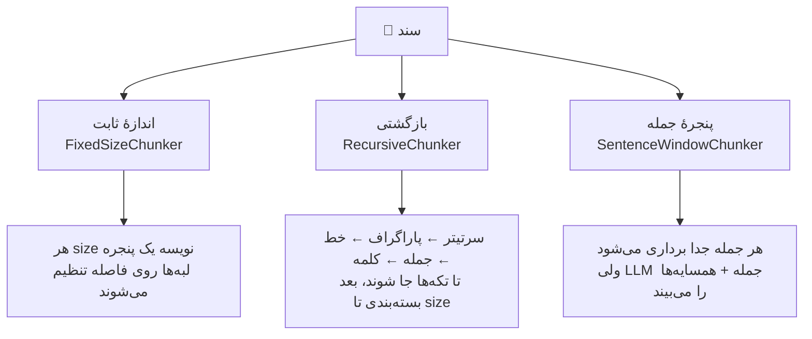
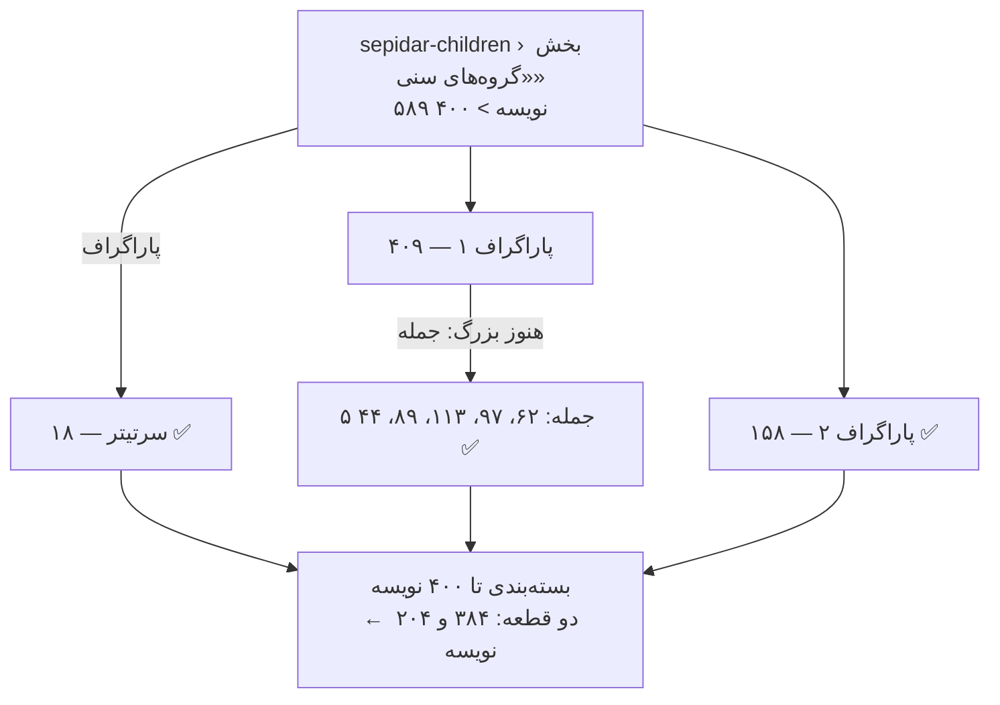
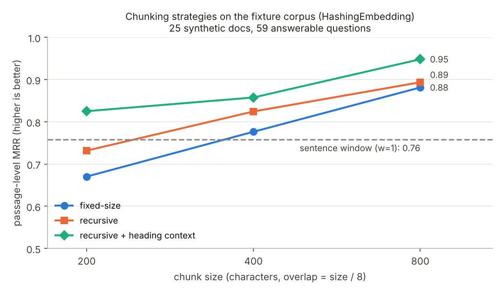

# درس ۰۴ — قطعه‌بندی متن فارسی

در درس ۰۱ متن را هر ۴۰۰ نویسه با قیچی بریدیم و دیدیم که پاسخ وسط کلمه قطع می‌شود («...در شهر اصفهان است و دَست»). حالا که در درس ۰۳ متن تمیز و **ساختار** سند (سرتیتر، صفحه) را داریم، وقت آن است که هوشمندانه‌تر ببریم.

## چرا اصلاً قطعه‌بندی؟

**قطعه‌بندی (Chunking)** یعنی شکستن هر سند به تکه‌هایی که جداگانه برداری‌سازی و بازیابی می‌شوند. دو نیروی مخالف داریم:

| قطعهٔ کوچک | قطعهٔ بزرگ |
|---|---|
| ✅ بردارش دقیق دربارهٔ یک موضوع است | ✅ زمینهٔ کافی برای فهمیدن پاسخ دارد |
| ❌ ممکن است پاسخ را نصفه داشته باشد | ❌ بردارش میانگینِ چند موضوع است و «رقیق» می‌شود |
| ❌ بی‌زمینه است («این هزینه» کدام هزینه؟) | ❌ متن بیشتری به LLM می‌رود: هزینه و نویز بیشتر |

هیچ اندازهٔ جادویی وجود ندارد. باید روی دادهٔ خودتان **اندازه بگیرید** — و این درس دقیقاً همین را نشان می‌دهد. به همین دلیل چهار سند بلند و چندبخشی (۸۰۰ تا ۱۱۰۰ کلمه) به داده‌ها اضافه کرده‌ایم؛ در اسناد ۱۰۰ کلمه‌ای، قطعه‌بندی تقریباً بی‌اهمیت است.

## هر قطعه می‌داند از کجا آمده

همهٔ قطعه‌بندهای `parsrag.chunking` روی **بازه (Span)** کار می‌کنند: `Span(text, start, end)` که همیشه `text == source[start:end]`. `chunk_document` با کمک `locate` از درس ۰۳، صفحه و بخش هر قطعه را هم ثبت می‌کند:

```python
from parsrag.chunking import RecursiveChunker, chunk_document
from parsrag.loaders import load_markdown
from parsrag.normalize import normalize

doc = load_markdown("data/fixtures/corpus/kahroba-seller-guide.md")
chunks = chunk_document(doc, RecursiveChunker(400, 50), preprocess=normalize)
chunks[5].metadata
# {'start': 1540, 'end': 1849, 'index': 5, 'page': None,
#  'section': 'تعریف کالا و قیمت گذاری',
#  'section_path': ['راهنمای فروشندگان بازارچهٔ کهربا', 'تعریف کالا و قیمت گذاری'],
#  'chunker': 'RecursiveChunker'}
```

یک نکتهٔ طراحی: نرمال‌سازی (`preprocess`) **بعد از** بریدن روی متن قطعه اعمال می‌شود. این‌طوری آفست‌ها همیشه به متن اصلی سند اشاره می‌کنند و در درس ۰۹ می‌توانیم دقیقاً همان جملهٔ اصلی را به‌عنوان منبع نشان دهیم.

## جمله در فارسی کجا تمام می‌شود؟

اولین ابزار ما یک **جمله‌بند (Sentence splitter)** فارسی است. به نظر ساده می‌آید — «روی نقطه ببُر» — ولی:

| متن | دام | رفتار `split_sentences` |
|---|---|---|
| `خوبی؟ بله!` | علامت سؤال فارسی `؟` | مرز جمله |
| `بود؛ کافی نبود.` | نقطه‌ویرگول فارسی `؛` | مرز جمله (طبق خواستهٔ این دوره؛ اگر برایتان زیادی ریز است حذفش کنید) |
| `صبر کن... باشه… خب` | سه‌نقطه و `…` | یک مرز، نه سه مرز |
| `واقعاً؟! آره` | ترکیب علامت‌ها | یک مرز |
| `«آیا می‌آیی؟» گفت.` | گیومه بعد از علامت | گیومه جزء جملهٔ اول می‌ماند |
| `قیمت 2.5 میلیون` | ممیز لاتین | مرز نیست (بعد از نقطه فاصله نیامده) |
| `۹٫۶ میلیارد` | ممیز فارسی `٫` (U+066B) | اصلاً نقطه نیست |
| `www.kahroba.ir است.` | نشانی وب | فقط نقطهٔ آخر مرز است |
| `ساعت ۱۰ ق.ظ. شروع شد` | اختصار فارسی (ق.ظ.، ب.ظ.، ه.ش.) | مرز نیست |
| `دکتر م. رضایی` | حرف اول نام | مرز نیست |
| `1. مورد اول` | شمارهٔ فهرست در ابتدای خط | مرز نیست |
| `خط اول⏎خط دوم` | خط‌های بدون نقطه | **خط جدید هم مرز است** — متن فارسی وب و چت پر از جمله‌های بی‌نقطه است |

```python
>>> [s.text for s in split_sentences("ساعت ۱۰ ق.ظ. شروع شد؛ دکتر م. رضایی آمد...\n1. مورد اول")]
['ساعت ۱۰ ق.ظ. شروع شد؛', 'دکتر م. رضایی آمد...', '1. مورد اول']
```

این جمله‌بند بر پایهٔ قاعده است و کامل نیست (مثلاً «ص. ۲۰» را می‌شناسد ولی هر اختصار تازه‌ای را نه). اگر به دقت بیشتری نیاز دارید، کتابخانه‌هایی مثل [hazm](https://github.com/roshan-research/hazm) جمله‌بند آموزش‌دیده دارند — ولی اول اندازه بگیرید که اصلاً لازم است یا نه.

## سه راهبرد



**۱. اندازهٔ ثابت (Fixed-size).** همان روش درس ۰۱، با دو بهبود: آفست دارد، و لبهٔ پنجره به نزدیک‌ترین فاصله عقب می‌رود تا هیچ کلمه‌ای نصف نشود.

**۲. بازگشتی (Recursive).** اول **ساختار**، بعد اندازه:

1. متن در سرتیترها شکسته می‌شود و هر بخش جداگانه قطعه‌بندی می‌شود (قطعه هیچ‌وقت دو بخش را قاطی نمی‌کند).
2. هر تکه‌ای که از `size` بزرگ‌تر است با جداکنندهٔ بعدی شکسته می‌شود: پاراگراف ← خط ← جمله ← کلمه ← (در بدترین حالت) برش سخت.
3. تکه‌های کوچک کنار هم دوباره **بسته‌بندی (Pack)** می‌شوند تا `size`؛ هم‌پوشانی فقط از **تکه‌های کامل** ساخته می‌شود، پس هیچ جمله‌ای در مرز هم‌پوشانی نصف نمی‌شود.



**۳. پنجرهٔ جمله (Sentence window).** هر جمله یک قطعه است (بردار دقیق)، ولی در `metadata["window"]` جملهٔ قبل و بعد هم نگه داشته می‌شود تا LLM زمینه داشته باشد. هم‌پوشانی ذاتی است: پنجره‌های کناری جمله مشترک دارند.

**ترفند: زمینهٔ سرتیتر (Heading context).** با `heading_context=True` عنوان سند و مسیر بخش‌ها اول متنِ قطعه می‌آید:

```text
راهنمای فروشندگان بازارچهٔ کهربا › کارمزد فروش
کارمزد کهربا درصدی از مبلغ فروش هر کالاست ...
```

حالا قطعه‌ای که فقط می‌گوید «۶ درصد تعیین شده است» می‌داند دربارهٔ *کارمزد فروش* در *راهنمای فروشندگان* است.

## توکن: چرا فارسی گران‌تر است؟

مدل‌ها متن را به **توکن (Token)** می‌شکنند و هم سقف ورودی و هم هزینه بر حسب توکن است. بیشتر توکنایزرهای امروزی (BPE بایتی) از **بایت‌های UTF-8** شروع می‌کنند و دنباله‌های پرتکرارِ دادهٔ آموزشی را به یک توکن «ادغام» (Merge) می‌کنند. برای فارسی دو چیز با هم جمع می‌شود:

1. **هر حرف فارسی در UTF-8 دو بایت است** (حرف لاتین یک بایت؛ نیم‌فاصله سه بایت!).
2. **دادهٔ آموزش توکنایزر بیشتر انگلیسی است**، پس دنباله‌های فارسی ادغام‌های کمتری یاد گرفته‌اند و کلمه‌ها به تکه‌های بیشتری شکسته می‌شوند.

این سه جملهٔ هم‌معنی (که برای همین درس نوشته شده‌اند) را بشمارید — این‌ها عددهای واقعی‌اند، نه حدس:

| | نویسه | بایت UTF-8 | تخمین `estimate_tokens` |
|---|---|---|---|
| ۳ جملهٔ انگلیسی | ۱۵۴ | ۱۵۴ | ۴۶ |
| همان ۳ جمله به فارسی | ۱۴۶ | ۲۶۹ | ۶۹ |

تعداد نویسه تقریباً برابر است، ولی فارسی **۱٫۷۵ برابر بایت** دارد. `estimate_tokens` یک مدل عمداً ساده است: برای هر کلمه، `ceil(بایت / ۴)` توکن. عدد ۴ یک **فرض** است، نه ویژگی هیچ ارائه‌دهندهٔ مشخصی؛ نسبت واقعی به توکنایزر مدل شما بستگی دارد. پیش از بودجه‌بندی، متن خودتان را با توکنایزر واقعی مدلتان بشمارید. نتیجهٔ عملی: **اندازهٔ قطعه را برای فارسی بر حسب توکن بسنجید، نه کلمه** — `RecursiveChunker(..., length=estimate_tokens)` دقیقاً همین کار را می‌کند.

## اندازه‌گیری: کدام راهبرد بهتر است؟

```bash
python examples/chunking_benchmark.py            # جدول
python examples/chunking_benchmark.py --chart    # + نمودار (نیاز به: pip install -e ".[dev]")
```

دو سطح ارزیابی داریم (درس ۰۵ این معیارها را دقیق‌تر می‌سازد):

- **سطح سند (Doc-level):** آیا سند درست در نتایج هست؟ (همان معیار درس‌های ۰۱–۰۲)
- **سطح قطعه (Passage-level):** آیا قطعهٔ بازیابی‌شده **واقعاً شاهد پاسخ را در خودش دارد؟** برای این کار هر پرسش در `qa.jsonl` یک `evidence` دارد: عبارتی که عیناً از سند کپی شده. این سخت‌گیرانه‌تر است و برای تولید پاسخ همین مهم است: LLM فقط قطعه را می‌بیند، نه کل سند را.

معیارها: **Recall@k** — در چند درصد پرسش‌ها، پاسخ در k نتیجهٔ اول بود؟ و **MRR (Mean Reciprocal Rank)** — میانگین `۱ / رتبهٔ اولین نتیجهٔ درست` (رتبهٔ ۱ → ۱، رتبهٔ ۲ → ۰٫۵، پیدا نشد → ۰). همه با `HashingEmbedding`، با نرمال‌سازی، روی ۵۹ پرسش پاسخ‌دار؛ هم‌پوشانی = یک‌هشتم اندازه:

```text
strategy                  size chunks avg len   P-R@1  P-R@3  P-R@5  P-MRR  D-R@1  D-R@3
-----------------------------------------------------------------------------------------
fixed                      200    175     188   0.525  0.780  0.847  0.670  0.881  0.966
recursive                  200    204     141   0.576  0.864  0.966  0.732  0.864  0.949
recursive+headings         200    204     187   0.712  0.966  0.983  0.825  0.847  0.966
fixed                      400     96     339   0.644  0.864  0.949  0.776  0.847  0.983
recursive                  400    109     266   0.712  0.949  0.966  0.824  0.814  0.983
recursive+headings         400    109     310   0.763  0.983  0.983  0.858  0.847  0.983
fixed                      800     50     630   0.814  0.932  0.966  0.881  0.932  0.983
recursive                  800     56     517   0.831  0.949  0.983  0.894  0.932  0.983
recursive+headings         800     56     560   0.915  0.983  0.983  0.948  0.966  0.983
sentence-window w=0          -    369      77   0.542  0.797  0.881  0.684  0.881  0.966
sentence-window w=1          -    369     227   0.610  0.864  0.966  0.758  0.881  0.966
sentence-window w=2          -    369     365   0.695  0.898  0.966  0.810  0.881  0.966
```

(`P-` = سطح قطعه، `D-` = سطح سند، `avg len` = میانگین نویسه‌هایی که هر نتیجه به LLM می‌دهد.)



چه یاد گرفتیم:

- **ساختار کمک می‌کند.** در هر سه اندازه، بازگشتی از اندازهٔ ثابت بهتر است (MRR در ۲۰۰ نویسه: ۰٫۶۷۰ → ۰٫۷۳۲) — با متن کمتر برای هر قطعه.
- **زمینهٔ سرتیتر ارزان‌ترین بُرد است.** در ۲۰۰ نویسه، Recall@3 سطح قطعه از ۰٫۸۶۴ به ۰٫۹۶۶ و MRR از ۰٫۷۳۲ به ۰٫۸۲۵ رسید؛ فقط با اضافه کردن یک خط عنوان.
- **سطح سند تقریباً ثابت است** (D-R@3 بین ۰٫۹۵ و ۰٫۹۸). تفاوت راهبردها در پیدا کردن *قطعهٔ درست* است، نه سند درست. اگر فقط معیار سطح سند را نگاه می‌کردیم، این را نمی‌دیدیم.
- **قطعهٔ بزرگ‌تر این‌جا برنده است — ولی بی‌هزینه نیست.** بیشتر اسناد ما کوتاه‌اند و قطعهٔ ۸۰۰ نویسه‌ای تقریباً کل سند است؛ هر نتیجه ۳ برابر متن بیشتری (۵۶۰ در برابر ۱۸۷ نویسه) به LLM می‌دهد. بالاترین Recall@3 (۰٫۹۸۳) از ۴۰۰ نویسه به بعد ثابت می‌ماند.
- **یک جملهٔ تنها زمینهٔ کافی ندارد** (w=0: MRR ۰٫۶۸۴). پنجره کمک می‌کند ولی روی این داده به بازگشتی با سرتیتر نمی‌رسد.

**انتخاب ما برای ادامهٔ دوره:** `RecursiveChunker(400, 50)` با `heading_context=True` — بالاترین Recall@3 با حدود ۳۰۰ نویسه برای هر قطعه.

**هشدار صادقانه:** این عددها از یک پیکرهٔ کوچک و **مصنوعی** (۲۵ سند، ۵۹ پرسش) و یک برداری‌ساز تقریباً واژگانی (`HashingEmbedding`) آمده‌اند. هر پرسش حدود ۱٫۷ واحد درصد است؛ اختلاف‌های کوچک را جدی نگیرید. با مدل‌های عصبی (درس ۰۵) و اسناد خودتان ممکن است نتیجه فرق کند — پس همین اسکریپت را روی دادهٔ خودتان اجرا کنید. این عددها در `tests/test_chunking.py` قفل شده‌اند.

## تمرین

فایل `lessons/04-chunking/starter/chunking.py` را باز کنید. `Span`، جداکننده‌ها (`split_headings`، `split_paragraphs`، ...) و سازنده‌های کلاس‌ها آماده‌اند. docstring هر تابع، مشخصات دقیق آن است:

| تابع | راهنمایی |
|---|---|
| `is_abbreviation` | آخرین توکن پیش از نقطه: اختصار؟ تک‌حرف؟ عدد در ابتدای خط؟ |
| `split_sentences` | `_BOUNDARY_RE.finditer` + `is_abbreviation` + `_span` |
| `estimate_tokens` | `ceil(len(piece.encode("utf-8")) / bytes_per_token)` |
| `FixedSizeChunker.split` | حلقه با `_snap`؛ همیشه جلو بروید! |
| `pack` | حریصانه تا `size`؛ هم‌پوشانی با تکه‌های کامل |
| `RecursiveChunker._atomize` | بازگشتی: اگر جا شد برگردان، وگرنه سطح بعدی |
| `SentenceWindowChunker.windows` | جمله‌های `i-window` تا `i+window` |
| `chunk_document` | `locate` + متادیتا + `heading_context` + `window` |

```bash
python -m grader run 04          # ۲۷ بررسی
python -m grader run 04 -v
```

آخرین بررسی، قطعه‌بند شما را روی کل پیکره امتحان می‌کند: بازگشتی با زمینهٔ سرتیتر باید MRR سطح قطعه را دست‌کم ۰٫۱ از پنجرهٔ ثابت بهتر کند. 🎉

### برای کنجکاوها

- `RecursiveChunker(100, 15, length=estimate_tokens)` را در بنچمارک امتحان کنید. با «اندازه بر حسب توکن» نتیجه چه تغییری می‌کند؟
- `respect_sections=False` را امتحان کنید. روی اسناد بلند چه می‌شود؟
- هم‌پوشانی را صفر کنید. کدام پرسش‌ها از دست می‌روند؟ (راهنمایی: `report.per_question` رتبهٔ هر پرسش را دارد.)
- `؛` را از مرزهای جمله حذف کنید. جمله‌ها بلندتر می‌شوند — بازیابی بهتر می‌شود یا بدتر؟

درس بعد: **برداری‌سازی (Embeddings)** — یک بنچمارک قابل‌استفادهٔ دوباره می‌سازیم و `HashingEmbedding` را با یک خط پایهٔ TF-IDF و (روی کامپیوتر خودتان) با مدل‌های واقعی چندزبانه مقایسه می‌کنیم.
