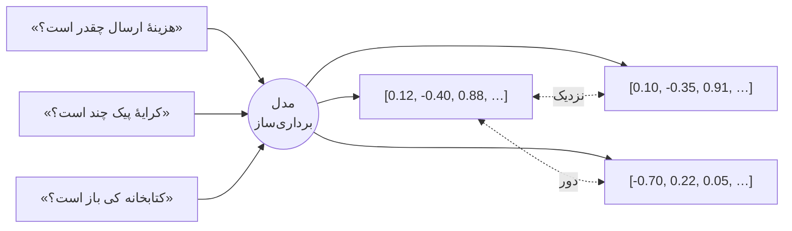

# درس ۰۵ — برداری‌سازی (Embeddings) و یک بنچمارک قابل‌اعتماد

> **ماژول:** `parsrag.embeddings`، `parsrag.eval.retrieval` · **کد شروع:** `starter/metrics.py`، `starter/tfidf.py` · **تصحیح:** `python -m grader run 05` (۲۲ بررسی) · **پیش‌نیاز:** [درس ۰۴ — قطعه‌بندی متن فارسی](../04-chunking/README.fa.md)

تا این‌جا با `HashingEmbedding` کار کردیم: سریع، آفلاین، بدون دانلود. ولی واقعاً چقدر خوب است؟ و اگر بخواهید یک مدل واقعی مثل `multilingual-e5` یا یک API را امتحان کنید، از کجا بفهمید بهتر است؟

در این درس سه کار می‌کنیم:

1. می‌فهمیم برداری‌سازی (Embedding) چیست و چرا برای فارسی، **چندزبانه بودن** و **نرمال‌سازی یکسان** حیاتی‌اند.
2. یک **بنچمارک بازیابی** قابل‌استفادهٔ دوباره می‌سازیم (`parsrag.eval.retrieval`: Recall@k، MRR، nDCG@k) که با *هر* `Embedding`ی کار می‌کند.
3. دو روش آفلاین را با عدد مقایسه می‌کنیم و به شما یاد می‌دهیم جدول مدل‌های واقعی را **خودتان** روی کامپیوترتان بسازید.

## برداری‌سازی چیست؟

یک **مدل برداری‌ساز (Embedding model)** هر متن را به یک بردار — فهرستی از چند صد عدد — تبدیل می‌کند، طوری که متن‌های **هم‌معنی** بردارهای **نزدیک** داشته باشند:



«نزدیکی» را معمولاً با **شباهت کسینوسی (Cosine similarity)** می‌سنجیم: کسینوس زاویهٔ بین دو بردار.

```python
def cosine_similarity(a, b):
    return a @ b / (norm(a) * norm(b))      # ۱: هم‌جهت، ۰: بی‌ربط، ۱-: مخالف
```

همهٔ برداری‌سازهای `parsrag` بردارها را **نرمال (طول ۱)** برمی‌گردانند، پس شباهت کسینوسی همان ضرب داخلی ساده است — و جست‌وجو در انبارهٔ برداری یعنی پیدا کردن بیشترین ضرب داخلی (درس ۰۶).

### سه خانوادهٔ برداری‌ساز

| روش | ایده | فارسی | در این دوره |
|---|---|---|---|
| **درهم‌سازی (Hashing)** | کلمه‌ها و n-gramهای حرفی به خانه‌های یک بردار ثابت | فقط شباهت **ظاهری**؛ «کرایه» و «هزینه» را بی‌ربط می‌بیند | `HashingEmbedding` |
| **TF-IDF** | وزن هر واژه = فراوانی در متن × کمیابی در پیکره | باز هم ظاهری؛ ولی واژه‌های کمیاب («پیشتاز») وزن بیشتری از واژه‌های رایج («است») می‌گیرند | `TfidfEmbedding` (همین درس) |
| **عصبی (Neural)** | شبکه‌ای که روی میلیاردها جمله آموزش دیده | شباهت **معنایی**؛ مترادف‌ها و حتی پرسش انگلیسی ↔ سند فارسی | `SentenceTransformerEmbedding`، `OpenAICompatibleEmbedding` |

### چرا «چندزبانه»؟

خیلی از مدل‌های برداری‌ساز معروف فقط با انگلیسی آموزش دیده‌اند. توکنایزرشان فارسی را به تکه‌های بی‌معنی (حتی بایت به بایت) می‌شکند و فضای برداری‌شان برای فارسی ساختار معنایی ندارد. برای فارسی سراغ مدل‌هایی بروید که صریحاً **چندزبانه (Multilingual)** آموزش دیده‌اند — مثلاً خانوادهٔ [multilingual-e5](https://huggingface.co/intfloat/multilingual-e5-small) یا [bge-m3](https://huggingface.co/BAAI/bge-m3) — یا مدل‌های مخصوص فارسی. یک نکتهٔ عملی: بعضی مدل‌ها پیشوند می‌خواهند (E5: `query: ` برای پرسش و `passage: ` برای سند). جاانداختن پیشوند بی‌صدا کیفیت را پایین می‌آورد؛ کارت مدل (Model card) را بخوانید.

### چرا نرمال‌سازی باید در هر دو طرف یکسان باشد؟

بردار سند در زمان **نمایه‌سازی (Indexing)** ساخته می‌شود و بردار پرسش در زمان **پرسش (Query)**. اگر اسناد را نرمال کنید ولی پرسش را نه، `كتاب` (با ک عربی) در پرسش کاربر با `کتاب` نمایه‌شده جور نمی‌شود — حتی با بهترین مدل دنیا. قانون ساده: **یک تابع `preprocess`، برای هر دو طرف.** پایین‌تر این را اندازه می‌گیریم.

## بنچمارک: `parsrag.eval.retrieval`

در درس ۰۴ از Recall@k و MRR استفاده کردیم؛ حالا خودشان را می‌سازیم. همه روی یک **فهرست رتبه‌بندی‌شده از شناسه‌ها** و یک **مجموعهٔ مرتبط‌ها** کار می‌کنند:

| معیار | تعریف | مثال: `ranked=[x, a, y]`، `relevant={a}` |
|---|---|---|
| **Recall@k** | چه کسری از مرتبط‌ها در k تای اول‌اند؟ | R@1 = ۰، R@2 = ۱ |
| **Reciprocal rank** | `۱ / رتبهٔ اولین مرتبط` — میانگینش روی پرسش‌ها **MRR** است | ۱/۲ = ۰٫۵ |
| **nDCG@k** | مرتبط‌های بالاتر امتیاز بیشتری دارند: `Σ 1/log2(i+2)` تقسیم بر بهترین حالت ممکن | nDCG@3 = ۱/log2(3) ≈ ۰٫۶۳ |

`evaluate_retrieval(items, retrieve, ks, level=...)` این‌ها را برای کل مجموعهٔ پرسش‌ها میانگین می‌گیرد. `retrieve` هر تابعی است که `(question, k)` بگیرد و نتیجهٔ جست‌وجو برگرداند — پس بنچمارک به هیچ مدل یا انبارهٔ خاصی وابسته نیست. دو سطح دارد: `doc` (سند درست پیدا شد؟) و `passage` (قطعه‌ای که شاهد پاسخ را دارد پیدا شد؟).

`parsrag.eval.benchmark.benchmark_embedding` کل پایپ‌لاین انتخابی درس ۰۴ را می‌چیند — قطعه‌بندی بازگشتی ۴۰۰ نویسه‌ای با زمینهٔ سرتیتر، متن نرمال‌شده — تا **تنها** چیزی که بین اجراها عوض می‌شود، برداری‌ساز باشد:

```python
from parsrag import HashingEmbedding, TfidfEmbedding
from parsrag.eval.benchmark import benchmark_embedding, load_fixture_benchmark

docs, qa = load_fixture_benchmark()
for emb in (HashingEmbedding(), TfidfEmbedding("word"), TfidfEmbedding("char")):
    reports = benchmark_embedding(emb, docs, qa)
    print(type(emb).__name__, reports["passage"].row())
```

## اندازه‌گیری ۱: روش‌های آفلاین

```bash
python examples/benchmark_embeddings.py
```

| model | dim | passage R@1 | passage R@3 | passage MRR | passage nDCG@3 | doc R@1 | time (s) |
|---|---|---|---|---|---|---|---|
| hashing | 1024 | 0.763 | 0.983 | 0.858 | 0.888 | 0.847 | 0.3 |
| tfidf-word | 1193 | 0.729 | 0.932 | 0.836 | 0.850 | 0.797 | 0.2 |
| tfidf-char | 5954 | 0.797 | 0.983 | 0.886 | 0.910 | 0.831 | 0.3 |

(۵۹ پرسش پاسخ‌دار؛ زمان یعنی کل نمایه‌سازی + ارزیابی روی همین کامپیوتر.)

- **TF-IDF واژه‌ای** از همه ضعیف‌تر است: «کتاب» و «کتاب‌ها» یا «امانت» و «امانتی» برایش واژه‌های کاملاً جدا هستند. فارسی صرف (Morphology) غنی دارد و تطبیق کل‌کلمه این را از دست می‌دهد.
- **n-gram حرفی** این مشکل را تا حدی حل می‌کند: `TfidfEmbedding("char")` در معیارهای سطح قطعه بهترین است (MRR ۰٫۸۸۶؛ در R@3 با hashing برابر) و `HashingEmbedding` که آن هم n-gram حرفی دارد، دوم است.
- ولی همهٔ این روش‌ها **واژگانی (Lexical)** هستند. پرسش‌های ما عمداً با واژه‌های خود اسناد نوشته شده‌اند؛ در دنیای واقعی کاربر می‌پرسد «کرایهٔ پیک» و سند نوشته «هزینهٔ ارسال». این‌جاست که مدل‌های عصبی برنده می‌شوند — و این را باید **خودتان** اندازه بگیرید (پایین‌تر).

## اندازه‌گیری ۲: نرمال‌سازی ناهمسان

فرض کنید کاربرانتان با صفحه‌کلید عربی تایپ می‌کنند: `ي` و `ك` عربی و ارقام عربی-هندی. همهٔ پرسش‌ها را این‌طور تغییر می‌دهیم و چهار حالت را مقایسه می‌کنیم (Recall@3 / MRR در سطح قطعه):

```bash
python examples/benchmark_embeddings.py --mismatch
```

| حالت | hashing | tfidf-word | tfidf-char |
|---|---|---|---|
| پرسش‌های تمیز، نرمال‌سازی هر دو طرف | 0.983 / 0.858 | 0.932 / 0.836 | 0.983 / 0.886 |
| پرسش‌های «صفحه‌کلید عربی»، نرمال‌سازی هر دو طرف | 0.983 / 0.858 | 0.932 / 0.836 | 0.983 / 0.886 |
| پرسش‌های «صفحه‌کلید عربی»، نرمال‌سازی **فقط اسناد** | 0.847 / 0.808 | 0.814 / 0.682 | 0.932 / 0.859 |
| پرسش‌های «صفحه‌کلید عربی»، بدون نرمال‌سازی | 0.831 / 0.775 | 0.746 / 0.611 | 0.847 / 0.759 |

- با نرمال‌سازی **هر دو طرف**، پرسش‌های شلخته **دقیقاً همان نتیجه** را می‌گیرند که پرسش‌های تمیز.
- نرمال کردن **فقط اسناد** برای TF-IDF واژه‌ای MRR را از ۰٫۸۳۶ به ۰٫۶۸۲ می‌اندازد — تقریباً به بدی حالتی که هیچ نرمال‌سازی نکنیم.
- n-gram حرفی مقاوم‌تر است (بخشی از n-gramها حرف عربی ندارند)، ولی باز هم افت می‌کند.

یک نکتهٔ صادقانه: با پرسش‌های تمیز خودمان، «فقط اسناد» با «هر دو طرف» فرقی نداشت — چون پرسش‌ها از اول تمیز بودند. ناهمسانی وقتی گاز می‌گیرد که ورودی کاربر شلخته باشد، و در محصول واقعی همیشه هست.

## اندازه‌گیری ۳: مدل‌های واقعی — روی کامپیوتر خودتان

تست‌ها و CI این دوره هیچ مدلی دانلود نمی‌کنند و هیچ API پولی صدا نمی‌زنند. پس جدول مدل‌های واقعی را **ما پر نکرده‌ایم** — هیچ عددی برای مدلی که اجرا نکرده‌ایم نمی‌نویسیم. شما با یک فرمان آن را می‌سازید:

```bash
pip install -e ".[st]"
python examples/benchmark_embeddings.py --model st:intfloat/multilingual-e5-small --query-prefix "query: " --doc-prefix "passage: "
python examples/benchmark_embeddings.py --model st:BAAI/bge-m3
```

یا با هر سرور سازگار با OpenAI (سرویس ابری یا سرور محلی مثل Ollama):

```bash
pip install -e ".[openai]"
python examples/benchmark_embeddings.py --model openai:text-embedding-3-small
python examples/benchmark_embeddings.py --model openai:nomic-embed-text --base-url http://localhost:11434/v1
```

هر اجرا یک سطر Markdown چاپ می‌کند. آن را در این جدول بگذارید:

| model | dim | passage R@1 | passage R@3 | passage MRR | passage nDCG@3 | doc R@1 | time (s) |
|---|---|---|---|---|---|---|---|
| hashing (مرجع) | 1024 | 0.763 | 0.983 | 0.858 | 0.888 | 0.847 | 0.3 |
| *(نتیجهٔ شما)* | | | | | | | |
| *(نتیجهٔ شما)* | | | | | | | |

موقع تفسیر، این‌ها را در نظر بگیرید:

- پیکرهٔ ما کوچک و **مصنوعی** است و پرسش‌ها واژه‌های اسناد را تکرار می‌کنند؛ این به نفع روش‌های واژگانی است. اگر مدل عصبی این‌جا فقط کمی بهتر بود، تعجب نکنید — روی پرسش‌های واقعی کاربرانتان دوباره بسنجید.
- زمان اجرا (CPU در برابر GPU، دانلود اول) و ابعاد بردار (حافظهٔ انباره در درس ۰۶) هم بخشی از تصمیم‌اند، نه فقط دقت.
- برای مقایسهٔ منصفانه، همهٔ مدل‌ها را با همان قطعه‌بندی و همان نرمال‌سازی اجرا کنید — `benchmark_embedding` دقیقاً همین را تضمین می‌کند.

## تمرین

دو فایل در `lessons/05-embeddings/starter/` دارید:

| فایل | تابع | راهنمایی |
|---|---|---|
| `metrics.py` | `dedupe`، `recall_at_k`، `reciprocal_rank`، `ndcg_at_k` | جدول بالا؛ رتبه از ۱ شروع می‌شود |
| `metrics.py` | `contains_evidence` | `match_key` روی هر دو طرف، `context_text` برای پنجرهٔ جمله |
| `metrics.py` | `evaluate_retrieval` | فقط پرسش‌های پاسخ‌دار؛ `ranked_ids` + میانگین |
| `tfidf.py` | `cosine_similarity` | `a·b / (|a||b|)`، بردار صفر → ۰ |
| `tfidf.py` | `TfidfEmbedding.terms` / `fit` / `embed` | `idf = log((1+N)/(1+df)) + 1`، وزن `(1 + log tf) × idf`، سپس `l2_normalize` |

```bash
python -m grader run 05          # ۲۲ بررسی
```

آخرین بررسی، بنچمارک **شما** را روی سه برداری‌ساز آفلاین اجرا می‌کند و انتظار دارد همان ترتیب جدول بالا را ببیند. 🎉

### برای کنجکاوها

- `TfidfEmbedding("char", ngram_range=(3, 5))` یا `HashingEmbedding(dim=4096)` را امتحان کنید. بُعد بیشتر همیشه بهتر است؟
- چند پرسش با **مترادف** بنویسید («کرایهٔ پیک» به‌جای «هزینهٔ پیک») و بنچمارک را روی آن‌ها اجرا کنید. روش‌های واژگانی چقدر افت می‌کنند؟ مدل عصبی چطور؟
- یک پرسش **انگلیسی** دربارهٔ اسناد فارسی بپرسید. کدام برداری‌سازها اصلاً شانسی دارند؟

## مطالعهٔ بیشتر

- **FaMTEB** — بنچمارک بزرگ برداری‌سازی متن فارسی بر پایهٔ MTEB، شامل وظایف بازیابی و RAG: [مقاله در arXiv](https://arxiv.org/abs/2502.11571). برای انتخاب مدل، جدول امتیازها را در [تابلوی MTEB](https://huggingface.co/spaces/mteb/leaderboard) ببینید.
- **ParsBench** — جعبه‌ابزار متن‌باز برای ارزیابی مدل‌های زبانی بزرگ روی وظایف فارسی: [مستندات](https://parsbench.github.io/ParsBench) و [بستهٔ PyPI](https://pypi.org/project/parsbench).
- **awesome-persian-nlp-ir** — فهرستی گردآوری‌شده از ابزارها، داده‌ها و مدل‌های پردازش زبان فارسی و بازیابی اطلاعات: [GitHub](https://github.com/mhbashari/awesome-persian-nlp-ir).

## درس بعد

[درس ۰۶ — انباره‌های برداری](../06-vector-stores/README.fa.md): از ماتریس NumPy در حافظه تا FAISS و pgvector، و این‌که جست‌وجوی «تقریبی» یعنی چه.
