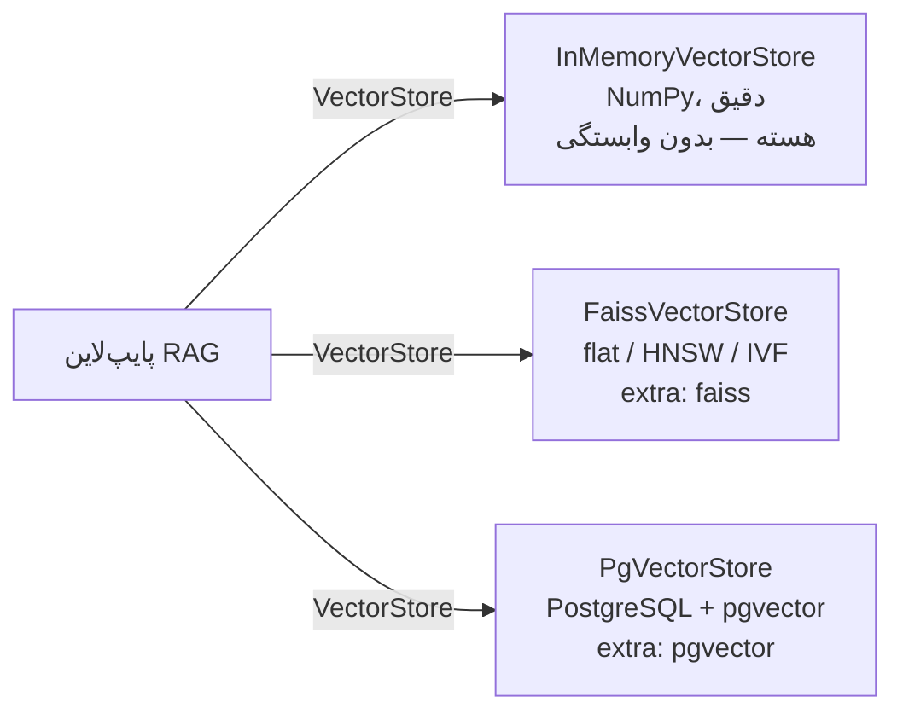
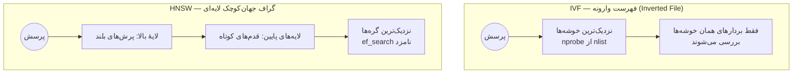

# درس ۰۶ — انباره‌های برداری (Vector Stores)

> **ماژول:** `parsrag.stores` · **کد شروع:** `starter/stores.py` · **تصحیح:** `python -m grader run 06` (۱۵ بررسی) · **پیش‌نیاز:** [درس ۰۵ — برداری‌سازی و بنچمارک بازیابی](../05-embeddings/README.fa.md)

تا این‌جا همهٔ بردارها در یک ماتریس NumPy در حافظه بودند و برای هر پرسش، شباهت پرسش با **همهٔ** قطعه‌ها حساب می‌شد. برای ۱۰۹ قطعهٔ دورهٔ ما این عالی است. ولی اگر ۱۰ میلیون قطعه داشته باشید؟ اگر برنامه ری‌استارت شود و نخواهید همه‌چیز را دوباره برداری کنید؟ اگر چند سرور هم‌زمان بخوانند و بنویسند؟

در این درس `parsrag.stores` را کامل می‌کنیم:

- یک **پروتکل (Protocol)** مشترک، تا بقیهٔ پایپ‌لاین اهمیتی ندهد بردارها کجا هستند؛
- **فیلتر متادیتا** و **ذخیره/بارگذاری روی دیسک** برای انبارهٔ درون‌حافظه‌ای؛
- **FAISS** برای جست‌وجوی سریع (دقیق و تقریبی)؛
- **pgvector** وقتی به یک پایگاه‌دادهٔ واقعی نیاز دارید.

## یک رابط، چند پیاده‌سازی

```python
from parsrag.stores import InMemoryVectorStore, FaissVectorStore, PgVectorStore

store.add(chunks)                                   # برداری‌سازی و ذخیره
store.add(chunks, vectors)                          # یا با بردارهای ازپیش‌ساخته
store.search("ساعت کاری کتابخانه", k=4)
store.search("کتابخانه", k=4, filter={"doc_id": "mehregan-rules"})
store.search("کتابخانه", k=4, filter={"section": ["ساعت", "امانت"]})   # «یکی از این‌ها»
store.search("کتابخانه", k=4, filter=lambda c: c.metadata["page"] > 1)  # هر شرطی
```



`VectorStore` یک `Protocol` پایتون است: هر کلاسی که `add`، `search`، `search_by_vector` و `__len__` داشته باشد، «انبارهٔ برداری» است — بدون ارث‌بری. درس‌های بعد (جست‌وجوی ترکیبی، بازرتبه‌بندی، API) فقط با همین رابط کار می‌کنند.

### فیلتر متادیتا

در درس‌های ۰۳ و ۰۴ به هر قطعه `section`، `page` و `doc_id` دادیم. فیلتر به شما اجازه می‌دهد بگویید «فقط در قوانین کتابخانه بگرد» یا «فقط صفحه‌های بعد از ۱». در انبارهٔ درون‌حافظه‌ای، امتیاز قطعه‌های ردشده `-inf` می‌شود و بعد مرتب می‌کنیم — پس فیلتر **قبل از** رتبه‌بندی اعمال می‌شود و نتیجه دقیق است.

### ذخیره و بارگذاری

برداری‌سازی گران است (با مدل‌های واقعی، دقیقه‌ها یا ساعت‌ها). پس نمایه را یک بار بسازید و ذخیره کنید:

```python
store.save("index/")          # vectors.npy + chunks.jsonl + store.json
store = InMemoryVectorStore.load("index/", HashingEmbedding())
```

`store.json` بُعد بردارها را نگه می‌دارد و اگر با مدل دیگری بارگذاری کنید، خطا می‌گیرید. **بردارهای یک مدل با مدل دیگر قابل‌مقایسه نیستند** — حتی اگر بُعدشان یکی باشد. با عوض کردن مدل (یا تنظیمات نرمال‌سازی!) باید کل نمایه را از نو بسازید.

## جست‌وجوی دقیق در برابر تقریبی

جست‌وجوی **دقیق (Exact / brute-force)** شباهت پرسش را با همهٔ n بردار حساب می‌کند: هزینه با n خطی بالا می‌رود. **جست‌وجوی تقریبی نزدیک‌ترین همسایه (ANN — Approximate Nearest Neighbor)** فقط بخش کوچکی را نگاه می‌کند و در عوض گاهی یکی از همسایه‌های واقعی را از دست می‌دهد. دو ایدهٔ اصلی:



- **IVF:** بردارها اول **خوشه‌بندی (Clustering)** می‌شوند (`nlist` خوشه — نیاز به **آموزش (Training)** دارد). هر پرسش فقط `nprobe` خوشهٔ نزدیک را می‌گردد. مثل این‌که در کتابخانه اول قفسهٔ درست را پیدا کنید و فقط همان را بگردید.
- **HNSW:** هر بردار یک گره در یک گراف است که به `m` همسایه‌اش وصل است؛ جست‌وجو مثل مسیریابی در شهر است: اول بزرگراه‌ها (لایه‌های بالا)، بعد کوچه‌ها. `ef_search` تعداد نامزدهایی است که در هر قدم نگه داشته می‌شود: بیشتر = دقیق‌تر و کندتر. آموزش لازم ندارد، ولی ساختنش کند است و حافظهٔ بیشتری می‌گیرد.

دقت جست‌وجوی تقریبی را با **Recall@k نسبت به جست‌وجوی دقیق** می‌سنجیم: از ۱۰ همسایهٔ واقعی، چندتا را پیدا کرد؟

## اندازه‌گیری: کی FAISS ارزشش را دارد؟

```bash
pip install -e ".[faiss]"
python examples/vector_store_latency.py
```

داده‌ها **مصنوعی**اند: بردارهای واحد ۳۸۴ بعدی دور ۵۰ مرکز خوشهٔ تصادفی (بردارهای واقعی هم خوشه‌ای‌اند؛ همین است که IVF را کارا می‌کند). ۲۰۰ پرسش، k=۱۰، همه‌چیز **تک‌رشته‌ای (Single-thread)** برای مقایسهٔ منصفانه. اعداد زیر یک اجرا روی CPU این محیط (Intel Xeon 2.8GHz) است؛ روی کامپیوتر شما فرق می‌کند — خودتان اجرا کنید:

```text
n = 2,000 vectors, dim = 384, 200 queries, k = 10
store                              build (s) query (ms) recall@10
in-memory (NumPy, exact)               0.006      0.359     1.000
FAISS flat (exact)                     0.003      0.235     1.000
FAISS HNSW (m=32, ef=64)               0.317      0.306     0.995
FAISS IVF (nlist=20, nprobe=8)         0.017      0.167     0.934

n = 10,000 vectors, dim = 384, 200 queries, k = 10
store                              build (s) query (ms) recall@10
in-memory (NumPy, exact)               0.027      2.998     1.000
FAISS flat (exact)                     0.039      1.336     1.000
FAISS HNSW (m=32, ef=64)               3.173      0.433     0.993
FAISS IVF (nlist=100, nprobe=8)        0.163      0.216     0.993
```

چه می‌بینیم:

- **با ۲٬۰۰۰ بردار، همه زیر نیم میلی‌ثانیه‌اند.** تفاوتشان در برابر زمان برداری‌سازی پرسش یا تولید پاسخ LLM (صدها میلی‌ثانیه) ناچیز است. برای اسناد یک تیم یا یک دورهٔ آموزشی، `InMemoryVectorStore` کاملاً کافی است.
- **با ۱۰٬۰۰۰ بردار** جست‌وجوی دقیق NumPy ~۳ میلی‌ثانیه و FAISS flat ~۱٫۳ میلی‌ثانیه طول می‌کشد (هر دو با n خطی رشد می‌کنند)، ولی HNSW و IVF زیر نیم میلی‌ثانیه می‌مانند — با بیش از ۹۹٪ از همسایه‌های درست.
- **هیچ ناهاری مجانی نیست:** ساخت HNSW برای ۱۰٬۰۰۰ بردار بیش از ۳ ثانیه طول کشید (حدود ۸۰ برابر flat). IVF با ۲۰ خوشه روی ۲٬۰۰۰ بردار فقط ۹۳٪ همسایه‌ها را پیدا کرد؛ `nprobe` را بالا ببرید تا ببینید دقت چطور با سرعت معامله می‌شود.
- بخشی از زمان هر پرسش، سربار پایتون (ساختن `SearchResult`) است و ربطی به خود جست‌وجو ندارد؛ برای همین در اندازه‌های کوچک فاصله‌ها کم است.

قاعدهٔ سرانگشتی ما (با همین اندازه‌گیری‌ها، برای همین ابعاد): تا چند ده هزار قطعه، جست‌وجوی دقیق را نگه دارید — ساده‌تر است و هیچ‌وقت اشتباه نمی‌کند. وقتی تأخیر جست‌وجو واقعاً در بودجهٔ زمانی‌تان دیده شد، سراغ HNSW (بدون آموزش، دقت بالا) یا IVF (ساخت سریع، حافظهٔ کمتر) بروید. با `--sizes 100000` روی کامپیوتر خودتان امتحان کنید.

### دام فیلتر در جست‌وجوی تقریبی

FAISS متادیتا ندارد، پس فیلتر را **بعد از** جست‌وجو اعمال می‌کنیم: `4k` نتیجه بگیر، فیلتر کن، اگر کم بود تعداد را دو برابر کن. ولی یک دام واقعی پیدا کردیم (و یکی از تست‌ها آن را نشان می‌دهد): وقتی فیلتر **خیلی گزینشی** است (مثلاً فقط ۳ قطعه از ۵۰۰ را قبول می‌کند)، HNSW حتی با درخواست همهٔ ۵۰۰ نتیجه هم بعضی گره‌ها را **اصلاً نمی‌بیند** — جست‌وجوی گرافی همهٔ گره‌ها را پیمایش نمی‌کند. برای همین `FaissVectorStore` در این حالت به یک **جست‌وجوی دقیق روی قطعه‌های قبول‌شده** برمی‌گردد (بردارها را از خود نمایه بازسازی می‌کند). پایگاه‌داده‌های برداری جدی برای همین مشکل فیلتر را داخل خود جست‌وجو می‌برند.

## کی به پایگاه‌دادهٔ واقعی نیاز دارید؟

یک فایل NumPy یا FAISS برای یک پردازه (Process) عالی است. وقتی این‌ها را لازم دارید، سراغ پایگاه‌داده بروید:

- چند سرور یا کارگر (Worker) هم‌زمان می‌خوانند و **می‌نویسند**؛
- **تراکنش (Transaction)**، پشتیبان‌گیری، کنترل دسترسی؛
- فیلترهای پیچیدهٔ SQL کنار بردارها (کاربر X فقط اسناد سازمان Y را ببیند)؛
- داده‌هایتان همین حالا در PostgreSQL است.

`PgVectorStore` از افزونهٔ [pgvector](https://github.com/pgvector/pgvector) استفاده می‌کند. جدول ساده است و جست‌وجو یک `ORDER BY` با عملگر فاصلهٔ کسینوسی `<=>`:

```sql
CREATE TABLE parsrag_chunks (id text PRIMARY KEY, doc_id text, text text,
                             metadata jsonb, embedding vector(1024));
CREATE INDEX ON parsrag_chunks USING hnsw (embedding vector_cosine_ops);

SELECT id, text, 1 - (embedding <=> $1) AS score
FROM parsrag_chunks WHERE metadata @> '{"page": 2}'
ORDER BY embedding <=> $1 LIMIT 4;
```

فیلترها باید `dict` باشند تا به SQL ترجمه شوند (`filter_to_sql`)؛ تابع پایتون را نمی‌شود به پایگاه‌داده فرستاد. شناسه‌ها همیشه به‌صورت پارامتر فرستاده می‌شوند و نام جدول اعتبارسنجی می‌شود — هیچ رشتهٔ کاربر مستقیم داخل SQL نمی‌رود.

```bash
pip install -e ".[pgvector]"
docker run -d -p 5432:5432 -e POSTGRES_PASSWORD=pw pgvector/pgvector:pg16
PARSRAG_TEST_DATABASE_URL=postgresql://postgres:pw@localhost:5432/postgres pytest tests/test_stores.py -k pgvector
```

بدون این متغیر محیطی، تست‌های pgvector با پیامی روشن **رد (Skip)** می‌شوند؛ CI هیچ پایگاه‌داده‌ای راه نمی‌اندازد.

## تمرین

فایل `lessons/06-vector-stores/starter/stores.py` را باز کنید. پروتکل، بررسی شناسه‌های تکراری، ساخت نمایه‌های FAISS و ذخیرهٔ فهرست قطعه‌ها آماده‌اند:

| تابع | راهنمایی |
|---|---|
| `matches_filter` | `chunk_field` + برابری، یا «عضو بودن» برای فهرست‌ها، یا صدا زدن تابع |
| `InMemoryVectorStore.search_by_vector` | `matrix @ query`، ماسک فیلتر با `-inf`، `argsort(kind="stable")` |
| `InMemoryVectorStore.save` / `load` | `save_chunks` + `np.save` / `load_chunks` + `np.load` |
| `FaissVectorStore.search_by_vector` | `4k` بگیر، فیلتر کن، دو برابر کن؛ در آخر `_exact_filtered` |

```bash
pip install -e ".[faiss]"
python -m grader run 06          # ۱۵ بررسی
```

آخرین بررسی، کل پیکرهٔ دوره را در HNSW شما می‌ریزد و چک می‌کند که کیفیت بازیابی (MRR سطح قطعه) با جست‌وجوی دقیق یکی باشد. 🎉

### برای کنجکاوها

- در `examples/vector_store_latency.py` مقدار `nprobe` را ۱، ۴ و ۳۲ کنید. نمودار «دقت در برابر تأخیر» را بکشید.
- `ef_search` را برای HNSW پایین بیاورید (مثلاً ۸). از کجا Recall@10 شروع به افت می‌کند؟
- حجم فایل‌های `index/` را برای `InMemoryVectorStore` و `FaissVectorStore("hnsw")` مقایسه کنید. گراف HNSW چقدر حافظهٔ اضافه می‌خواهد؟
- FAISS برای فیلتر داخل جست‌وجو `IDSelector` دارد. آن را جایگزین «فیلتر بعد از جست‌وجو» کنید و دام فیلتر گزینشی را دوباره بسنجید.

## مطالعهٔ بیشتر

- Malkov & Yashunin، *Efficient and robust approximate nearest neighbor search using Hierarchical Navigable Small World graphs* (2016) — مقالهٔ HNSW: [arXiv](https://arxiv.org/abs/1603.09320).
- Johnson, Douze & Jégou، *Billion-scale similarity search with GPUs* (2017) — مقالهٔ FAISS: [arXiv](https://arxiv.org/abs/1702.08734)؛ و [ویکی FAISS](https://github.com/facebookresearch/faiss/wiki) برای انتخاب نوع نمایه.
- [pgvector](https://github.com/pgvector/pgvector) — جست‌وجوی برداری داخل PostgreSQL، با نمایه‌های HNSW و IVFFlat.

## درس بعد

[درس ۰۷ — جست‌وجوی ترکیبی](../07-hybrid-search/README.fa.md): BM25 فارسی + برداری + ادغام رتبه‌ای (RRF).
