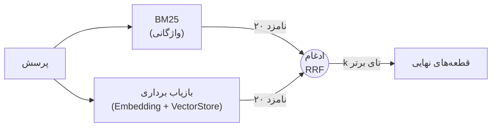
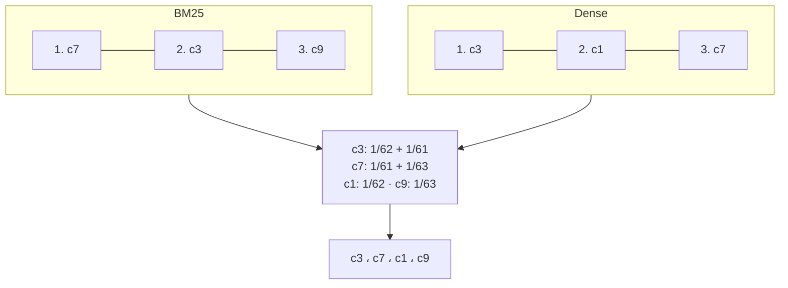
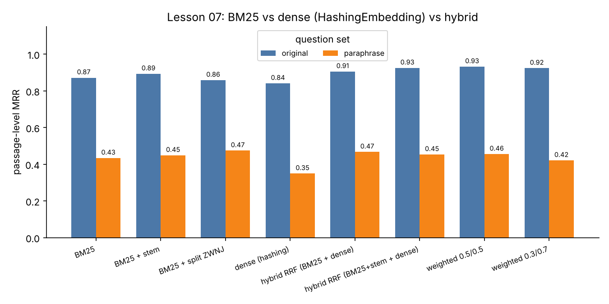

# درس ۰۷ — جست‌وجوی ترکیبی (Hybrid search): BM25 فارسی + برداری + RRF

> **ماژول:** `parsrag.retrieval` · **کد شروع:** `starter/retrieval.py` · **تصحیح:** `python -m grader run 07` (۲۰ بررسی) · **پیش‌نیاز:** [درس ۰۶ — انباره‌های برداری](../06-vector-stores/README.fa.md)

تا این‌جا بازیابی (Retrieval) یعنی «بردار پرسش را بساز و نزدیک‌ترین بردارها را پیدا کن». ولی موتورهای جست‌وجو دهه‌ها قبل از برداری‌سازها هم کار می‌کردند، با یک فرمول ساده به اسم **BM25**. در این درس:

1. BM25 را برای فارسی **از صفر** می‌نویسیم (نرمال‌سازی + توکن‌سازی + یک ریشه‌یاب سبک).
2. بازیاب برداری (Dense retriever) را دور هر `VectorStore`ی می‌پیچیم.
3. این دو را با **ادغام رتبهٔ متقابل (Reciprocal Rank Fusion, RRF)** و **ادغام وزنی امتیازها (Weighted score fusion)** ترکیب می‌کنیم.
4. همه را روی **دو** مجموعهٔ پرسش اندازه می‌گیریم: پرسش‌های قبلی و یک مجموعهٔ تازه از پرسش‌های **بازنویسی‌شده (Paraphrased)** که دیگر واژه‌های خود اسناد را تکرار نمی‌کنند.



## مجموعهٔ پرسش تازه: «بازنویسی‌شده‌ها»

یافتهٔ درس ۰۵ این بود: پرسش‌های `qa.jsonl` با همان کلمه‌های اسناد نوشته شده‌اند و این به نفع روش‌های واژگانی (Lexical) است. پس `data/fixtures/qa_paraphrase.jsonl` را اضافه کردیم: ۵۱ پرسش (۴۶ پاسخ‌دار، ۵ بی‌پاسخ) دربارهٔ **همان واقعیت‌ها**، ولی همان‌طور که کاربر واقعی می‌پرسد:

| پرسش اصلی (`qa.jsonl`) | بازنویسی (`qa_paraphrase.jsonl`) |
|---|---|
| تا چند روز بعد از تحویل می‌توانم کالا را به کهربا برگردانم؟ | چند روز وقت دارم جنسی رو که از کهربا خریدم **پس بدم**؟ |
| هزینهٔ پیک در **تهران** چقدر است؟ | **کرایهٔ** پیک داخل **پایتخت** چنده؟ |
| لوازم برقی کهربا چند ماه **گارانتی** دارند؟ | **ضمانت** وسایل برقی‌ای که از کهربا می‌خرم چقدره؟ |
| آیا می‌توانم خریدم را **قسطی** پرداخت کنم؟ | میشه پول خریدمو چند ماهه و **قصطی** بدم؟ (غلط تایپی عمدی) |

هر سطر `source_id` دارد (شناسهٔ پرسش اصلی) و همان `doc_id`، `answer` و `evidence` را به ارث می‌برد، پس هر دو مجموعه دقیقاً یک‌جور نمره می‌گیرند.

## BM25 در یک نگاه

BM25 برای هر واژهٔ مشترک بین پرسش و قطعه امتیاز می‌دهد و جمع می‌زند:

```text
score(d) = Σ_t  idf(t) · tf(t,d) · (k1 + 1) / (tf(t,d) + k1 · (1 − b + b · |d| / avgdl))
idf(t)   = log(1 + (N − df + 0.5) / (df + 0.5))
```

| نماد | معنی | شهود |
|---|---|---|
| `tf(t,d)` | چند بار واژه در قطعه آمده | بیشتر بهتر، ولی **اشباع** می‌شود (`k1`، پیش‌فرض ۱٫۵) |
| `idf(t)` | واژه چقدر کمیاب است | «پیشتاز» خیلی بیشتر از «است» می‌ارزد |
| `|d| / avgdl` | طول قطعه نسبت به میانگین | قطعه‌های بلند کمی جریمه می‌شوند (`b`، پیش‌فرض ۰٫۷۵) |

تفاوتش با TF-IDF درس ۰۵: اشباع `tf` و نرمال‌سازی طول. و یک چیز مهم‌تر: BM25 **فقط** به قطعه‌هایی امتیاز می‌دهد که دست‌کم یک واژهٔ مشترک دارند — اگر کاربر «کرایه» بگوید و سند «هزینه»، امتیاز صفر است.

### توکن‌سازی فارسی

قبل از BM25 باید متن را به واژه (Token) بشکنیم. سه تصمیم فارسی‌مخصوص:

```python
from parsrag.retrieval import tokenize

tokenize("كتاب هاي  من")                 # ['کتاب‌های', 'من']      ← نرمال‌سازی درس ۰۲ اول
tokenize("کتاب‌ها", split_zwnj=True)      # ['کتاب', 'ها']         ← نیم‌فاصله = جداکننده؟
tokenize("خریدهای بزرگ‌تر", stem=True)    # ['خرید', 'بزرگ']       ← ریشه‌یابی سبک
```

1. **نرمال‌سازی**: بدون آن `كتاب` و `کتاب` دو واژهٔ جدا هستند (درس ۰۲). برای BM25 این از برداری‌ساز هم بدتر است، چون n-gram حرفی ندارد که بخشی از شباهت را نجات دهد.
2. **نیم‌فاصله (ZWNJ)**: پیش‌فرض ما «کتاب‌ها» را یک واژه نگه می‌دارد. گزینهٔ `split_zwnj` آن را دو تکه می‌کند تا «کتاب» با «کتاب‌ها» جور شود.
3. **ریشه‌یابی سبک (Light stemming)**: `light_stem` فقط یک پسوند از `ها/های/هایی/تر/ترین/ی` را برمی‌دارد، آن هم محتاطانه (دست‌کم ۳ حرف باید بماند، تا «تنها» به «تن» تبدیل نشود). این یک ریشه‌یاب واقعی نیست؛ ارزان‌ترین چیزی است که *شاید* کمک کند. پس باید **اندازه‌اش بگیریم**.

## بازیاب برداری و ادغام

`DenseRetriever(store)` کار زیادی نمی‌کند: پرسش را با **همان** `normalize` نمایه نرمال می‌کند (قانون درس ۰۵) و `store.search` را صدا می‌زند. همهٔ بازیاب‌ها — `BM25Retriever`، `DenseRetriever`، `HybridRetriever` و حتی خود انباره‌های درس ۰۶ — یک متد مشترک دارند:

```python
retriever.search("پرسش", k=5, filter={"doc_id": "kahroba-faq"})  # -> list[SearchResult]
```

حالا دو فهرست رتبه‌بندی‌شده داریم. امتیاز BM25 بین ۰ و حدود ۲۰ است و شباهت کسینوسی بین ۱- و ۱؛ نمی‌شود ساده جمعشان زد. دو راه داریم:

| روش | فرمول | مزیت | عیب |
|---|---|---|---|
| **RRF** | `Σ 1 / (60 + rank)` | فقط **رتبه** مهم است؛ مقیاس امتیازها بی‌اهمیت؛ تقریباً بدون تنظیم | اطمینان بالای یک روش را نمی‌بیند |
| **وزنی** | `Σ w · minmax(score)` | از مقدار امتیاز استفاده می‌کند | به وزن‌ها و توزیع امتیازها حساس است؛ باید تنظیم شود |



```python
from parsrag import HashingEmbedding
from parsrag.eval.benchmark import index_documents, load_fixture_benchmark
from parsrag.retrieval import BM25Retriever, DenseRetriever, HybridRetriever, PersianTokenizer

docs, qa = load_fixture_benchmark()
store = index_documents(docs, HashingEmbedding())        # پایپ‌لاین درس ۰۴
bm25 = BM25Retriever(store.chunks, tokenizer=PersianTokenizer(stem=True))
hybrid = HybridRetriever([bm25, DenseRetriever(store)])   # پیش‌فرض: RRF با k=60
hybrid.search("هزینهٔ پیک در تهران", k=3)
```

## اندازه‌گیری: دو مجموعهٔ پرسش

```bash
python examples/hybrid_search.py --chart
```

سطح قطعه (Passage-level)، همان پایپ‌لاین درس ۰۴ (قطعهٔ بازگشتی ۴۰۰ نویسه‌ای + زمینهٔ سرتیتر). «dense» همان `HashingEmbedding` آفلاین است. ۵۹ پرسش پاسخ‌دار اصلی و ۴۶ پرسش پاسخ‌دار بازنویسی‌شده:

| بازیاب | اصلی R@1 | R@3 | MRR | بازنویسی R@1 | R@3 | MRR |
|---|---|---|---|---|---|---|
| BM25 | 0.780 | 0.949 | 0.872 | 0.370 | 0.435 | 0.434 |
| BM25 + ریشه‌یابی سبک | 0.814 | 0.983 | 0.893 | 0.370 | 0.478 | 0.448 |
| BM25 + شکستن در نیم‌فاصله | 0.763 | 0.949 | 0.858 | 0.391 | 0.500 | 0.474 |
| BM25 + حذف ایست‌واژه‌ها | 0.814 | 0.949 | 0.892 | 0.370 | 0.457 | 0.430 |
| dense (hashing) | 0.729 | 0.983 | 0.841 | 0.196 | 0.391 | 0.349 |
| **RRF (BM25 + dense)** | 0.831 | 0.983 | 0.905 | 0.370 | 0.478 | 0.467 |
| **RRF (BM25 + ریشه‌یابی + dense)** | 0.864 | 0.983 | 0.925 | 0.326 | **0.500** | 0.453 |
| وزنی ۰٫۵ / ۰٫۵ | **0.881** | **1.000** | **0.932** | 0.370 | 0.457 | 0.455 |
| وزنی ۰٫۳ / ۰٫۷ (برداری سنگین‌تر) | 0.864 | **1.000** | 0.924 | 0.304 | 0.478 | 0.421 |
| وزنی ۰٫۷ / ۰٫۳ (BM25 سنگین‌تر) | 0.847 | 0.966 | 0.910 | 0.413 | 0.435 | 0.465 |



چه یاد گرفتیم:

- **ترکیب جواب می‌دهد.** روی پرسش‌های اصلی، RRF از هر دو روش تنها بهتر است (MRR ۰٫۹۰۵ در برابر ۰٫۸۷۲ و ۰٫۸۴۱)، چون دو روش اشتباه‌های **متفاوتی** می‌کنند: BM25 کلمهٔ دقیق را می‌خواهد و hashing شباهت حرفی را.
- **ریشه‌یابی سبک: کمک کوچک، نه قطعی.** روی پرسش‌های اصلی MRR از ۰٫۸۷۲ به ۰٫۸۹۳ رسید (یعنی حدود دو پرسش جابه‌جا شد؛ هر پرسش ≈ ۱٫۷ واحد درصد R@1)، روی بازنویسی‌ها ۰٫۴۳۴ → ۰٫۴۴۸ — در حد نویز. صادقانه: با این مجموعه‌های کوچک نمی‌توانیم بگوییم واقعاً کمک می‌کند؛ فقط ضرر نمی‌زند. درس ۱۰ این را با **بوت‌استرپ جفتی** می‌سنجد: بازهٔ ۹۵٪ بهبود MRR روی پرسش‌های اصلی [۰٫۰۱۲-، ۰٫۰۵۹+] است — صفر داخلش است. از ادعاهای این جدول، فقط «ترکیبی بهتر از dense تنهاست» آن آزمون را پاس می‌کند.
- **شکستن در نیم‌فاصله** روی بازنویسی‌ها بهترین BM25 است (۰٫۴۷۴) ولی روی اصلی کمی بدتر — یک بده‌بستان، نه برد.
- **ایست‌واژه‌ها (Stop words)** تقریباً اثری ندارند: `idf` خودش «است» و «در» را کم‌وزن می‌کند.
- **وزن‌ها حساس‌اند.** وزنی ۰٫۵/۰٫۵ روی اصلی کمی از RRF جلوتر است (MRR ۰٫۹۳۲ در برابر ۰٫۹۲۵ — حدود یک پرسش، در حد نویز)، ولی ۰٫۳/۰٫۷ روی بازنویسی‌ها R@1 را به ۰٫۳۰۴ می‌اندازد و ۰٫۷/۰٫۳ روی اصلی به ۰٫۸۴۷. RRF بدون هیچ تنظیمی نزدیک بهترین است؛ برای همین **پیش‌فرض خوبی** است.
- **و درس بزرگ: فاصلهٔ واژگانی.** همهٔ روش‌ها روی بازنویسی‌ها حدود **نصف** می‌شوند (MRR ≈ ۰٫۴۵). هیچ ترفند توکن‌سازی‌ای «کرایه» را به «هزینه» یا «پس دادن» را به «مرجوعی» وصل نمی‌کند. این دقیقاً جای **برداری‌ساز عصبی** است — و `HashingEmbedding` با وجود اسم «dense» در اصل واژگانی است (روی بازنویسی‌ها از BM25 هم بدتر: ۰٫۳۴۹).

> انتخاب دوره از این به بعد: **RRF (BM25 + ریشه‌یابی سبک + dense)** با ۲۰ نامزد از هر بازیاب. دلیل: در حد بهترین روی پرسش‌های اصلی (فقط وزنی ۰٫۵/۰٫۵ با اختلافی در حد نویز جلوتر است)، در حد بقیه روی بازنویسی‌ها، و بدون وزنی که باید تنظیم شود.

### با یک مدل عصبی واقعی، روی کامپیوتر خودتان

عددهای مدل عصبی را این‌جا **ننوشته‌ایم**، چون در CI مدلی دانلود نمی‌کنیم. خودتان اجرا کنید:

```bash
pip install -e ".[st]"
python examples/hybrid_search.py --model st:intfloat/multilingual-e5-small
```

انتظار منطقی (که باید **خودتان** بسنجید): بازیاب برداری عصبی روی بازنویسی‌ها خیلی بهتر از hashing باشد، و ترکیبش با BM25 روی پرسش‌های اصلی (که کلمهٔ دقیق، عدد و اسم خاص دارند) چیزی از دست ندهد. اگر نتیجهٔ شما چیز دیگری نشان داد، همان را باور کنید.

## تمرین

فایل `lessons/07-hybrid-search/starter/retrieval.py` را کامل کنید:

| تابع | راهنمایی |
|---|---|
| `tokenize` | `normalize` → `lower()` → `re.findall(r"[\w‌]+")`؛ بعد ایست‌واژه‌ها و ریشه‌یابی |
| `light_stem` | بعد از نیم‌فاصله هر پسوند فهرست؛ پسوند چسبیده فقط اگر ≥ ۳ حرف بماند |
| `bm25_idf` | `log(1 + (N − df + 0.5) / (df + 0.5))` |
| `BM25Retriever.add` / `scores` / `search` | فهرست وارونه (Inverted index): `واژه → شمارهٔ قطعه‌ها`؛ فقط امتیاز > ۰ |
| `DenseRetriever.search` | `preprocess` روی پرسش، بعد `store.search` |
| `reciprocal_rank_fusion` | `Σ w / (k + rank)`، rank از ۱ |
| `normalize_scores` / `weighted_score_fusion` | min-max، بعد `Σ w · score` |
| `HybridRetriever.search` | از هر بازیاب `max(fetch_k, k)` نامزد (پیش‌فرض ۲۰)، ادغام، `k` تای اول |

```bash
python -m grader run 07          # ۲۰ بررسی
```

آخرین بررسی، BM25 و RRF **شما** را روی پیکرهٔ دوره اجرا می‌کند و انتظار دارد ترکیب از هر دو بهتر باشد — و روی بازنویسی‌ها افت بزرگ را ببیند. 🎉

### برای کنجکاوها

- `k1` و `b` را تغییر دهید (مثلاً `k1=0.9, b=0.4`). قطعه‌های ما کوتاه و هم‌اندازه‌اند؛ `b` اصلاً مهم است؟
- `rrf_k` را از ۶۰ به ۱۰ یا ۲۰۰ ببرید. چه چیزی عوض می‌شود و چرا؟
- چند پرسش بازنویسی‌شده را که همه شکست خوردند پیدا کنید (`report.per_question` با `rank=None`). چند تایشان را یک **مترادف‌نامه (Synonym list)** کوچک نجات می‌دهد؟ این راه در محصول واقعی چقدر مقیاس‌پذیر است؟

## مطالعهٔ بیشتر

- Robertson & Zaragoza، *The Probabilistic Relevance Framework: BM25 and Beyond* (2009) — منبع اصلی فرمول BM25.
- Cormack, Clarke & Büttcher، *Reciprocal Rank Fusion outperforms Condorcet and individual rank learning methods* (SIGIR 2009) — مقالهٔ RRF و مقدار `k=60`.
- برای ریشه‌یابی و واحدسازی واقعی فارسی، کتابخانه‌هایی مثل [hazm](https://github.com/roshan-research/hazm) و [parsivar](https://github.com/ICTRC/Parsivar) را ببینید (در این دوره از آن‌ها استفاده نمی‌کنیم تا نصب سبک بماند).

## چالش‌ها (اختیاری)

تمرین‌هایی باز، بدون پاسخ مرجع و بدون بررسی Grader، برای وقتی که می‌خواهید جلوتر بروید:

1. **ریشه‌یابی بهتر.** قاعده‌های `light_stem` را بهتر کنید (مثلاً برای «‌ها»، «ان» و «ات») و با بوت‌استرپ جفتی درس ۱۰ نشان دهید آیا بهبود واقعی است یا نه.
2. **مترادف‌ها.** یک فهرست کوچک مترادف («کرایه ↔ هزینه»، «پس دادن ↔ مرجوعی») برای گسترش پرسش در BM25 بسازید. فهرست را فقط از روی پرسش‌های اصلی بنویسید و نتیجه را روی بازنویسی‌ها گزارش کنید.

## درس بعد

[درس ۰۸ — بازرتبه‌بندی](../08-reranking/README.fa.md): ۲۰ نامزد بگیر، با یک مدل دقیق‌تر (و کندتر) دوباره مرتبشان کن و فقط بهترین‌ها را به LLM بده.
