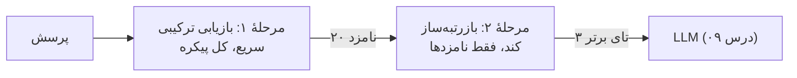
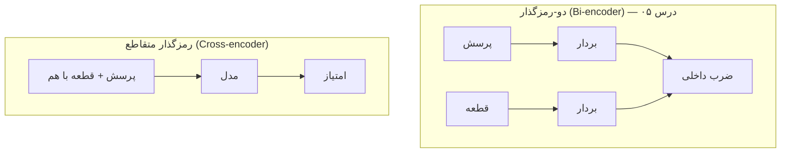
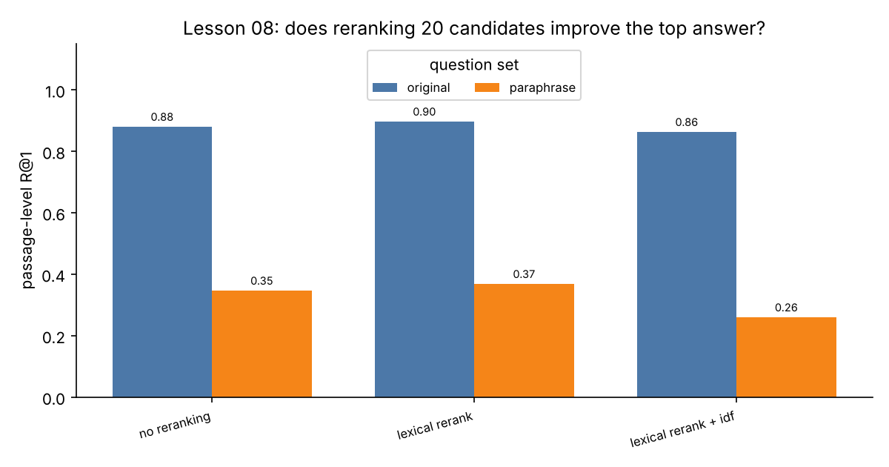

# درس ۰۸ — بازرتبه‌بندی (Reranking): زیاد بیاور، کم بفرست

بازیاب‌های درس ۰۷ سریع‌اند چون هر قطعه را **جداگانه** و با یک فرمول ساده امتیاز می‌دهند: بردار پرسش · بردار قطعه، یا جمع BM25. هیچ‌کدام پرسش و قطعه را **کنار هم** نمی‌خوانند. یک **بازرتبه‌ساز (Reranker)** دقیقاً همین کار را می‌کند — دقیق‌تر ولی کندتر — پس فقط روی چند ده نامزد اول اجرا می‌شود:



چرا این مهم است؟ LLM فقط چند قطعهٔ اول را می‌بیند (و هر قطعه هزینهٔ توکن دارد). اگر جواب در رتبهٔ ۷ باشد، برای LLM انگار وجود ندارد. بازرتبه‌بندی می‌خواهد **R@1 و R@3** را بالا ببرد؛ R@20 را مرحلهٔ اول تعیین می‌کند.

## سه نوع بازرتبه‌ساز

همه یک رابط (Protocol) دارند:

```python
reranker.rerank(query, results, top_k=3)   # -> list[SearchResult]، بهترین اول
```

| بازرتبه‌ساز | چه می‌کند | سرعت / هزینه | در این دوره |
|---|---|---|---|
| **واژگانی (Lexical)** | پوشش واژه‌های پرسش در قطعه، با تحمل غلط تایپی | خیلی سریع، آفلاین | `LexicalReranker` — تست‌ها و پیش‌فرض |
| **رمزگذار متقاطع (Cross-encoder)** | یک ترنسفورمر که پرسش و قطعه را با هم می‌خواند و یک عدد می‌دهد | ده‌ها میلی‌ثانیه برای هر جفت روی CPU | `CrossEncoderReranker` (`st`، روی کامپیوتر خودتان) |
| **LLM** | از LLM می‌پرسد «از ۰ تا ۱۰ این متن چقدر به پرسش جواب می‌دهد؟» | یک فراخوانی برای **هر** نامزد | `LLMReranker` (با `FakeLLM` در تست‌ها) |



دو-رمزگذار بردار قطعه‌ها را **یک بار** می‌سازد و ذخیره می‌کند؛ برای همین روی میلیون‌ها قطعه کار می‌کند. رمزگذار متقاطع برای **هر** جفت (پرسش، قطعه) یک بار اجرا می‌شود؛ دقیق‌تر است ولی فقط برای چند ده نامزد مقرون‌به‌صرفه است.

### بازرتبه‌ساز واژگانی (جایگزین آفلاین)

برای تست‌ها و CI یک بازرتبه‌ساز قطعی و بدون مدل ساختیم که پرسش و قطعه را با هم می‌خواند:

```text
score = coverage + proximity_weight · proximity + prior_weight / rank
```

- **پوشش (Coverage)**: چه کسری از واژه‌های محتوایی پرسش (بعد از حذف ایست‌واژه‌ها و ریشه‌یابی سبک درس ۰۷) در قطعه هست؟ تطبیق دقیق ۱ و تطبیق **تقریبی** ۰٫۷ — یعنی یک غلط تایپی (`قصطی` ≈ `قسطی`) یا پیشوند مشترک (`امتیاز` ≈ `امتیازهایی`)، برای واژه‌های دست‌کم ۴ حرفی. می‌توانید با `idf=bm25.idf` واژه‌های کمیاب را سنگین‌تر کنید.
- **نزدیکی (Proximity)**: `تعداد واژه‌های پیداشده / طول کوتاه‌ترین پنجره‌ای که همه را دارد`. «پیک تهران» در یک جمله بهتر از «پیک» در خط اول و «تهران» در خط آخر است — **در تئوری**.
- **پیشین (Prior)**: رتبهٔ مرحلهٔ اول، تا در حالت تقریباً برابر نظر بازیاب حفظ شود.

## اندازه‌گیری

```bash
python examples/reranking.py --chart
```

مرحلهٔ اول همان انتخاب درس ۰۷ است: RRF روی BM25 (با ریشه‌یابی سبک) و `HashingEmbedding`، ۲۰ نامزد. معیارها در سطح قطعه: R@1، R@3 و MRR روی ۱۰ نتیجهٔ اول. **قاعدهٔ بازی:** تنظیم‌ها را فقط روی پرسش‌های اصلی انتخاب می‌کنیم و بازنویسی‌ها را مثل یک مجموعهٔ **کنارگذاشته (Held-out)** فقط گزارش می‌کنیم.

| حالت | اصلی R@1 | R@3 | MRR@10 | بازنویسی R@1 | R@3 | MRR@10 |
|---|---|---|---|---|---|---|
| بدون بازرتبه‌بندی | 0.881 | 0.966 | 0.929 | 0.348 | 0.522 | 0.459 |
| **بازرتبه‌ساز واژگانی (پیش‌فرض)** | **0.898** | **1.000** | **0.949** | 0.370 | 0.522 | 0.488 |
| بازرتبه‌ساز واژگانی + وزن idf | 0.864 | 0.966 | 0.917 | 0.261 | 0.457 | 0.415 |



- روی پرسش‌های اصلی، بازرتبه‌بندی **هر** پاسخ را به ۳ قطعهٔ اول آورد (R@3 = ۱٫۰۰۰) و R@1 یک پرسش بهتر شد (۰٫۸۸۱ → ۰٫۸۹۸). روی بازنویسی‌ها هم کمی بهتر (MRR ۰٫۴۵۹ → ۰٫۴۸۸)، ولی این‌ها چند پرسش‌اند، نه یک تحول.
- **وزن idf ضرر زد** — برخلاف شهود. حدس ما: با idf، یک واژهٔ کمیاب ولی بی‌ربط در پرسش (مثل «کهربا» که فقط در بعضی قطعه‌ها آمده) وزن زیادی می‌گیرد. به‌جای حدس زدن، `per_question` را باز کنید و ببینید.

### آزمایش جداسازی (Ablation): نزدیکی و پیشین

| proximity / prior | اصلی R@1 | R@3 | MRR@10 | بازنویسی R@1 | R@3 | MRR@10 |
|---|---|---|---|---|---|---|
| 0.0 / 0.0 (پیش‌فرض) | 0.898 | 1.000 | 0.949 | 0.370 | 0.522 | 0.488 |
| 0.0 / 0.2 | 0.898 | 1.000 | 0.946 | 0.370 | 0.543 | 0.494 |
| 0.3 / 0.0 | 0.797 | 0.898 | 0.857 | 0.370 | 0.543 | 0.484 |
| 0.3 / 0.2 | 0.898 | 0.966 | 0.941 | 0.435 | 0.543 | 0.523 |
| 0.6 / 0.0 | 0.678 | 0.847 | 0.766 | 0.348 | 0.500 | 0.458 |
| 0.6 / 0.2 | 0.763 | 0.881 | 0.831 | 0.326 | 0.522 | 0.456 |

صادقانه: **نزدیکی روی پرسش‌های اصلی در هیچ تنظیمی کمک نکرد** و بدون پیشین شدیداً ضرر زد (R@1 تا ۰٫۶۷۸ افتاد). یک دلیل احتمالی: قطعه‌های ما با «زمینهٔ سرتیتر» شروع می‌شوند (درس ۰۴)، و دو واژهٔ رایج پرسش که کنار هم در یک سرتیتر آمده‌اند، امتیاز نزدیکی کامل می‌گیرند. پس پیش‌فرض را **۰** گذاشتیم؛ کدش هست تا روی دادهٔ خودتان امتحان کنید.

و یک دام آموزنده: ردیف `0.3 / 0.2` روی بازنویسی‌ها بهترین است (R@1 ۰٫۴۳۵). اگر تنظیم را روی مجموعهٔ بازنویسی انتخاب می‌کردیم، عدد گزارش‌شده‌مان **خوش‌بینانه** می‌شد — این همان **بیش‌برازش روی مجموعهٔ آزمون (Overfitting to the test set)** است. روی یک مجموعه تنظیم کنید، روی مجموعهٔ دیگر گزارش دهید (درس ۱۰).

### چند نامزد؟ تأخیر و هزینه

| fetch_k | اصلی R@1 | بازنویسی MRR@10 | زمان هر پرسش (ms، تقریبی) |
|---|---|---|---|
| — (بدون بازرتبه‌بندی) | 0.881 | 0.459 | ~2 |
| 10 | 0.898 | 0.469 | ~5 |
| 20 | 0.898 | 0.488 | ~9 |
| 40 | 0.898 | 0.482 | ~17 |

(زمان‌ها روی کامپیوتر ما اندازه‌گیری شده‌اند و روی کامپیوتر شما فرق می‌کنند؛ نسبت‌ها مهم‌اند.)

زمان بازرتبه‌بندی با تعداد نامزدها **خطی** رشد می‌کند، ولی کیفیت بعد از ۲۰ دیگر بهتر نمی‌شود. با یک LLM این بده‌بستان خیلی گران‌تر است. `LLMReranker` نقطه‌ای (Pointwise) است: برای هر نامزد یک فراخوانی. اسکریپت هزینه را **بدون** صدا زدن هیچ مدلی تخمین می‌زند (`FakeLLM` فراخوانی‌ها را ثبت می‌کند و `estimate_tokens` درس ۰۴ توکن‌ها را تخمین می‌زند):

| fetch_k | فراخوانی LLM برای هر پرسش | توکن ورودی برای هر پرسش (≈) |
|---|---|---|
| 10 | 10 | 2,866 |
| 20 | 20 | 5,710 |
| 40 | 40 | 11,384 |

یعنی بازرتبه‌بندی با LLM برای ۲۰ نامزد حدود **۲۰ برابر** فراخوانی‌ها و چند برابر توکن‌های خود تولید پاسخ است، به‌علاوهٔ تأخیر ۲۰ درخواست (مگر موازی بفرستید). برای همین در محصول معمولاً یک رمزگذار متقاطع کوچک کافی و خیلی ارزان‌تر است.

### با مدل واقعی، روی کامپیوتر خودتان

عددی برای مدل‌هایی که اجرا نکرده‌ایم نمی‌نویسیم. خودتان بسنجید:

```bash
pip install -e ".[st]"
python examples/reranking.py --cross-encoder BAAI/bge-reranker-v2-m3

pip install -e ".[openai]"
python examples/reranking.py --llm qwen2.5:7b --base-url http://localhost:11434/v1   # Ollama محلی
```

جایی که یک رمزگذار متقاطع چندزبانه باید بدرخشد، **بازنویسی‌ها** هستند: «کرایه» و «هزینه» برایش هم‌معنی‌اند، برای بازرتبه‌ساز واژگانی ما نه.

## تمرین

فایل `lessons/08-reranking/starter/rerank.py` را کامل کنید:

| تابع | راهنمایی |
|---|---|
| `sort_by_scores` | مرتب‌سازی پایدار نزولی؛ امتیاز جدید را در `SearchResult` بگذارید |
| `edit_distance_at_most_one` | دو اشاره‌گر؛ حداکثر یک اختلاف |
| `term_match` | ۱٫۰ / ۰٫۷ / ۰ |
| `min_window` | پنجرهٔ لغزان روی موقعیت‌های مرتب‌شده |
| `LexicalReranker.score` / `rerank` | فرمول بالا |
| `parse_score` | «امتیاز: ۷» → `7.0`؛ ارقام فارسی؛ محدود به [۰، ۱۰] |
| `LLMReranker.rerank` | یک `generate` برای هر نامزد |
| `RerankingRetriever.search` | `max(fetch_k, k)` نامزد، بعد `rerank(..., top_k=k)` |

```bash
python -m grader run 08          # ۲۱ بررسی
```

### برای کنجکاوها

- یک بازرتبه‌ساز LLM **فهرستی (Listwise)** بنویسید: همهٔ ۲۰ نامزد در یک پرامپت، و LLM فقط شمارهٔ ۳ تای بهتر را برگرداند. چند فراخوانی صرفه‌جویی می‌شود؟ چه خطری دارد (طول پرامپت، سوگیری جایگاه)؟
- `LexicalReranker` را روی خروجی **فقط BM25** اجرا کنید. بهبودش بیشتر است یا کمتر؟ چرا؟

## مطالعهٔ بیشتر

- Nogueira & Cho، *Passage Re-ranking with BERT* (2019) — نقطهٔ شروع بازرتبه‌سازهای متقاطع.
- [مستندات CrossEncoder در sentence-transformers](https://www.sbert.net/docs/cross_encoder/usage/usage.html) و کارت مدل [bge-reranker-v2-m3](https://huggingface.co/BAAI/bge-reranker-v2-m3).
- Sun et al.، *Is ChatGPT Good at Search? Investigating LLMs as Re-Ranking Agents* (2023) — بازرتبه‌بندی فهرستی با LLM.

درس بعد: **تولید مستند (Grounded generation)** — پاسخ با ارجاع به منبع، و شجاعت گفتن «نمی‌دانم».
