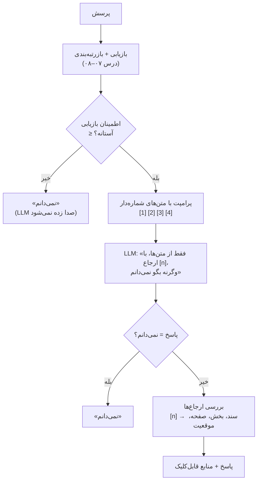

# درس ۰۹ — تولید مستند (Grounded generation): ارجاع به منبع و «نمی‌دانم»ِ صادقانه

> **ماژول:** `parsrag.generate` · **کد شروع:** `starter/generate.py` · **تصحیح:** `python -m grader run 09` (۲۰ بررسی) · **پیش‌نیاز:** [درس ۰۸ — بازرتبه‌بندی](../08-reranking/README.fa.md)

تا این‌جا روی **بازیابی** کار کردیم. حالا نوبت حرف زدن LLM است — و دو خطر بزرگ:

1. **توهم (Hallucination)**: مدل جوابی می‌سازد که در هیچ سندی نیست، با اعتمادبه‌نفس کامل.
2. **بی‌منبعی**: حتی اگر جواب درست باشد، کاربر نمی‌تواند بفهمد از کجا آمده و درستی‌اش را چک کند.

راه‌حل این درس سه لایه دارد:



## لایهٔ ۱: پرامپت با متن‌های شماره‌دار

هر قطعهٔ بازیابی‌شده یک **بلوک شماره‌دار** می‌شود، با برچسبی که هم مدل و هم انسان بفهمد از کجا آمده:

```text
متن‌ها:
[1] kahroba-shipping › شیوه‌های ارسال سفارش
شیوه‌های ارسال سفارش
# شیوه‌های ارسال سفارش

سفارش‌های داخل شهر تهران با پیک ویژهٔ کهربا حداکثر 24 ساعت پس از ثبت سفارش تحویل داده می‌شوند.
هزینهٔ پیک در تهران 45 هزار تومان است.
...

[2] kahroba-payment › روش‌های پرداخت
...

پرسش: هزینهٔ پیک در تهران چقدر است؟
```

و دستورالعمل سیستمی (`parsrag.generate.SYSTEM_PROMPT`):

```text
تو دستیار پاسخ‌گویی هستی که فقط بر اساس متن‌های شماره‌دارِ داده‌شده جواب می‌دهی.
قانون‌ها:
۱. فقط از اطلاعات همین متن‌ها استفاده کن، نه دانسته‌های خودت.
۲. بعد از هر جمله شمارهٔ متنِ منبع را در کروشه بیاور، مثل [1] یا [2][3].
۳. اگر پاسخ در متن‌ها نیست، فقط و دقیقاً بنویس: نمی‌دانم
۴. کوتاه، دقیق و به فارسی روان جواب بده.
```

چند نکتهٔ طراحی:

- **شمارهٔ ارجاع با رقم لاتین** (`[1]`) خواسته شده، ولی `parse_citations` رقم فارسی (`[۲]`) و فهرست (`[1، 3]`) را هم می‌فهمد — مدل‌ها همیشه دستور را دقیق اجرا نمی‌کنند.
- **جملهٔ ردّ دقیق** («فقط و دقیقاً بنویس: نمی‌دانم») تشخیص خودکار را ساده می‌کند. `is_refusal` گونه‌های نزدیک («نمیدانم»، «نمي دانم»، «در متن‌ها نیست») را هم با نرمال‌سازی درس ۰۲ می‌گیرد.
- اگر قطعه **پنجرهٔ جمله** داشته باشد (درس ۰۴)، همان پنجره به مدل نشان داده می‌شود.

## لایهٔ ۲: ارجاع‌هایی که به منبع واقعی وصل‌اند

ارجاع `[1]` برای کاربر بی‌معنی است؛ باید به **سند، بخش، صفحه و موقعیت دقیق** تبدیل شود. فرادادهٔ (Metadata) همهٔ این‌ها را درس ۰۴ روی هر قطعه گذاشته است:

```python
from parsrag.generate import GroundedGenerator

answer = generator.answer("هزینهٔ پیک در تهران چقدر است؟")
answer.answer        # 'هزینهٔ پیک در تهران 45 هزار تومان است. [1]'
answer.text          # همان، بدون [1]
answer.citations[0]  # Citation(number=1, chunk_id='kahroba-shipping#0', doc_id='kahroba-shipping',
                     #          section='شیوه‌های ارسال سفارش', page=None, start=0, end=375, score=...)
```

`start`/`end` موقعیت نویسه‌ها در **متن اصلی سند** است (نه متن نرمال‌شده)، پس یک رابط کاربری می‌تواند دقیقاً همان تکه را برجسته کند.

**اعتبارسنجی ارجاع (Citation validation)** دو خطای رایج را می‌گیرد:

| مشکل | مثال | در `GroundedAnswer` |
|---|---|---|
| ارجاع به بلوکی که وجود ندارد | ۴ بلوک داده‌ایم، مدل نوشته `[7]` | `invalid_citations=[7]` |
| پاسخ بدون هیچ ارجاع معتبر | «پاسخ بدون ارجاع.» | `uncited=True` |

```bash
python examples/grounded_answers.py
```

بخش ۵ خروجی یک «مدل شلخته» را شبیه‌سازی می‌کند:

| پاسخ مدل | ارجاع‌های نگه‌داشته | نامعتبر | بدون ارجاع | «نمی‌دانم» |
|---|---|---|---|---|
| پاسخ این است [1]. | [1] kahroba-returns#0 | — | False | False |
| پاسخ این است [7]. | — | [7] | True | False |
| پاسخ بدون ارجاع. | — | — | True | False |
| نمی‌دانم | — | — | False | True |

با `FakeLLM` (حالت استخراجی با `cite=True`) روی هر دو مجموعهٔ پرسش **صفر** ارجاع نامعتبر داشتیم — طبیعی است، چون جملهٔ پاسخ را عیناً از یک بلوک برمی‌دارد. با یک مدل واقعی این عدد را **خودتان** بشمارید (پایین‌تر).

## لایهٔ ۳: «نمی‌دانم»ِ صادقانه

دو جا می‌شود «نمی‌دانم» گفت:

- **آستانهٔ امتیاز بازیابی (Retrieval threshold)**: اگر حتی بهترین قطعه هم ضعیف است، اصلاً LLM را صدا نزن. ارزان و قطعی.
- **ردّ در سطح دستورالعمل (Instruction-level refusal)**: مدل خودش تشخیص بدهد جواب در متن‌ها نیست. هوشمندتر، ولی به مدل بستگی دارد.

### کدام امتیاز؟

آستانه روی **کدام** عدد؟ امتیاز RRF فقط از رتبه می‌آید (همیشه حدود ۰٫۰۳)، پس به درد نمی‌خورد. `GroundedGenerator` یک تابع `confidence` می‌گیرد و `retriever_confidence(r)` بهترین امتیاز یک بازیاب دیگر را برمی‌گرداند. سه سیگنال را امتحان کردیم. آستانه با `calibrate_threshold` روی پرسش‌های **اصلی** انتخاب شد (بیشترین F1)، و **بدون تغییر** روی بازنویسی‌ها اعمال شد. کلاس مثبت = «باید نمی‌دانم بگوید» (۷ پرسش بی‌پاسخ اصلی، ۵ بی‌پاسخ بازنویسی):

| سیگنال اطمینان | آستانه | اصلی P | R | F1 | بازنویسی P | R | F1 |
|---|---|---|---|---|---|---|---|
| **بیشترین امتیاز BM25** | 8.423 | 0.71 | 0.71 | **0.71** | 0.10 | 0.80 | 0.18 |
| بیشترین کسینوسی (hashing) | 0.404 | 0.67 | 0.29 | 0.40 | 0.08 | 0.60 | 0.14 |
| بیشترین امتیاز بازرتبه‌ساز | 0.904 | 0.21 | 1.00 | 0.35 | 0.10 | 1.00 | 0.18 |

- **امتیاز خام BM25** بهترین جداکننده است. امتیاز بازرتبه‌ساز («چه کسری از واژه‌های پرسش پیدا شد») بدترین: پرسش‌های بی‌پاسخ ما عمداً با واژه‌های پیکره نوشته شده‌اند («مدیر **کتابخانهٔ سپیدار** چه کسی است؟») و پوشش بالایی می‌گیرند.
- **و درس سخت: آستانه منتقل نمی‌شود.** همان آستانه روی بازنویسی‌ها F1 را به ۰٫۱۸ می‌رساند. چرا؟ پرسش‌های محاوره‌ای واژه‌های کمتری با اسناد شریک‌اند، پس BM25 به **پرسش‌های پاسخ‌دار** هم امتیاز کم می‌دهد و سیستم از جواب دادن به آن‌ها هم فرار می‌کند (جدول بعد). یک آستانه روی امتیاز واژگانی در واقع می‌سنجد «این پرسش چقدر شبیه اسناد نوشته شده»، نه «جوابش در اسناد هست یا نه».

### آستانه در برابر دستورالعمل

`FakeLLM` نمی‌فهمد، پس «ردّ در سطح دستورالعمل» را شبیه‌سازی می‌کنیم: اگر هیچ جمله‌ای از متن‌ها دست‌کم `min_overlap` واژهٔ محتوایی (غیر ایست‌واژه) با پرسش شریک نباشد، «نمی‌دانم» می‌گوید. `min_overlap=3` بهترین مقدار روی پرسش‌های اصلی بود. «پاسخ داده» = چند پرسش پاسخ‌دار واقعاً جواب گرفتند:

| حالت | اصلی P | R | F1 | پاسخ داده | بازنویسی P | R | F1 | پاسخ داده |
|---|---|---|---|---|---|---|---|---|
| پایه (`min_overlap=1`) | 0.00 | 0.00 | 0.00 | 59/59 | 0.33 | 0.20 | 0.25 | 44/46 |
| فقط دستورالعمل (`min_overlap=3`) | 0.40 | 0.57 | 0.47 | 53/59 | 0.11 | 1.00 | 0.20 | 6/46 |
| **فقط آستانه (BM25)** | **0.71** | **0.71** | **0.71** | **57/59** | 0.10 | 0.80 | 0.18 | 10/46 |
| آستانه + دستورالعمل | 0.42 | 0.71 | 0.53 | 52/59 | 0.10 | 1.00 | 0.19 | 3/46 |

- روی پرسش‌های اصلی، **آستانه به‌تنهایی** بهترین است: ۵ از ۷ پرسش بی‌پاسخ را رد می‌کند و فقط ۲ پرسش پاسخ‌دار را از دست می‌دهد. اضافه کردن دستورالعمل شبیه‌سازی‌شده فقط پرسش‌های پاسخ‌دار بیشتری را قربانی کرد.
- روی بازنویسی‌ها **همه** بد هستند: یا تقریباً همه چیز را جواب می‌دهند (پایه) یا تقریباً از همه چیز فرار می‌کنند. «نمی‌دانم» گفتن درست، به **فهمیدن** نیاز دارد، و `FakeLLM` و BM25 هیچ‌کدام نمی‌فهمند.
- این عددها دربارهٔ **یک مدل استخراجی ساختگی** هستند، نه یک LLM واقعی. یک LLM خوب در ردّ دستورالعملی احتمالاً خیلی بهتر است — ولی تا اندازه نگرفته‌اید، نمی‌دانید.

> انتخاب دوره: آستانه روی بیشترین امتیاز BM25، کالیبره‌شده روی `qa.jsonl`، به‌علاوهٔ دستورالعمل «نمی‌دانم» در پرامپت (برای مدل‌های واقعی). و یک هشدار در کارت پایپ‌لاین: «روی پرسش‌های محاوره‌ای بیش از حد نمی‌دانم می‌گوید». درس ۱۰ این‌ها را با پاسخ درست، وفاداری و ارجاع در یک گزارش جمع می‌کند.

## با یک مدل واقعی

هر مدلی که پروتکل OpenAI را بفهمد (سرویس ابری، vLLM، یا Ollama محلی) با `OpenAICompatibleLLM` وصل می‌شود. هیچ‌کدام از تست‌ها و CI این کار را نمی‌کنند:

```python
from parsrag.generate import GroundedGenerator, retriever_confidence
from parsrag.llm import OpenAICompatibleLLM

llm = OpenAICompatibleLLM("qwen2.5:7b", base_url="http://localhost:11434/v1")  # Ollama، بدون کلید
generator = GroundedGenerator(retriever, llm, k=4, min_score=8.4, confidence=retriever_confidence(bm25))
print(generator.answer("کارت هدیهٔ کهربا چه مدت اعتبار دارد؟").answer)
```

```bash
pip install -e ".[openai]"
python examples/grounded_answers.py --llm qwen2.5:7b --base-url http://localhost:11434/v1
```

این دو ردیف «فقط دستورالعمل» و «آستانه + دستورالعمل» را با مدل شما به جدول بالا اضافه می‌کند، و تعداد ارجاع‌های نامعتبر/جاافتاده را هم می‌شمارد. دو چیز را نگاه کنید: آیا مدل واقعی روی بازنویسی‌ها **کمتر** فرار می‌کند؟ آیا گاهی `[5]` می‌نویسد وقتی فقط ۴ بلوک داده‌اید؟

## تمرین

فایل `lessons/09-grounded-generation/starter/generate.py` را کامل کنید:

| تابع | راهنمایی |
|---|---|
| `block_header` / `build_context` / `build_messages` | قالب‌های بالا؛ پنجرهٔ جمله اگر هست |
| `parse_citations` | `\[ ... \]` با ارقام فارسی/لاتین و `،`/`,`؛ یکتا به ترتیب ظهور |
| `is_refusal` | `normalize` و جست‌وجوی گونه‌های «نمی‌دانم» |
| `validate_citations` / `to_citation` | valid / invalid / uncited؛ فراداده از `chunk.metadata` |
| `GroundedGenerator.answer` | نمودار بالای درس، از بالا به پایین |
| `AbstentionStats`، `abstention_stats` | مثبت = «باید نمی‌دانم بگوید» |
| `calibrate_threshold` | وسط امتیازهای متوالی؛ بیشترین F1 |

```bash
python -m grader run 09          # ۲۰ بررسی
```

آخرین بررسی کل پایپ‌لاین **شما** را روی پیکره اجرا می‌کند: دست‌کم ۵۰ پرسش پاسخ‌دار باید جواب بگیرند، همه با ارجاع معتبر، و دست‌کم ۸۰٪ ارجاع‌ها باید به قطعه‌ای اشاره کنند که شاهد پاسخ را دارد. 🎉

### برای کنجکاوها

- `k` را از ۴ به ۲ و ۸ تغییر دهید. ارجاع‌ها دقیق‌تر می‌شوند یا پرسش‌های بیشتری بی‌جواب می‌مانند؟
- یک «آستانهٔ نسبی» امتحان کنید: امتیاز BM25 تقسیم بر بیشترین امتیاز ممکن برای همان پرسش (`Σ idf × (k1+1)`). روی بازنویسی‌ها بهتر منتقل می‌شود؟
- پرامپت را عوض کنید تا مدل علاوه بر `[n]`، **عین جملهٔ منبع** را هم نقل کند. اعتبارسنجی را چطور گسترش می‌دهید تا چک کند نقل‌قول واقعاً در آن بلوک هست؟

## مطالعهٔ بیشتر

- Gao et al.، *Enabling Large Language Models to Generate Text with Citations* (ALCE، 2023) — معیارهای کیفیت ارجاع.
- Rajpurkar, Jia & Liang، *Know What You Don't Know: Unanswerable Questions for SQuAD* (2018) — چرا مجموعهٔ پرسش باید پرسش بی‌پاسخ داشته باشد.

## درس بعد

[درس ۱۰ — ارزیابی](../10-evaluation/README.fa.md): همهٔ این‌ها را در یک گزارش جمع می‌کنیم و آن را به یک دروازهٔ CI تبدیل می‌کنیم.
