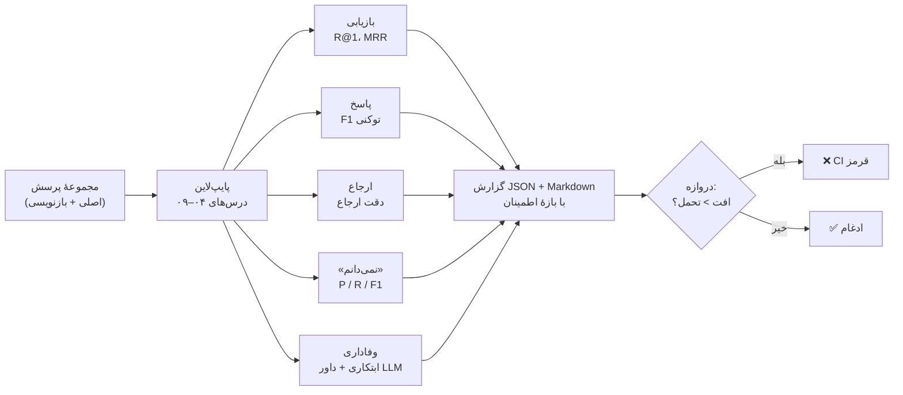

# درس ۱۰ — ارزیابی (Evaluation): از عدد تا دروازهٔ CI

در درس‌های ۰۷ تا ۰۹ مدام گفتیم «این بهتر شد» و «آن کمک نکرد». حالا سه سؤال جدی‌تر:

1. **چه چیزی** را بسنجیم؟ بازیابی خوب کافی نیست؛ پاسخ باید درست، مستند و صادق باشد.
2. **چقدر مطمئن** باشیم؟ با ۵۹ پرسش، یک پرسش یعنی ۱٫۷ واحد درصد. کدام بهبودها واقعی‌اند؟
3. چطور مطمئن شویم فردا **بدتر نمی‌شود**؟ ارزیابی را به یک تست CI تبدیل می‌کنیم.



## معیارها

`parsrag.eval.retrieval` (درس ۰۵) را دوباره به کار می‌بریم و این‌ها را به `parsrag.eval.generation` اضافه می‌کنیم:

| معیار | سؤال | چطور |
|---|---|---|
| **F1 توکنی (Token F1)** | پاسخ چقدر با پاسخ مرجع یکی است؟ | هم‌پوشانی واژه‌ها به سبک SQuAD، بعد از نرمال‌سازی فارسی |
| **دقت ارجاع (Citation precision)** | قطعه‌هایی که ارجاع داده شده، واقعاً شاهد پاسخ را دارند؟ | `contains_evidence` روی هر قطعهٔ ارجاع‌شده |
| **دقت/بازیابی «نمی‌دانم»** | به‌جا امتناع کرد؟ | درس ۰۹: مثبت = پرسش بی‌پاسخ |
| **وفاداری (Faithfulness)** | هر ادعای پاسخ در متن‌های بازیابی‌شده آمده؟ | ابتکاری (پایین) یا داور LLM |

### F1 توکنی با نرمال‌سازی فارسی

«۴۵ هزار تومان» و «45 هزار تومان است [1].» یک جواب‌اند. `answer_tokens` قبل از مقایسه: ارجاع‌های `[n]` را حذف می‌کند، `normalize` درس ۰۲ را اجرا می‌کند (ارقام، ی/ک)، جداکنندهٔ هزارگان را برمی‌دارد (`۱۰٬۴۲۰` = `10420`)، نیم‌فاصله را فاصله می‌کند (`می‌شود` = `می شود`) و چند واژهٔ دستوری («است»، «را»، «در»...) را کنار می‌گذارد:

```python
from parsrag.eval.generation import token_f1

token_f1("۴۵ هزار تومان.", "45 هزار تومان")                    # 1.0
token_f1("هزینهٔ پیک 45 هزار تومان است [1].", "۴۵ هزار تومان.")  # 0.75  (دقت ۰٫۶، بازیابی ۱)
```

با یک توکن‌ساز خام (`\w+` بدون نرمال‌سازی)، دومی ۰٫۴ می‌شد — فقط به‌خاطر رقم فارسی، «است» و شمارهٔ ارجاع.

### وفاداری: یک ابتکار شفاف

پاسخ را به جمله‌ها (ادعاها) می‌شکنیم. یک ادعا **پشتیبانی‌شده** است اگر در *یک* قطعهٔ بازیابی‌شده، دست‌کم ۸۰٪ واژه‌های محتوایی‌اش و **همهٔ عددهایش** آمده باشد:

```python
from parsrag.eval.generation import faithfulness

ctx = ["هزینهٔ پیک در تهران 45 هزار تومان است."]
faithfulness("هزینهٔ پیک 45 هزار تومان است [1]. ارسال با هواپیما در یک ساعت است.", ctx).score  # 0.5
faithfulness("هزینهٔ پیک در تهران 50 هزار تومان است.", ctx).score                                # 0.0 ← عدد غلط
```

قانون عدد مهم است: «۵۰ هزار» به‌جای «۴۵ هزار» از نظر واژه‌ها ۸۳٪ شبیه است (بالای آستانهٔ ۸۰٪)، ولی یک توهم کامل است. محدودیت‌های این روش را هم بدانید: نقیض را در جمله‌های بلند نمی‌بیند (تبدیل «می‌شود» به «نمی‌شود» در یک جملهٔ ده‌واژه‌ای فقط یک واژه را عوض می‌کند و از آستانهٔ ۸۰٪ رد می‌شود)، و بازنویسی درست با واژه‌های دیگر را ناپشتیبانی‌شده حساب می‌کند. برای همین یک داور LLM هم داریم.

### داور LLM (LLM-as-judge)

`LLMJudge` همین سؤال را با یک پرامپت فارسی از یک LLM می‌پرسد و «امتیاز: ۰ تا ۱۰» را به ۰ تا ۱ تبدیل می‌کند:

```text
متن‌های منبع:
[1] ...
پرسش: ...
پاسخ سیستم: ...

آیا **همهٔ** ادعاهای پاسخ سیستم در متن‌های منبع آمده است؟ ادعایی که در متن‌ها نیست،
حتی اگر درست باشد، پشتیبانی‌نشده حساب می‌شود.
دقیقاً در دو سطر جواب بده:
امتیاز: <عددی از ۰ (هیچ ادعایی پشتیبانی نمی‌شود) تا ۱۰ (همه پشتیبانی می‌شوند)>
دلیل: <یک جملهٔ کوتاه>
```

و یک داور `correctness` که پاسخ را با پاسخ مرجع **از نظر معنا** مقایسه می‌کند (جایی که F1 توکنی کم می‌آورد: «خیر» و «نه، ممکن نیست»).

داورها **سوگیری (Bias)** دارند و باید این را جدی بگیرید:

| سوگیری | یعنی | چه کنیم |
|---|---|---|
| **طول (Verbosity)** | پاسخ بلندتر امتیاز بیشتری می‌گیرد | در پرامپت صریحاً بگویید طول مهم نیست؛ با نمونه‌های کوتاه و بلند چک کنید |
| **جایگاه (Position)** | در مقایسهٔ دوتایی، گزینهٔ اول (یا دوم) ترجیح داده می‌شود | ترتیب را عوض کنید و میانگین بگیرید |
| **خودی (Self-preference)** | داور متن مدل‌های هم‌خانوادهٔ خودش را ترجیح می‌دهد | داور را از خانوادهٔ دیگری انتخاب کنید |
| **حساسیت به پرامپت** | تغییر کوچک در عبارت، امتیازها را جابه‌جا می‌کند | پرامپت داور را نسخه‌بندی کنید و با برچسب انسانی بسنجید |

اسکریپت زیر سوگیری طول را با یک داور **ساختگی** (`FakeLLM`ی که عمداً به طول امتیاز می‌دهد) نشان می‌دهد — این یک شبیه‌سازی است، نه اندازه‌گیری یک مدل واقعی:

| پاسخ | وفاداری ابتکاری | داور طول‌دوست (ساختگی) |
|---|---|---|
| کوتاه و درست | 1.00 | 0.10 |
| بلند، با یک ادعای بی‌پشتوانه | 0.50 | 0.70 |

قبل از اعتماد به یک داور واقعی، روی ۲۰–۳۰ پاسخ خودتان برچسب «وفادار / ناوفادار» بزنید و **توافق** داور با خودتان را بسنجید. اسکریپت این را برای ابتکار در برابر داور انجام می‌دهد:

```bash
pip install -e ".[openai]"
python examples/evaluation_report.py --judge qwen2.5:7b --base-url http://localhost:11434/v1
```

## گزارش پایپ‌لاین دوره

`evaluate_pipeline(generator, qa)` همه را یک‌جا حساب می‌کند. `build_course_pipeline()` پایپ‌لاین انتخابی درس‌های ۰۴–۰۹ را می‌سازد (آفلاین و قطعی):

```bash
python -m parsrag.eval run --json report.json --markdown report.md
```

خلاصهٔ گزارش (کامل در [`docs/eval/report.md`](../../docs/eval/report.md)؛ بازه‌ها ۹۵٪ بوت‌استرپ):

| معیار | اصلی (۶۶ پرسش) | بازنویسی (۵۱ پرسش) |
|---|---|---|
| بازیابی R@1 | 0.898 [0.814, 0.966] | 0.370 [0.239, 0.500] |
| بازیابی MRR@10 | 0.949 [0.907, 0.983] | 0.488 [0.372, 0.600] |
| F1 پاسخ (امتناع = ۰) | 0.289 [0.221, 0.360] | 0.016 [0.005, 0.031] |
| دقت ارجاع | 0.860 [0.772, 0.947] | 0.800 [0.500, 1.000] |
| وفاداری (ابتکاری) | 1.000 | 1.000 |
| «نمی‌دانم» F1 | 0.714 | 0.178 |
| نرخ پاسخ به پرسش‌های پاسخ‌دار | 0.966 | 0.217 |

چطور بخوانیم:

- **وفاداری ۱٫۰ ولی F1 پاسخ ۰٫۲۹.** `FakeLLM` استخراجی جمله‌ها را عیناً کپی می‌کند، پس هرگز توهم نمی‌زند — ولی اغلب جملهٔ **اشتباه** یا یک جملهٔ طولانی را برمی‌دارد. **وفادار بودن با درست بودن یکی نیست**؛ هر دو را بسنجید.
- **دقت ارجاع ۰٫۸۶**: در ۱۴٪ پاسخ‌ها، قطعهٔ ارجاع‌شده شاهد پاسخ را ندارد — یعنی مدل از قطعهٔ دیگری جمله برداشته.
- **روی بازنویسی‌ها پایپ‌لاین عملاً از کار می‌افتد**: فقط به ۲۲٪ پرسش‌های پاسخ‌دار جواب می‌دهد (آستانهٔ BM25 درس ۰۹) و F1 تقریباً صفر است. این مهم‌ترین یافتهٔ این دوره تا این‌جاست، و دقیقاً همان چیزی که یک برداری‌ساز عصبی و یک LLM واقعی باید درست کنند. **اندازه بگیرید**، فرض نکنید.

## چقدر مطمئنیم؟ بوت‌استرپ

**بوت‌استرپ (Bootstrap)**: از همان پرسش‌ها، با جایگذاری، هزاران «مجموعهٔ پرسش خیالی» هم‌اندازه بساز و معیار را روی هر کدام حساب کن. پراکندگی این عددها نشان می‌دهد چقدر از نتیجه **شانسی** است.

```python
from parsrag.eval.stats import bootstrap_ci, paired_bootstrap

bootstrap_ci(per_question_rr)            # Interval(mean=0.949, low=0.907, high=0.983)
paired_bootstrap(rr_before, rr_after)    # بازهٔ اطمینانِ «بعد − قبل» روی همان پرسش‌ها
```

برای مقایسهٔ دو سیستم، **بوت‌استرپ جفتی (Paired)** بگیرید: پرسش‌ها را نمونه‌گیری کنید، نه هر سیستم را جدا — «پرسشی که برای هر دو سخت است» نباید نویز حساب شود. حالا ادعاهای درس‌های قبل را آزمایش می‌کنیم:

```bash
python examples/evaluation_report.py
```

| ادعا | اصلی ΔMRR [۹۵٪] | بازنویسی ΔMRR [۹۵٪] |
|---|---|---|
| درس ۰۷: ریشه‌یابی سبک به BM25 کمک می‌کند | +0.021 [-0.012, +0.059] **نشان داده نشد** | +0.017 [-0.040, +0.082] **نشان داده نشد** |
| درس ۰۷: ترکیبی بهتر از dense تنهاست | +0.072 [+0.018, +0.134] **واقعی** | +0.117 [+0.032, +0.211] **واقعی** |
| درس ۰۷: ترکیبی بهتر از BM25 + ریشه‌یابی است | +0.036 [-0.008, +0.084] **نشان داده نشد** | +0.020 [-0.046, +0.077] **نشان داده نشد** |
| درس ۰۸: بازرتبه‌بندی کمک می‌کند | +0.020 [-0.014, +0.058] **نشان داده نشد** | +0.029 [-0.039, +0.103] **نشان داده نشد** |

از چهار «بهبود» درس‌های قبل، فقط **یکی** با این تعداد پرسش قابل دفاع است. بقیه شاید واقعی باشند، شاید نه — داده‌های ما نمی‌تواند بگوید. «نشان داده نشد» یعنی «نمی‌دانیم»، نه «اثری ندارد».

و پهنای بازه با تعداد پرسش چطور کم می‌شود (R@1 = ۰٫۹ ثابت):

| تعداد پرسش | بازهٔ ۹۵٪ | پهنا |
|---|---|---|
| 20 | [0.750, 1.000] | 0.250 |
| 59 | [0.814, 0.966] | 0.153 |
| 200 | [0.855, 0.940] | 0.085 |
| 1000 | [0.880, 0.918] | 0.038 |

پهنا تقریباً با `۱/√n` کم می‌شود: برای نصف کردن عدم‌قطعیت، **چهار برابر** پرسش لازم است.

### مجموعهٔ کنارگذاشته را دست نزنید

در درس‌های ۰۸ و ۰۹ تنظیم‌ها (وزن‌ها، آستانه) را **فقط** روی `qa.jsonl` انتخاب کردیم و `qa_paraphrase.jsonl` را فقط گزارش دادیم. اگر روی مجموعه‌ای تنظیم کنید که رویش گزارش می‌دهید، عددتان خوش‌بینانه است — در درس ۰۸ دیدیم بهترین تنظیم روی بازنویسی‌ها، تنظیمی نبود که روی پرسش‌های اصلی انتخاب می‌شد. در یک پروژهٔ واقعی: یک مجموعهٔ **ثابت** کنارگذاشته داشته باشید، به آن پرسش اضافه نکنید و هر بار بعد از نگاه کردن به آن تصمیم عوض نکنید؛ پرسش‌های تازه را به مجموعهٔ توسعه (Development set) اضافه کنید.

## ارزیابی به‌عنوان CI

پایپ‌لاین دوره **قطعی** است (بدون مدل تصادفی، بدون شبکه)، پس می‌توانیم عددهایش را در مخزن ثبت کنیم و هر تغییری را با آن مقایسه کنیم:

```bash
python -m parsrag.eval gate --baseline docs/eval/baseline.json
```

```text
| set | metric | baseline | current | Δ | |
|---|---|---|---|---|---|
| original | abstention_f1 | 0.714 | 0.714 | +0.000 | ✔ |
| original | answer_f1 | 0.289 | 0.289 | +0.000 | ✔ |
...
✔ no metric dropped by more than 0.02 — gate passed.
```

این فرمان در CI همین مخزن اجرا می‌شود (`.github/workflows/ci.yml`). اگر یک تغییر، مثلاً در توکن‌ساز یا نرمال‌ساز، R@1 روی هر مجموعه را بیش از ۰٫۰۲ پایین بیاورد، CI قرمز می‌شود.

- **چرا تحمل ۰٫۰۲؟** روی ۵۹ پرسش، یک پرسش ≈ ۰٫۰۱۷. پس دروازه با **از دست رفتن حتی یک پرسش** در R@1 هشدار نمی‌دهد ولی با دو پرسش می‌دهد. این تحمل خیلی کوچک‌تر از بازهٔ اطمینان است — و درست است: دروازه نمی‌پرسد «آیا بهبود از نظر آماری معنادار است؟»؛ می‌پرسد «آیا رفتار یک سیستم قطعی بی‌صدا عوض شد؟».
- **بهبود هیچ‌وقت شکست نیست.** وقتی عمداً پایپ‌لاین را بهتر کردید، `--update` را بزنید و تغییر `baseline.json` را در همان PR بگذارید تا بازبین ببیند کدام عددها عوض شده‌اند:

```bash
python -m parsrag.eval gate --baseline docs/eval/baseline.json --update
```

- **با مدل واقعی** (غیرقطعی و پولی) این دروازه را در CI اجرا نکنید؛ به‌جایش یک گزارش شبانه با چند تکرار و بازهٔ اطمینان بسازید.

## تمرین

سه فایل در `lessons/10-evaluation/starter/`:

| فایل | تابع | راهنمایی |
|---|---|---|
| `generation.py` | `answer_tokens`، `token_f1` | ترتیب: ارجاع‌ها، `normalize`، هزارگان، نیم‌فاصله، ایست‌واژه‌ها؛ `Counter` برای هم‌پوشانی |
| `generation.py` | `citation_precision`، `citation_hit` | `contains_evidence` درس ۰۵ |
| `generation.py` | `split_claims`، `check_claim`، `faithfulness` | ۸۰٪ واژه‌ها **و** همهٔ عددها در یک قطعه |
| `generation.py` | `LLMJudge._ask` / `faithfulness` / `correctness` | `parse_score` درس ۰۸، تقسیم بر ۱۰ |
| `stats.py` | `bootstrap_ci`، `paired_bootstrap` | `np.random.default_rng(seed)`، چندک‌ها |
| `gate.py` | `compare_metrics` | معیارهای جاافتاده هم شکست‌اند |

```bash
python -m grader run 10          # ۱۴ بررسی
```

آخرین بررسی، `token_f1` و `faithfulness` **شما** را روی پاسخ‌های پایپ‌لاین دوره اجرا می‌کند و انتظار دارد دقیقاً عددهای `docs/eval/baseline.json` را بازتولید کنید. 🎉

### برای کنجکاوها

- یک تغییر عمدی بدهید (مثلاً در `build_course_pipeline` به‌جای `RecursiveChunker(400, 50)` قطعه‌های ۲۰۰ نویسه‌ای) و `gate` را اجرا کنید. کدام معیارها قرمز می‌شوند؟
- ۲۰ پاسخ از `report.json` را خودتان برچسب بزنید (درست / غلط). F1 توکنی با برچسب شما چقدر هم‌خوان است؟ کجا اشتباه می‌کند؟
- ۳۰ پرسش بازنویسی‌شدهٔ تازه بنویسید و بازه‌های اطمینان را دوباره حساب کنید. ادعای «بازرتبه‌بندی کمک می‌کند» قابل دفاع شد؟

## مطالعهٔ بیشتر

- Es et al.، *RAGAS: Automated Evaluation of Retrieval Augmented Generation* (2023) — وفاداری و ارتباط پاسخ به‌عنوان معیار.
- Zheng et al.، *Judging LLM-as-a-Judge with MT-Bench and Chatbot Arena* (2023) — سوگیری‌های جایگاه، طول و خودی.
- Efron & Tibshirani، *An Introduction to the Bootstrap* (1993) — مرجع کلاسیک بوت‌استرپ.
- Dror et al.، *The Hitchhiker's Guide to Testing Statistical Significance in NLP* (ACL 2018).

درس بعد: **RAG عامل‌محور (Agentic RAG) با LangGraph** — وقتی یک بار بازیابی کافی نیست.
