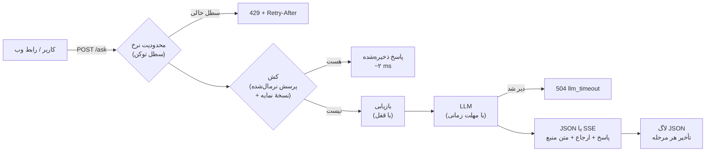

# درس ۱۲ — API تولیدی (Production API): FastAPI، استریم، کش، محدودیت نرخ و Docker

> **ماژول:** `parsrag.api` (`cache`، `ratelimit`) · **کد شروع:** `starter/cache.py`، `starter/ratelimit.py` · **تصحیح:** `python -m grader run 12` (۱۰ بررسی) · **پیش‌نیاز:** [درس ۱۱ — RAG عامل‌محور با LangGraph](../11-agentic-rag/README.fa.md)

تا این‌جا همه‌چیز یک کتابخانهٔ پایتون بود: یک نفر، یک ترمینال، یک پرسش. در دنیای واقعی، RAG یک **سرویس** است: ده‌ها کاربر هم‌زمان، مدلی که گاهی کند است یا جواب نمی‌دهد، پرسش‌هایی که بارها تکرار می‌شوند، و کسی که ساعت سه صبح باید از روی لاگ‌ها بفهمد چه شد.

این درس پایپ‌لاین درس‌های ۰۴–۰۹ را — از طریق `PersianRAG`، شیء یک‌جایی که در درس ۱۳ کامل معرفی می‌شود — پشت یک API می‌گذارد:



```bash
pip install -e ".[api]"
parsrag serve --docs data/fixtures/corpus      # http://127.0.0.1:8000  و  /docs برای OpenAPI
```

## نقطه‌های پایانی (Endpoints)

| مسیر | کار | پاسخ |
|---|---|---|
| `GET /health` | سلامت سرویس | وضعیت، تعداد سند و قطعه، نسخهٔ نمایه، آمار کش |
| `POST /ingest` | افزودن سند به‌صورت JSON | `{"documents": [{"id", "text", "title"}]}` |
| `POST /ingest/files` | بارگذاری فایل (TXT، MD، HTML، DOCX، PDF — درس ۰۳) | همان |
| `GET /documents`، `GET /documents/{id}` | فهرست و متن کامل سندها | برای رابط کاربری |
| `POST /ask` | پرسش → پاسخ با ارجاع | `AskResponse` |
| `POST /ask/stream` | همان، به‌صورت **رویدادهای سرور (SSE)** | `sources` → `token`… → `done` |

مدل‌های درخواست و پاسخ با **pydantic** تعریف شده‌اند؛ FastAPI از روی آن‌ها هم ورودی را اعتبارسنجی می‌کند (پرسش خالی → `422`) و هم مستندات OpenAPI را در `/docs` می‌سازد:

```python
class AskRequest(BaseModel):
    question: str = Field(min_length=1, max_length=2000)

class AskResponse(BaseModel):
    question: str
    answer: str            # با [n]
    text: str              # بدون [n]
    abstained: bool
    abstain_reason: str | None
    citations: list[Citation]   # doc_id، section، start، end، و passage: متن دقیق منبع
    cached: bool
    timings: StageTimings       # retrieve_ms، generate_ms، total_ms
```

```bash
curl -s -X POST http://127.0.0.1:8000/ask -H 'content-type: application/json' \
     -d '{"question": "هزینهٔ پیک در تهران چقدر است؟"}'
```

```json
{"text": "هزینهٔ پیک در تهران 45 هزار تومان است.", "abstained": false, "cached": false,
 "citations": [{"number": 1, "doc_id": "kahroba-shipping", "section": "شیوه‌های ارسال سفارش",
                "start": 0, "end": 375, "passage": "# شیوه‌های ارسال سفارش\n\nسفارش های داخل شهر تهران ..."}],
 "timings": {"retrieve_ms": 7.0, "generate_ms": 0.9, "total_ms": 7.9}}
```

`passage` متن **اصلی** سند است (با `start`/`end` درس ۰۴)، نه متن نرمال‌شده — کاربر باید همان چیزی را ببیند که در سند نوشته شده.

## پیکربندی از متغیرهای محیطی

یک سرویس را با **متغیر محیطی** پیکربندی می‌کنیم، نه با ویرایش کد — همان تصویر Docker با تنظیمات مختلف در محیط‌های مختلف اجرا می‌شود (اصل سوم «Twelve-Factor App»):

| متغیر | معنا | پیش‌فرض |
|---|---|---|
| `PARSRAG_CONFIG` | فایل `parsrag.toml` (درس ۱۳) | — |
| `PARSRAG_INDEX` / `PARSRAG_DOCS` | نمایهٔ ذخیره‌شده / پوشه‌ای برای نمایه‌سازی هنگام شروع | — |
| `PARSRAG_DATABASE_URL` | PostgreSQL + pgvector به‌جای حافظه | — |
| `PARSRAG_LLM_PROVIDER` / `_MODEL` / `_BASE_URL` | مدل زبانی (`fake`، `ollama`، `openai`) | از پیکربندی |
| `PARSRAG_LLM_TIMEOUT` | مهلت مدل، ثانیه | 30 |
| `PARSRAG_CACHE_SIZE` / `PARSRAG_CACHE_TTL` | اندازهٔ کش / عمر هر پاسخ (ثانیه) | 256 / 3600 |
| `PARSRAG_RATE_LIMIT` | درخواست در دقیقه برای هر کاربر (۰ = خاموش) | 60 |
| `PARSRAG_MAX_UPLOAD_MB` / `PARSRAG_LOG_LEVEL` | بیشینهٔ فایل / سطح لاگ | 20 / INFO |

کلید API هیچ‌وقت در فایل نیست: `OPENAI_API_KEY` از محیط خوانده می‌شود.

## کش پاسخ: کلید = پرسش نرمال‌شده

پرسش‌های تکراری در یک سرویس واقعی زیادند («ساعت کاری؟»، «هزینهٔ ارسال؟»)، و هر بار LLM را صدا زدن یعنی پول و ثانیه. ولی کاربرها یک پرسش را **یک‌جور** تایپ نمی‌کنند: «هزینهٔ پیک چقدر است؟» با صفحه‌کلید عربی می‌شود «هزينه پيک چقدر است». پس کلید کش، خود متن نیست:

```python
normalize_question("  هزينه پيک   چقدر است؟ ")   # 'هزینه پیک چقدر است'
cache_key(question, rag.index_version)            # sha256(نسخه + \x00 + پرسش نرمال‌شده)
```

`normalize` درس ۰۲ (ی/ک عربی، ارقام، نیم‌فاصله)، حروف کوچک، حذف نشانه‌ها و فاصله‌های اضافه. **نسخهٔ نمایه** هم در کلید است: با افزودن یک سند، `index_version` بالا می‌رود و هیچ پاسخ کهنه‌ای برنمی‌گردد. کش خودش **LRU با عمر محدود (TTL)** است: قدیمی‌ترین استفاده‌شده‌ها اول بیرون می‌روند و هیچ پاسخی بیش از `PARSRAG_CACHE_TTL` نمی‌ماند.

```bash
python examples/api_latency.py
```

روی ۱۱۷ پرسش هر دو مجموعه، از طریق خود اپ FastAPI (درون‌فرایندی، بدون شبکه؛ یک اجرا روی ماشین ما — عددهای شما فرق می‌کند):

| درخواست | میانه (ms) | صدک ۹۵ (ms) |
|---|---|---|
| کش خالی (رفت‌وبرگشت کامل HTTP) | 9.08 | 13.23 |
| … که بازیابی‌اش (زمان‌سنجی سرور) | 6.15 | 9.67 |
| کش پر (همان پرسش دوباره) | 1.90 | 2.56 |

| همان پرسش، با ي/ك عربی، بدون «؟» و با فاصله‌های اضافه | برخورد با کش |
|---|---|
| کلید = متن خام پرسش | 0/117 |
| کلید = پرسش نرمال‌شده (`cache_key`) | 117/117 |

با `FakeLLM` تولید تقریباً رایگان است، پس بیشترِ زمانِ «کش خالی» بازیابی است. با یک مدل واقعی، تفاوت کش پر و خالی از چند میلی‌ثانیه به **ثانیه‌ها** می‌رسد. برای این‌که این را بدون مدل واقعی ببینیم، یک مدل **شبیه‌سازی‌شده** با ۳۰ میلی‌ثانیه برای هر واژه (این عدد را ما انتخاب کرده‌ایم، اندازه‌گیری یک مدل واقعی نیست):

| درخواست (مدل شبیه‌سازی‌شده، ۳۰ ms/واژه) | میانه (ms) | صدک ۹۵ (ms) |
|---|---|---|
| کش خالی | 251.80 | 880.83 |
| کش پر | 2.47 | 3.71 |

**کِی کش خطرناک است؟** وقتی پاسخ به کاربر بستگی دارد (سطح دسترسی، زبان، تاریخ)، آن هم باید در کلید باشد. و یک پاسخ غلط در کش، تا TTL تمام شود، غلط می‌ماند — برای همین با هر تغییر نمایه کل کش عملاً باطل می‌شود.

## محدودیت نرخ: سطل توکن

هر کاربر (کلید `X-API-Key`، یا نشانی IP) یک **سطل** با `rate` توکن دارد. هر درخواست `POST` یک توکن برمی‌دارد و سطل با سرعت `rate / 60` توکن در ثانیه پر می‌شود:

```text
rate = 60/دقیقه:  ۶۰ درخواست پشت‌سرهم مجاز است (انفجار)،
                  بعد هر ثانیه یکی؛ سطل خالی → 429 و  Retry-After: ثانیه تا توکن بعدی
```

چرا سطل توکن و نه «حداکثر ۶۰ در هر دقیقهٔ ساعت»؟ چون پنجرهٔ ثابت اجازه می‌دهد کسی ۶۰ درخواست در ثانیهٔ آخر یک دقیقه و ۶۰ تای دیگر در ثانیهٔ اول دقیقهٔ بعد بفرستد. سطل توکن میانگین را محدود می‌کند و انفجار را تا اندازهٔ سطل می‌پذیرد. محدودیت **درون حافظهٔ یک فرایند** است: با چند worker یا چند ماشین، سطل‌ها را در Redis یا در دروازهٔ API (Gateway) بگذارید.

## استریم با رویدادهای سرور (Server-Sent Events)

کاربر نباید چند ثانیه به صفحهٔ خالی نگاه کند. `POST /ask/stream` پاسخ را **واژه به واژه** می‌فرستد:

```text
event: sources
data: [{"number": 1, "doc_id": "kahroba-shipping", ...}]

event: token
data: {"text": "هزینهٔ "}

event: token
data: {"text": "پیک "}
...
event: done
data: {"answer": "هزینهٔ پیک در تهران 45 هزار تومان است. [1]", "citations": [...], "timings": {...}}
```

رویداد `done` همان `AskResponse` کامل است: ارجاع‌ها **بعد از** تمام شدن متن، روی کل پاسخ اعتبارسنجی می‌شوند (درس ۰۹). اگر مدل وسط کار از مهلت بگذرد، به‌جای `done` یک `event: error` می‌آید. چون پرسش در بدنهٔ `POST` است، در مرورگر از `fetch` و `ReadableStream` استفاده می‌کنیم، نه `EventSource` (که فقط `GET` دارد) — رابط وب درس ۱۳ همین کار را می‌کند.

`LLM`ها اگر متد `stream` داشته باشند (`OpenAICompatibleLLM.stream` با `"stream": true`)، واقعاً تکه‌تکه می‌فرستند؛ وگرنه `stream_text` پاسخ کامل را واژه‌به‌واژه می‌شکند. با همان مدل شبیه‌سازی‌شده، زمان سمت سرور تا اولین واژه:

| لحظه (۱۹ پرسش پاسخ‌دار، مدل شبیه‌سازی‌شده) | میانه (ms) | صدک ۹۵ (ms) |
|---|---|---|
| اولین واژه | 37.21 | 42.92 |
| کل پاسخ | 345.86 | 1130.20 |

استریم کل کار را سریع‌تر **نمی‌کند**؛ فقط زمانی را که کاربر چیزی نمی‌بیند کوتاه می‌کند.

## لاگ ساختاریافته با تأخیر هر مرحله

هر خط لاگ یک شیء JSON است — قابل جست‌وجو و نمودارکشی با هر ابزاری:

```json
{"ts": "2026-10-31T15:51:41.228+00:00", "level": "INFO", "event": "ask", "question_id": "d90ebca3c504",
 "question_chars": 29, "stream": false, "cached": false, "abstained": false, "abstain_reason": null,
 "citations": 1, "retrieve_ms": 7.0, "generate_ms": 0.88, "total_ms": 7.88}
{"ts": "2026-10-31T15:51:41.228+00:00", "level": "INFO", "event": "request", "method": "POST",
 "path": "/ask", "status": 200, "duration_ms": 9.03}
```

دو تصمیم: (۱) تأخیر **جدا برای هر مرحله** (`retrieve_ms` در برابر `generate_ms`) — وقتی سرویس کند شد، اول باید بدانید کدام مرحله؛ (۲) **خود پرسش لاگ نمی‌شود**، فقط یک اثر انگشت کوتاه و طولش. پرسش‌ها می‌توانند اطلاعات شخصی داشته باشند و لاگ‌ها معمولاً بیشتر از داده‌ها نگه داشته و دیده می‌شوند. از روی `abstain_reason` هم می‌توانید نرخ «نمی‌دانم» را در طول زمان دنبال کنید — نشانهٔ خوبی از این‌که کاربران دربارهٔ چیزهایی می‌پرسند که در اسناد نیست.

## خطاها: واضح و قابل‌اقدام

| وضعیت | کد | `error` |
|---|---|---|
| هنوز سندی نمایه نشده | 409 | `empty_index` |
| سند تکراری | 409 | `duplicate_document` |
| ورودی نامعتبر (پرسش خالی، بیش از ۲۰۰۰ نویسه) | 422 | (اعتبارسنجی FastAPI) |
| فایل بزرگ‌تر از حد / نوع پشتیبانی‌نشده | 413 / 415 | `file_too_large` / `unsupported_file` |
| درخواست زیاد | 429 | `rate_limited` + `Retry-After` |
| مدل خطا داد | 502 | `llm_error` |
| مدل در مهلت جواب نداد | 504 | `llm_timeout` |

همه با یک بدنهٔ یکسان: `{"error": "...", "message": "..."}` — `error` برای کد برنامه، `message` (انگلیسی/فارسی) برای انسان.

**هم‌زمانی:** بازیابی زیر یک قفل اجرا می‌شود (افزودن سند، نمایهٔ BM25 و انبارهٔ برداری را تغییر می‌دهد)، ولی فراخوانی LLM **بیرون از قفل** است تا پرسش‌های کند همدیگر را معطل نکنند. مدل در یک thread با `asyncio.wait_for` و مهلت `PARSRAG_LLM_TIMEOUT` اجرا می‌شود.

## Docker: تصویر کوچک، کاربر غیر root

```dockerfile
FROM python:3.12-slim AS build                        # مرحلهٔ ساخت: wheelها
RUN pip wheel --wheel-dir /wheels ".[api,openai,loaders,pgvector]"

FROM python:3.12-slim                                 # مرحلهٔ اجرا: فقط wheelها
RUN useradd --create-home --uid 10001 parsrag
RUN pip install --no-index --find-links /wheels "parsrag[...]"
USER parsrag                                          # هرگز root
HEALTHCHECK CMD python -c "import urllib.request; urllib.request.urlopen('http://127.0.0.1:8000/health')"
CMD ["parsrag", "serve", "--host", "0.0.0.0", "--port", "8000"]
```

- **چندمرحله‌ای (Multi-stage)**: ابزار ساخت در تصویر نهایی نمی‌ماند.
- **غیر root**: اگر کسی از راه یک باگ وارد کانتینر شد، دسترسی root ندارد.
- **HEALTHCHECK**: Docker (و Compose و Kubernetes) خودشان می‌فهمند سرویس زنده است یا نه.

```bash
docker build -t parsrag .
docker run --rm -p 8000:8000 -v "$PWD/data/fixtures/corpus:/data/docs:ro" parsrag
```

روی ماشین ما: تصویر ۴۲۰ مگابایت، کانتینر با `uid=10001` اجرا شد و بعد از ۳۰ ثانیه وضعیتش `healthy` بود.

### با PostgreSQL + pgvector

`docker-compose.yml` دو سرویس دارد: `pgvector/pgvector:pg16` و API. API با `PARSRAG_DATABASE_URL` بردارها را به‌جای حافظه در PostgreSQL می‌گذارد (`PgVectorStore` درس ۰۶):

```bash
docker compose up --build
# با Ollama روی همین کامپیوتر:
PARSRAG_LLM_PROVIDER=ollama PARSRAG_LLM_MODEL=qwen2.5:7b docker compose up --build
```

روی ماشین ما، `docker compose up` جدول `parsrag_chunks` را با ۱۰۹ قطعهٔ پیکرهٔ دوره پر کرد و `/ask` از طریق آن جواب داد. یک انتخاب ساده‌کننده: پوشهٔ اسناد **منبع حقیقت** است و جدول در هر شروع از نو ساخته می‌شود — برای چند هزار سند خوب است؛ برای بیشتر، نمایه‌سازی را به یک کار جدا (`parsrag ingest`) منتقل کنید. نمایهٔ BM25 هنوز در حافظهٔ API است؛ برای جست‌وجوی واژگانی در خود پایگاه داده، به `tsvector` در PostgreSQL نگاه کنید.

CI این مخزن تصویر را می‌سازد، `/health` و `/ask` و کاربر غیر root را بررسی می‌کند و فایل Compose را اعتبارسنجی می‌کند؛ اگر Docker در دسترس نباشد، این مرحله رد می‌شود و بقیهٔ تست‌ها بدون Docker اجرا می‌شوند.

## تمرین

دو فایل در `lessons/12-production-api/starter/`:

| فایل | تابع | راهنمایی |
|---|---|---|
| `cache.py` | `normalize_question`، `cache_key` | `normalize` → حروف کوچک → حذف نشانه‌ها → یک فاصله؛ `sha256` |
| `cache.py` | `AnswerCache.get` / `set` | `OrderedDict`، `move_to_end`، `popitem(last=False)`، TTL با `clock()` |
| `ratelimit.py` | `RateLimiter.check` | پر شدن `rate/period` در ثانیه، سقف `rate`، `retry_after` |

```bash
python -m grader run 12          # ۱۰ بررسی
```

دو بررسی، کش و محدودکنندهٔ **شما** را داخل اپ واقعی FastAPI می‌گذارند (`create_app(rag, cache=..., limiter=...)`) و با `TestClient` امتحان می‌کنند. 🎉

### برای کنجکاوها

- کش را **معنایی** کنید: اگر بردار پرسش تازه با یک پرسش کش‌شده شباهت کسینوسی بالای ۰٫۹۵ داشت، همان پاسخ را بدهید. روی `qa.jsonl` و `qa_paraphrase.jsonl` (که جفت‌های هم‌معنا دارند) بسنجید: چند بار درست برخورد می‌کند و چند بار پاسخ **غلط** می‌دهد؟
- با `PARSRAG_LLM_TIMEOUT=0.001` و یک مدل واقعی، رفتار `/ask` و `/ask/stream` را ببینید. کاربر در هر حالت چه می‌بیند؟
- `uvicorn --workers 4` اجرا کنید و ۱۰۰ درخواست بفرستید. محدودیت نرخ و کش هنوز درست کار می‌کنند؟ چرا نه؟

## مطالعهٔ بیشتر

- مستندات FastAPI: *Bigger Applications*، *Dependencies* و *Testing*.
- WHATWG HTML Standard، بخش *Server-sent events* — قالب دقیق `event:` و `data:`.
- Adam Wiggins، *The Twelve-Factor App* — به‌ویژه «Config» و «Logs».
- مستندات Docker: *Best practices for writing Dockerfiles* (multi-stage، کاربر غیر root).

## درس بعد

[درس ۱۳ — پروژهٔ پایانی](../13-capstone/README.fa.md): همهٔ این‌ها روی اسناد خودتان، با یک مدل واقعی، یک رابط وب فارسی و مجموعهٔ ارزیابی خودتان.
